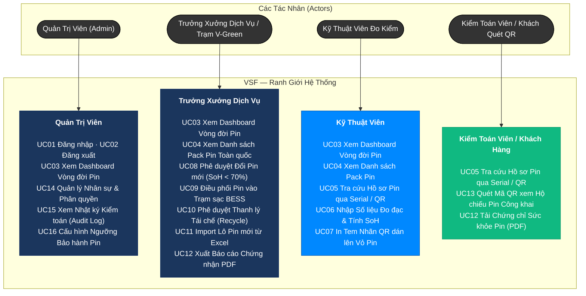
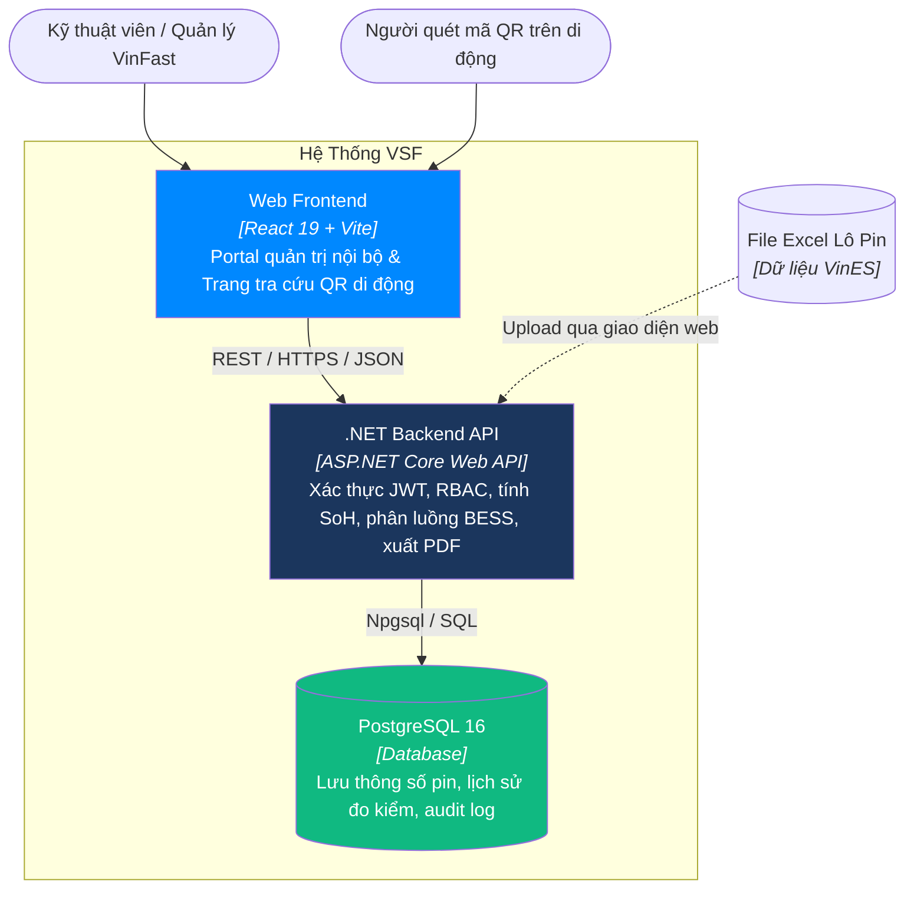
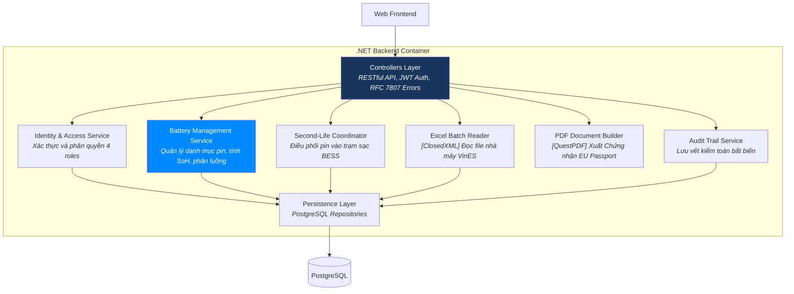
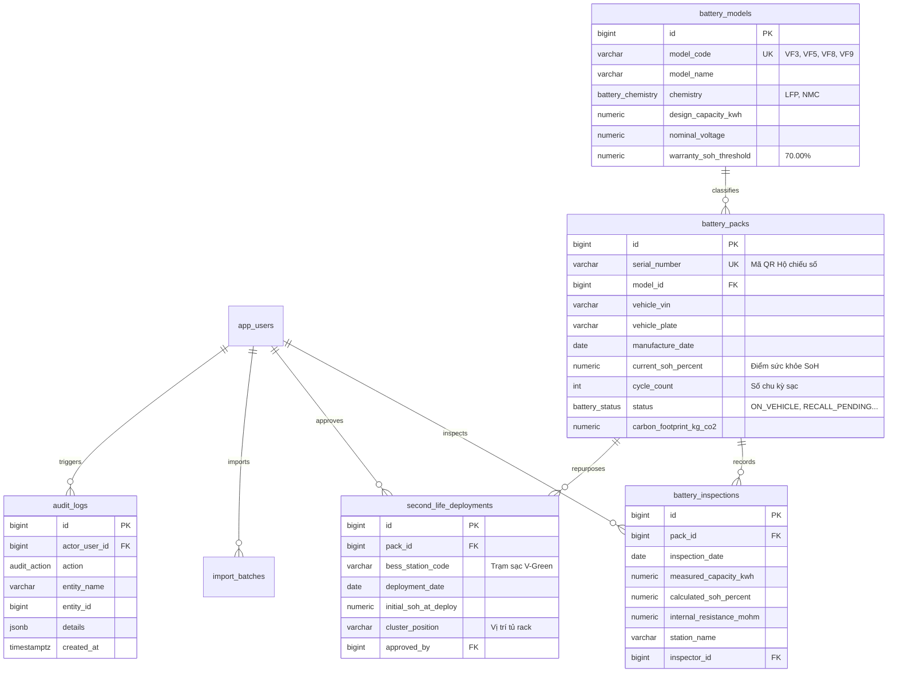
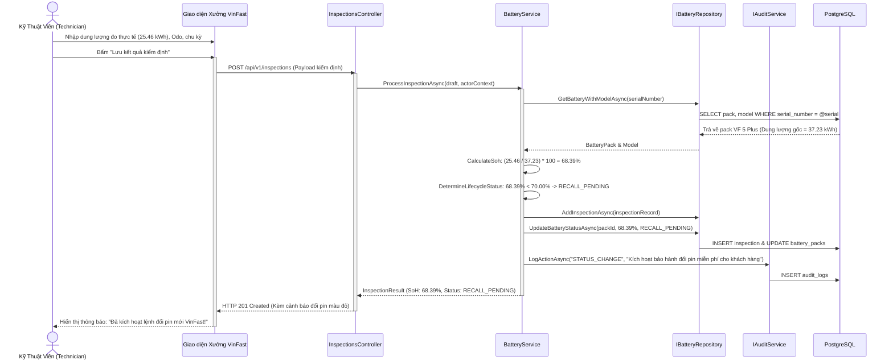

# VSF — VinFast Battery Passport & Second-Life Platform

**Hệ thống Hộ chiếu Số & Quản trị Vòng đời Tái sinh Pin Xe Điện VinFast**  
Tuân thủ tiêu chuẩn pin Châu Âu (*EU Battery Regulation 2023/1542*) và chính sách bảo hành đổi pin miễn phí của VinFast.

---

## 1. Yêu Cầu Nghiệp Vụ — INVEST, Use Cases & Phân Quyền

Hệ thống giải quyết bài toán cốt lõi: Quản trị toàn bộ vòng đời của hàng chục nghìn pack pin xe điện VinFast (từ VF 3, VF 5, VF 6, VF 7, VF 8, VF 9) từ lúc xuất xưởng tại nhà máy VinES Hải Phòng, vận hành trên đường, kiểm định đo chai pin (SoH) định kỳ, kích hoạt đổi pin miễn phí khi SoH < 70%, đến khi tái sinh làm trạm tích điện đệm (BESS) cho mạng lưới trạm sạc V-Green.

### 1.1 Product mind map

Hệ thống **VSF** được trực quan hóa toàn diện qua Bản đồ Tư duy Sản phẩm (Product Mind Map), bao gồm sơ đồ tổng quan và hai cụm phân hệ nghiệp vụ chi tiết:

#### A. Bức tranh Tổng quan Toàn hệ thống (High-Level Overview)


#### B. Phân hệ Cổng Hộ Chiếu QR, Quản Trị Pack Pin & Tái Sinh Second-Life BESS


#### C. Phân hệ Kiểm Định Dung Lượng SoH, Báo Cáo Excel & Quản Trị Hệ Thống


### 1.2 Sơ đồ Ca Sử Dụng (Use Cases)



### 1.3 Ma Trận Phân Quyền (Roles & Permissions)

| Chức Năng Nghiệp Vụ | Admin | Station Lead | Technician | Viewer / Public |
|---|:---:|:---:|:---:|:---:|
| **Xem Dashboard & Danh sách Pin** | Có | Có | Có | Có (Chỉ xem) |
| **Nhập kết quả kiểm định & Đo SoH** | Có | Có | Có | Không |
| **Phê duyệt Đổi pin miễn phí (<70%)** | Có | Có | Không | Không |
| **Điều phối Pin vào Trạm sạc BESS** | Có | Có | Không | Không |
| **Import lô pin từ Excel (VinES)** | Có | Có | Không | Không |
| **In tem nhãn QR & Xuất PDF** | Có | Có | Có | Có |
| **Xem Nhật ký hoạt động (Audit log)** | Có | Có | Không | Không |
| **Quản trị người dùng & Phân vai trò** | **Có** | Không | Không | Không |

---

## 2. Kiến Trúc Thông Tin & Giao Diện Người Dùng

```text
Public Gateway (Không cần login)
├── /login                         [Đăng nhập xác thực nội bộ]
└── /passport/:serialNumber        [Tra cứu Hộ chiếu Pin QR dành cho Mobile]

Authenticated Workspace
├── /dashboard                     [KPIs vòng đời & Biểu đồ phân bố SoH]
├── /batteries                     [Sổ Quản lý Pack Pin toàn hệ thống]
├── /inspections                   [Nhật ký Đo đạc & Lịch sử Kiểm định]
├── /second-life                   [Phân luồng Tái sinh Trạm sạc V-Green BESS]
├── /import                        [Nhập lô Pin mới từ Excel]
├── /reports                       [Xuất Báo cáo & Chứng nhận Kiểm định PDF]
├── /audit                         [Nhật ký Kiểm toán Toàn hệ thống]
├── /users                         [Quản trị Tài khoản & Phân quyền Xưởng]
└── /profile                       [Hồ sơ Cá nhân & Đổi Mật khẩu]
```

---

## 3. Kiến Trúc C4 (C4 Architecture)

### C1 — System Context


### C2 — Container



### C3 — Component (.NET Backend)



---

## 4. Mô Hình Cơ Sở Dữ Liệu & Hợp Đồng OpenAPI 3.0

### 4.1 Sơ Đồ Thực Thể (ERD)



- File DDL chi tiết: [src/database/vsf_battery.sql](src/database/vsf_battery.sql)
- DBML quan hệ: [src/database/vsf_battery.dbml](src/database/vsf_battery.dbml)
- Hợp đồng API: [docs/api/openapi.yaml](docs/api/openapi.yaml)

---

## 5. Sơ Đồ Tuần Tự Cốt Lõi (Sequence Diagrams)

### Luồng Kiểm Định Pin & Tự Động Kích Hoạt Đổi Pin Miễn Phí (< 70%)



---

## 6. Tài Khoản Khởi Tạo Mẫu (Development Seed Users)

Tất cả tài khoản trong hệ thống sử dụng chung mật khẩu phát triển:
> **Mật khẩu chung:** `ChangeMe123!`

| Tài Khoản (Email) | Vai Trò | Trụ Sở / Đơn Vị |
|---|:---:|---|
| `admin@vinfast.vn` | **ADMIN** | Trụ sở chính VinFast |
| `lead.hanoi@vinfast.vn` | **STATION_LEAD** | VinFast Service Center Phạm Văn Đồng - Hà Nội |
| `tech.nam@vinfast.vn` | **TECHNICIAN** | VinFast Service Center Phạm Văn Đồng - Hà Nội |
| `auditor@eu-tuv.de` | **AUDITOR** | TÜV Rheinland Battery Certification (Châu Âu) |

---

## 7. Tiến Độ Dự Án (Project Progress)

- [x] Nghiên cứu đề bài và phân tích quy chuẩn EU Battery Regulation 2023/1542
- [x] Xác định phạm vi và chính sách bảo hành đổi pin miễn phí của VinFast (<70%)
- [x] Lập danh sách tính năng và 16 User Stories chuẩn INVEST
- [x] Thiết kế ma trận phân quyền 4 Roles (Admin, Station Lead, Technician, Auditor)
- [x] Thiết kế Kiến trúc Thông tin (IA) và phân cấp màn hình
- [x] Thiết kế Sơ đồ Kiến trúc C4 (C1 System Context, C2 Container, C3 Component)
- [x] Thiết kế Mô hình Dữ liệu PostgreSQL DDL, DBML, Triggers và Seeds
- [x] Soạn thảo Hợp đồng API OpenAPI 3.0.4
- [x] Thiết kế Class Diagrams và Sequence Diagrams cho các luồng nghiệp vụ cốt lõi
- [x] Tạo cấu trúc thư mục dự án và thiết lập môi trường Docker Compose
- [ ] Xây dựng tầng Backend API ASP.NET Core (.NET 9) ba lớp
- [ ] Xây dựng giao diện React 19 + Vite (Portal quản trị & Trang QR di động)
- [ ] Tích hợp tính năng Import Excel và xuất file Chứng chỉ PDF
- [ ] Viết Unit Tests và Integration Tests
