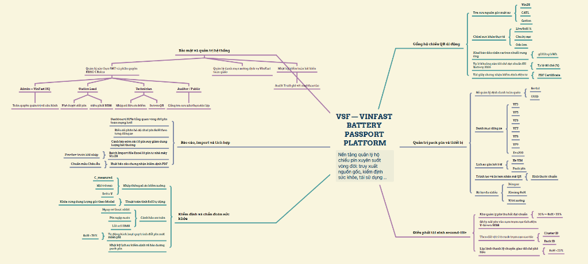
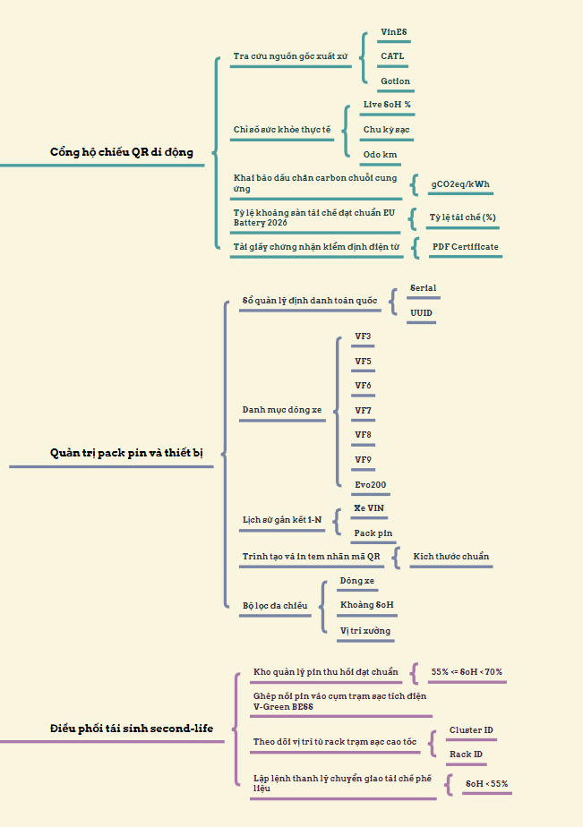
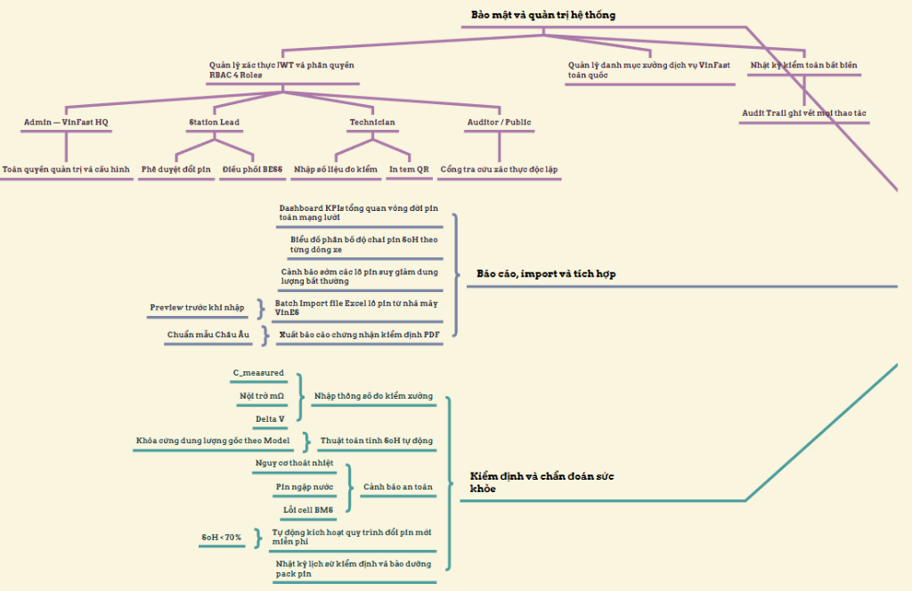
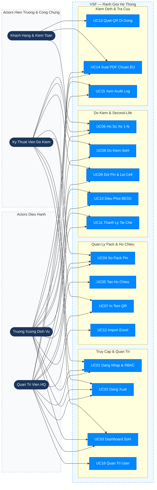
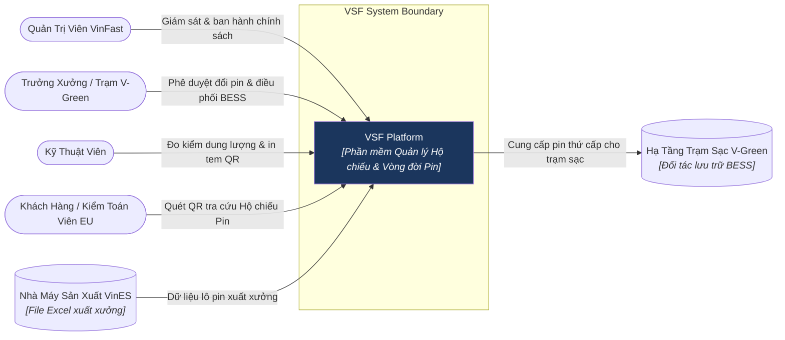
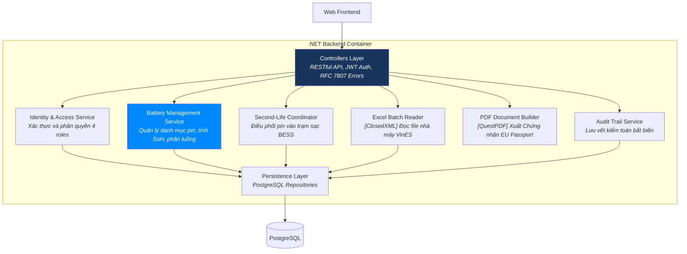
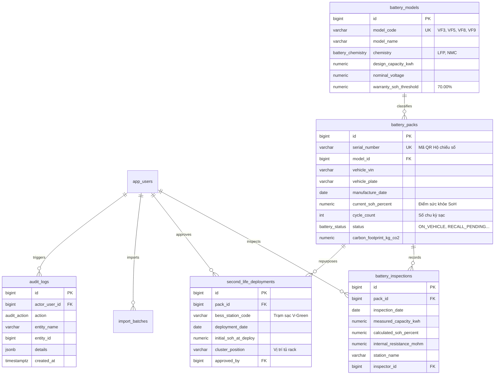
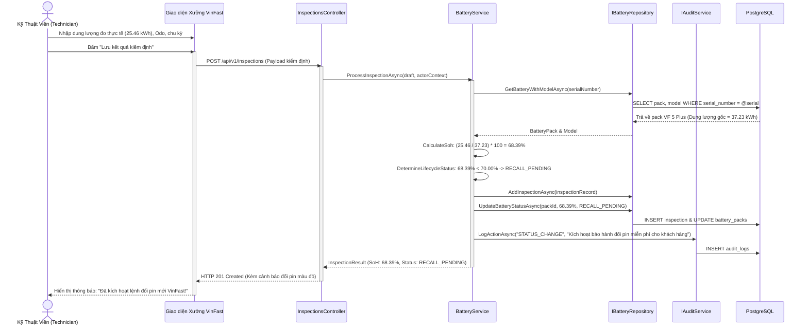

# VSF — VinFast Battery Passport & Second-Life Platform

**Hệ thống Hộ chiếu Số & Quản trị Vòng đời Tái sinh Pin Xe Điện VinFast**  
Tuân thủ tiêu chuẩn pin Châu Âu (*EU Battery Regulation 2023/1542*) và chính sách bảo hành đổi pin miễn phí của VinFast.

---

## 1. Yêu Cầu Nghiệp Vụ — INVEST, Use Cases & Phân Quyền (RBAC)

Yêu cầu nghiệp vụ định nghĩa những gì nền tảng VSF phải thực thi, các nhóm tác nhân sử dụng, giá trị mang lại cho chuỗi cung ứng VinFast và các tiêu chí thành công quan sát được. Toàn bộ 16 User Stories được rà soát nghiêm ngặt theo chuẩn INVEST và ánh xạ trực tiếp sang 16 Use Cases và ma trận phân quyền 4 Roles.

### 1.1 Product Mind Map

Hệ thống **VSF** được trực quan hóa toàn diện qua Bản đồ Tư duy Sản phẩm (Product Mind Map), bao gồm sơ đồ tổng quan và hai cụm phân hệ nghiệp vụ chi tiết:

#### A. Bức tranh Tổng quan Toàn hệ thống (High-Level Overview)



#### B. Phân hệ Cổng Hộ Chiếu QR, Quản Trị Pack Pin & Tái Sinh Second-Life BESS



#### C. Phân hệ Kiểm Định Dung Lượng SoH, Báo Cáo Excel & Quản Trị Hệ Thống



### 1.2 Tiêu Chuẩn INVEST & Danh Sách 16 User Stories

Danh mục sản phẩm V1 bao gồm **16 User Stories**. Các câu chuyện người dùng này bao phủ toàn bộ vòng đời pin: đăng nhập an toàn, dashboard giám sát SoH, quản trị pack pin, kiểm định đo dung lượng tự động, kích hoạt thu hồi đổi pin, tái sinh trạm sạc BESS, thanh lý tái chế, import Excel từ VinES, xuất PDF chứng nhận EU, cổng QR di động công khai, nhật ký kiểm toán và quản trị nhân sự xưởng.

Trước khi đưa vào phát triển, mỗi User Story đều được kiểm định chặt chẽ theo 6 tiêu chí **INVEST**:

| Tiêu Chí | Ý Nghĩa Thực Tế Trong Hệ Thống VSF |
|---|---|
| **Independent (Độc Lập)** | Mỗi User Story đại diện cho một năng lực nghiệp vụ cụ thể, có thể phát triển, kiểm thử và bàn giao độc lập mà không bị phụ thuộc vòng tròn. |
| **Negotiable (Có Thể Đàm Phán)** | Thiết kế UI và giải pháp công nghệ có thể tinh chỉnh linh hoạt, miễn là bảo toàn tuyệt đối quy tắc bảo hành đổi pin của VinFast và quy chuẩn EU. |
| **Valuable (Có Giá Trị)** | Mang lại giá trị trực tiếp cho chuỗi giá trị VinFast: ngăn chặn gian lận bảo hành, mở đường thông quan xuất khẩu EU, và tối ưu hóa tài sản tái sinh BESS. |
| **Estimable (Ước Lượng Được)** | Rõ ràng về Tác nhân (Actor), Đầu vào (Inputs), Đầu ra (Outputs), Điều kiện kích hoạt và Kịch bản lỗi để ước lượng chính xác Story Points. |
| **Small (Đủ Nhỏ)** | Mỗi Story đủ gọn để phân rã hoàn chỉnh thành 5 phần việc kỹ thuật: API Endpoint, Application Policy, Database Query, React UI/Modal, và Unit/Integration Test. |
| **Testable (Kiểm Thử Được)** | Mọi Story đều ánh xạ trực tiếp sang các tiêu chí nghiệm thu định lượng (như công thức SoH, mã lỗi RFC 7807, trạng thái Database). |

```text
US01–US02   Xác thực & Quản lý Phiên làm việc (Authentication & Session)
US03        Dashboard Phân tích Vòng đời & Tỷ lệ SoH Toàn mạng lưới
US04–US07   Quản trị Pack Pin & Truy vết Hộ chiếu QR (Asset Tracking)
US08–US09   Kiểm định Đo đạc, Tính SoH & Kích hoạt Bảo hành Đổi pin
US10–US11   Điều phối Tái sinh Second-Life BESS & Thanh lý Tái chế
US12–US13   Nhập lô Excel Nhà máy VinES & Xuất Chứng nhận PDF Chuẩn EU
US14        Nhật ký Kiểm toán & Đối soát Tuân thủ (Audit Trail)
US15        Quản trị Người dùng & Phân bổ Xưởng Dịch vụ (Admin Only)
US16        Quản lý Hồ sơ Cá nhân & Bảo mật Mật khẩu
```

Toàn bộ 16 User Stories đều đã có hành vi mục tiêu định lượng: Đăng xuất xóa token client-side, công thức SoH tự động khóa cứng dung lượng chuẩn theo Model xe, nhập Excel nguyên tử All-or-Nothing giới hạn 10 MB/5.000 dòng, xuất PDF đạt chuẩn EU kèm chữ ký băm, và cổng quét QR di động không làm lộ thông tin cá nhân (PII). Tài liệu rà soát và phân rã kỹ thuật 5 tầng được duy trì đầy đủ tại [Rà Soát INVEST Requirements](docs/08-invest-requirements.md).

### 1.3 Sơ Đồ Ca Sử Dụng (Use Cases)



Đặc tả chi tiết từng luồng tiền điều kiện, luồng chính, kịch bản lỗi và hậu điều kiện được duy trì tại [Đặc Tả Use Cases & RBAC](docs/03-use-cases.md).

### 1.4 Ma Trận Phân Quyền (Roles & Permissions)

| Năng Lực Nghiệp Vụ (Capabilities) | Admin (VinFast HQ) | Station Lead (Trưởng Xưởng) | Technician (Kỹ Thuật Viên) | Auditor / Public (Thanh Tra / Khách) | Ghi Chú Ràng Buộc Kỹ Thuật |
|---|:---:|:---:|:---:|:---:|---|
| **Xem Dashboard KPI & Biểu đồ SoH** | Có | Có | Có | Không | Phân vùng dữ liệu toàn quốc vs xưởng |
| **Tra cứu Sổ Pack Pin (Battery Registry)** | Có | Có | Có | Không | Hỗ trợ bộ lọc đa chiều (SoH, Model) |
| **Đăng ký Pack Pin mới xuất xưởng** | Có | Có | Không | Không | Ràng buộc duy nhất Serial Number |
| **In Tem Nhãn Mã QR kích thước chuẩn** | Có | Có | Có | Không | Định dạng vector nhiệt 50x30mm |
| **Nhập thông số đo kiểm dung lượng** | Có | Có | Có | Không | Tự động tính SoH, khóa Model gốc |
| **Phê duyệt lệnh đổi pin mới (< 70%)** | Có | Có | Không | Không | Căn cứ hợp đồng thuê pin VinFast |
| **Điều phối Pin vào Trạm sạc BESS** | Có | Có | Không | Không | Điều kiện $55\% \le \text{SoH} < 70\%$ |
| **Lập lệnh chuyển giao tái chế (< 55%)** | Có | Có | Không | Không | Bóc tách Lithium/Cobalt tại VinES |
| **Batch Import file Excel từ VinES** | Có | Có | Không | Không | Giới hạn 10 MB / 5.000 dòng, Atomic |
| **Quét mã QR tra cứu Hộ chiếu Công khai** | Có | Có | Có | **Có** | Endpoint mở, bảo vệ PII theo NĐ 13 |
| **Xuất Giấy Chứng Nhận PDF chuẩn EU** | Có | Có | Có | Có | File PDF có QR và chữ ký số băm |
| **Xem Nhật ký Kiểm toán (Audit Trail)** | Có | Có | Không | Không | Quyền chỉ đọc (Read-only immutable) |
| **Quản trị người dùng & Phân xưởng** | **Có** | Không | Không | Không | Phân quyền độc quyền của Admin HQ |

Tầng Backend API bắt buộc thực thi cưỡng chế phân quyền RBAC và token claims; việc ẩn/hiện các nút thao tác tại giao diện React chỉ phục vụ trải nghiệm người dùng (UI/UX).

## 2. Kiến Trúc Thông Tin & Giao Diện Người Dùng

```text
Public Gateway (Không cần login)
├── /login                         [Đăng nhập xác thực nội bộ]
└── /passport/:serialNumber        [Tra cứu Hộ chiếu Pin QR dành cho Mobile]

Authenticated Workspace
├── /dashboard                     [KPIs vòng đời & Biểu đồ phân bố SoH]
├── /batteries                     [Sổ Quản lý Pack Pin toàn hệ thống]
├── /inspections                   [Nhật ký Đo đạc & Lịch sử Kiểm định]
├── /second-life                   [Phân luồng Tái sinh Trạm sạc V-Green BESS]
├── /import                        [Nhập lô Pin mới từ Excel]
├── /reports                       [Xuất Báo cáo & Chứng nhận Kiểm định PDF]
├── /audit                         [Nhật ký Kiểm toán Toàn hệ thống]
├── /users                         [Quản trị Tài khoản & Phân quyền Xưởng]
└── /profile                       [Hồ sơ Cá nhân & Đổi Mật khẩu]
```

---

## 3. Kiến Trúc C4 (C4 Architecture)

### C1 — System Context



### C2 — Container


### C3 — Component (.NET Backend)



---

## 4. Mô Hình Cơ Sở Dữ Liệu & Hợp Đồng OpenAPI 3.0

### 4.1 Sơ Đồ Thực Thể (ERD)



- File DDL chi tiết: [src/database/vsf_battery.sql](src/database/vsf_battery.sql)
- DBML quan hệ: [src/database/vsf_battery.dbml](src/database/vsf_battery.dbml)
- Hợp đồng API: [docs/api/openapi.yaml](docs/api/openapi.yaml)

---

## 5. Sơ Đồ Tuần Tự Cốt Lõi (Sequence Diagrams)

### Luồng Kiểm Định Pin & Tự Động Kích Hoạt Đổi Pin Miễn Phí (< 70%)



---

## 6. Tài Khoản Khởi Tạo Mẫu (Development Seed Users)

Tất cả tài khoản trong hệ thống sử dụng chung mật khẩu phát triển:
> **Mật khẩu chung:** `ChangeMe123!`

| Tài Khoản (Email) | Vai Trò | Trụ Sở / Đơn Vị |
|---|:---:|---|
| `admin@vinfast.vn` | **ADMIN** | Trụ sở chính VinFast |
| `lead.hanoi@vinfast.vn` | **STATION_LEAD** | VinFast Service Center Phạm Văn Đồng - Hà Nội |
| `tech.nam@vinfast.vn` | **TECHNICIAN** | VinFast Service Center Phạm Văn Đồng - Hà Nội |
| `auditor@eu-tuv.de` | **AUDITOR** | TÜV Rheinland Battery Certification (Châu Âu) |

---

## 7. Tiến Độ Dự Án (Project Progress)

- [x] Nghiên cứu đề bài và phân tích quy chuẩn EU Battery Regulation 2023/1542
- [x] Xác định phạm vi và chính sách bảo hành đổi pin miễn phí của VinFast (<70%)
- [x] Lập danh sách tính năng và 16 User Stories chuẩn INVEST
- [x] Thiết kế ma trận phân quyền 4 Roles (Admin, Station Lead, Technician, Auditor)
- [x] Thiết kế Kiến trúc Thông tin (IA) và phân cấp màn hình
- [x] Thiết kế Sơ đồ Kiến trúc C4 (C1 System Context, C2 Container, C3 Component)
- [x] Thiết kế Mô hình Dữ liệu PostgreSQL DDL, DBML, Triggers và Seeds
- [x] Soạn thảo Hợp đồng API OpenAPI 3.0.4
- [x] Thiết kế Class Diagrams và Sequence Diagrams cho các luồng nghiệp vụ cốt lõi
- [x] Tạo cấu trúc thư mục dự án và thiết lập môi trường Docker Compose
- [ ] Xây dựng tầng Backend API ASP.NET Core (.NET 9) ba lớp
- [ ] Xây dựng giao diện React 19 + Vite (Portal quản trị & Trang QR di động)
- [ ] Tích hợp tính năng Import Excel và xuất file Chứng chỉ PDF
- [ ] Viết Unit Tests và Integration Tests
