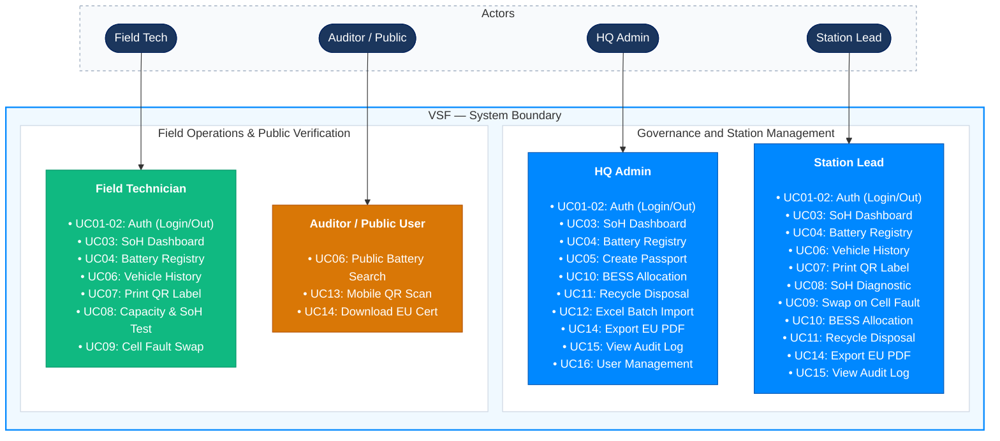
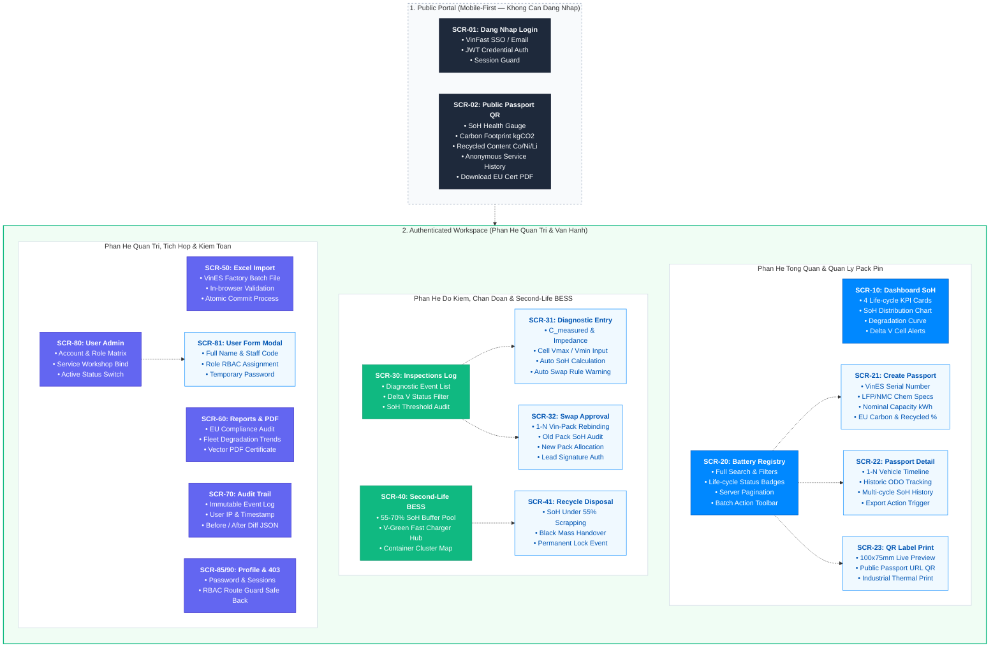
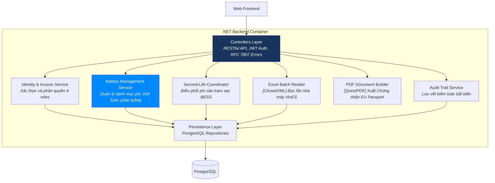
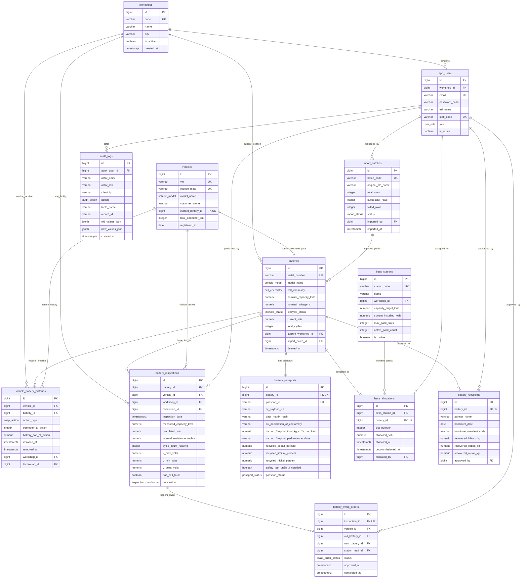
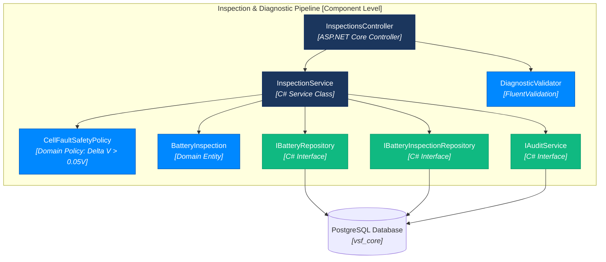
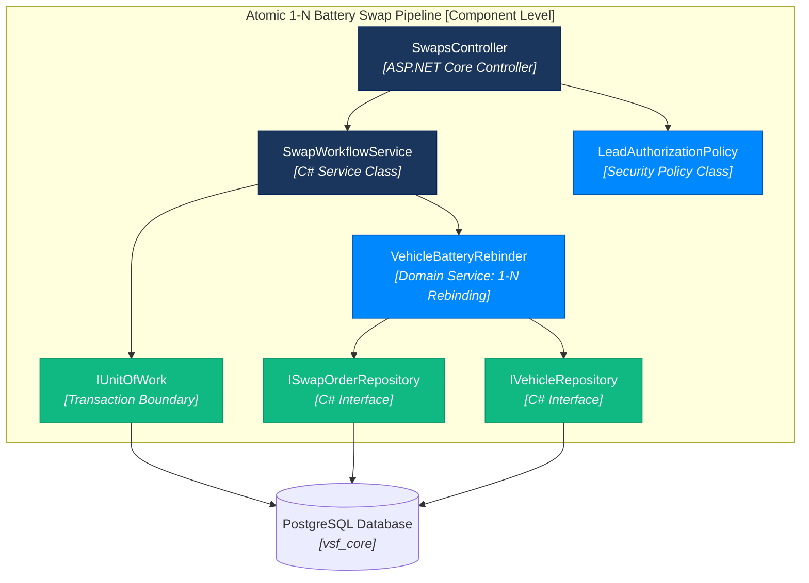
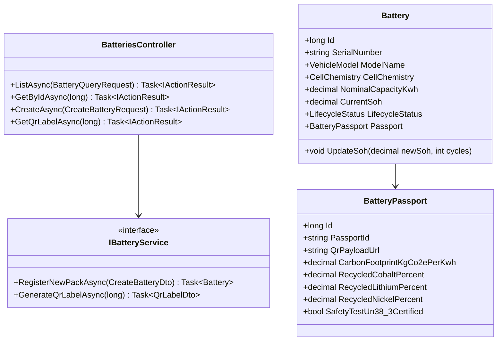
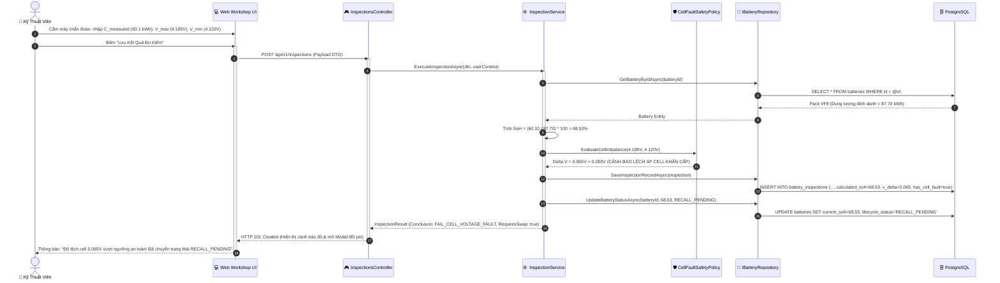

# VSF — VinFast Battery Passport & Second-Life Platform

**Hệ thống Hộ chiếu Số & Quản trị Vòng đời Tái sinh Pin Xe Điện VinFast**  
Tuân thủ tiêu chuẩn pin Châu Âu (*EU Battery Regulation 2023/1542*) và chính sách bảo hành đổi pin miễn phí của VinFast.

---

## 1. Yêu Cầu Nghiệp Vụ — INVEST, Use Cases & Phân Quyền (RBAC)

Yêu cầu nghiệp vụ định nghĩa những gì nền tảng VSF phải thực thi, các nhóm tác nhân sử dụng, giá trị mang lại cho chuỗi cung ứng VinFast và các tiêu chí thành công quan sát được. Toàn bộ 16 User Stories được rà soát nghiêm ngặt theo chuẩn INVEST và ánh xạ trực tiếp sang 16 Use Cases và ma trận phân quyền 4 Roles.

### 1.1 Product Mind Map

Hệ thống **VSF** được trực quan hóa toàn diện qua Bản đồ Tư duy Sản phẩm (Product Mind Map), bao gồm sơ đồ tổng quan và hai cụm phân hệ nghiệp vụ chi tiết:

#### A. Bức tranh Tổng quan Toàn hệ thống (High-Level Overview)


#### B. Phân hệ Cổng Hộ Chiếu QR, Quản Trị Pack Pin & Tái Sinh Second-Life BESS


#### C. Phân hệ Kiểm Định Dung Lượng SoH, Báo Cáo Excel & Quản Trị Hệ Thống


### 1.2 Tiêu Chuẩn INVEST & Danh Sách 16 User Stories

Danh mục sản phẩm V1 bao gồm **16 User Stories**. Các câu chuyện người dùng này bao phủ toàn bộ vòng đời pin: đăng nhập an toàn, dashboard giám sát SoH, quản trị pack pin, kiểm định đo dung lượng tự động, kích hoạt thu hồi đổi pin, tái sinh trạm sạc BESS, thanh lý tái chế, import Excel từ VinES, xuất PDF chứng nhận EU, cổng QR di động công khai, nhật ký kiểm toán và quản trị nhân sự xưởng.

Trước khi đưa vào phát triển, mỗi User Story đều được kiểm định chặt chẽ theo 6 tiêu chí **INVEST**:

| Tiêu Chí | Ý Nghĩa Thực Tế Trong Hệ Thống VSF |
|---|---|
| **Independent (Độc Lập)** | Mỗi User Story đại diện cho một năng lực nghiệp vụ cụ thể, có thể phát triển, kiểm thử và bàn giao độc lập mà không bị phụ thuộc vòng tròn. |
| **Negotiable (Có Thể Đàm Phán)** | Thiết kế UI và giải pháp công nghệ có thể tinh chỉnh linh hoạt, miễn là bảo toàn tuyệt đối quy tắc bảo hành đổi pin của VinFast và quy chuẩn EU. |
| **Valuable (Có Giá Trị)** | Mang lại giá trị trực tiếp cho chuỗi giá trị VinFast: ngăn chặn gian lận bảo hành, mở đường thông quan xuất khẩu EU, và tối ưu hóa tài sản tái sinh BESS. |
| **Estimable (Ước Lượng Được)** | Rõ ràng về Tác nhân (Actor), Đầu vào (Inputs), Đầu ra (Outputs), Điều kiện kích hoạt và Kịch bản lỗi để ước lượng chính xác Story Points. |
| **Small (Đủ Nhỏ)** | Mỗi Story đủ gọn để phân rã hoàn chỉnh thành 5 phần việc kỹ thuật: API Endpoint, Application Policy, Database Query, React UI/Modal, và Unit/Integration Test. |
| **Testable (Kiểm Thử Được)** | Mọi Story đều ánh xạ trực tiếp sang các tiêu chí nghiệm thu định lượng (như công thức SoH, mã lỗi RFC 7807, trạng thái Database). |

```text
US01–US02   Xác thực & Quản lý Phiên làm việc (Authentication & Session)
US03        Dashboard Phân tích Vòng đời & Tỷ lệ SoH Toàn mạng lưới
US04–US07   Quản trị Pack Pin & Truy vết Hộ chiếu QR (Asset Tracking)
US08–US09   Kiểm định Đo đạc, Tính SoH & Kích hoạt Bảo hành Đổi pin
US10–US11   Điều phối Tái sinh Second-Life BESS & Thanh lý Tái chế
US12–US13   Nhập lô Excel Nhà máy VinES & Xuất Chứng nhận PDF Chuẩn EU
US14        Nhật ký Kiểm toán & Đối soát Tuân thủ (Audit Trail)
US15        Quản trị Người dùng & Phân bổ Xưởng Dịch vụ (Admin Only)
US16        Quản lý Hồ sơ Cá nhân & Bảo mật Mật khẩu
```

Toàn bộ 16 User Stories đều đã có hành vi mục tiêu định lượng: Đăng xuất xóa token client-side, công thức SoH tự động khóa cứng dung lượng chuẩn theo Model xe, nhập Excel nguyên tử All-or-Nothing giới hạn 10 MB/5.000 dòng, xuất PDF đạt chuẩn EU kèm chữ ký băm, và cổng quét QR di động không làm lộ thông tin cá nhân (PII). Tài liệu rà soát và phân rã kỹ thuật 5 tầng được duy trì đầy đủ tại [Rà Soát INVEST Requirements](docs/08-invest-requirements.md).

### 1.3 Sơ Đồ Ca Sử Dụng (Use Cases)



Đặc tả chi tiết từng luồng tiền điều kiện, luồng chính, kịch bản lỗi và hậu điều kiện được duy trì tại [Đặc Tả Use Cases & RBAC](docs/03-use-cases.md).

### 1.4 Ma Trận Phân Quyền (Roles & Permissions)

| Năng Lực Nghiệp Vụ (Capabilities) | Admin (VinFast HQ) | Station Lead (Trưởng Xưởng) | Technician (Kỹ Thuật Viên) | Auditor / Public (Thanh Tra / Khách) | Ghi Chú Ràng Buộc Kỹ Thuật |
|---|:---:|:---:|:---:|:---:|---|
| **Xem Dashboard KPI & Biểu đồ SoH** | Có | Có | Có | Không | Phân vùng dữ liệu toàn quốc vs xưởng |
| **Tra cứu Sổ Pack Pin (Battery Registry)** | Có | Có | Có | Không | Hỗ trợ bộ lọc đa chiều (SoH, Model) |
| **Đăng ký Pack Pin mới xuất xưởng** | Có | Có | Không | Không | Ràng buộc duy nhất Serial Number |
| **In Tem Nhãn Mã QR kích thước chuẩn** | Có | Có | Có | Không | Định dạng vector nhiệt 50x30mm |
| **Nhập thông số đo kiểm dung lượng** | Có | Có | Có | Không | Tự động tính SoH, khóa Model gốc |
| **Phê duyệt lệnh đổi pin mới (< 70%)** | Có | Có | Không | Không | Căn cứ hợp đồng thuê pin VinFast |
| **Điều phối Pin vào Trạm sạc BESS** | Có | Có | Không | Không | Điều kiện $55\% \le \text{SoH} < 70\%$ |
| **Lập lệnh chuyển giao tái chế (< 55%)** | Có | Có | Không | Không | Bóc tách Lithium/Cobalt tại VinES |
| **Batch Import file Excel từ VinES** | Có | Có | Không | Không | Giới hạn 10 MB / 5.000 dòng, Atomic |
| **Quét mã QR tra cứu Hộ chiếu Công khai** | Có | Có | Có | **Có** | Endpoint mở, bảo vệ PII theo NĐ 13 |
| **Xuất Giấy Chứng Nhận PDF chuẩn EU** | Có | Có | Có | Có | File PDF có QR và chữ ký số băm |
| **Xem Nhật ký Kiểm toán (Audit Trail)** | Có | Có | Không | Không | Quyền chỉ đọc (Read-only immutable) |
| **Quản trị người dùng & Phân xưởng** | **Có** | Không | Không | Không | Phân quyền độc quyền của Admin HQ |

Tầng Backend API bắt buộc thực thi cưỡng chế phân quyền RBAC và token claims; việc ẩn/hiện các nút thao tác tại giao diện React chỉ phục vụ trải nghiệm người dùng (UI/UX).

## 2. Kiến Trúc Thông Tin, Phân Cấp Màn Hình & Giao Diện Người Dùng (Information Architecture)

Kiến trúc thông tin tổ chức không gian làm việc số hóa dựa trên năng lực nghiệp vụ thực tế của chuỗi xưởng dịch vụ và vòng đời pin VinFast. Phân quyền màn hình và điều hướng tuân thủ nghiêm ngặt ma trận RBAC, đồng thời mọi màn hình đều chuẩn hóa 8 trạng thái giao diện (Loading, Empty, Validation, API Error, 401, 403, Saving, Success).

### 2.1 Sơ Đồ Kiến Trúc Thông Tin & Thành Phần Màn Hình (Information Architecture Diagram)

Sơ đồ kiến trúc thông tin chi tiết hóa toàn bộ các màn hình, thành phần dữ liệu và chức năng nghiệp vụ trực quan:



### 2.2 Sơ Đồ Cây Kiến Trúc Thông Tin (Sitemap Tree)

```text
VSF — VinFast Battery Passport & Second-Life Platform
│
├── Public Portal (Không cần đăng nhập, Mobile-First)
│   ├── /login                         [SCR-01: Đăng nhập xác thực nội bộ VinFast SSO]
│   └── /passport/:serialNumber        [SCR-02: Cổng Tra Cứu Hộ Chiếu Pin Công Khai (Mobile QR)]
│       └── Action: Tải Giấy Chứng Nhận Kiểm Định PDF Chuẩn EU
│
└── Authenticated Workspace (Bảo mật JWT & RBAC, Sidebar + Topbar)
    ├── /dashboard                     [SCR-10: Dashboard Giám Sát SoH & Cảnh Báo Pin Khẩn Cấp]
    ├── /batteries                     [SCR-20: Sổ Quản Lý Pack Pin Toàn Hệ Thống (Battery Registry)]
    │   ├── Modal: Khởi Tạo Hộ Chiếu Pin Mới                [SCR-21]
    │   ├── Modal / Drawer: Chi Tiết Hộ Chiếu & Lịch Sử Xe 1-N [SCR-22]
    │   └── Modal: Cấu Hình & In Tem Nhãn Mã QR Pack Pin     [SCR-23]
    ├── /inspections                   [SCR-30: Danh Mục Nhật Ký Đo Kiểm Dung Lượng & Cell]
    │   ├── Modal: Nhập Liệu Đo Dung Lượng & Đánh Giá SoH    [SCR-31]
    │   └── Modal: Phê Duyệt Lệnh Đổi Pin Mới Khi Lỗi Cell/SoH < 70% [SCR-32]
    ├── /second-life                   [SCR-40: Phân Hệ Điều Phối Pin Tái Sinh Trạm Sạc BESS]
    │   └── Modal: Phê Duyệt Lệnh Thanh Lý & Tái Chế Đen     [SCR-41]
    ├── /import                        [SCR-50: Nhập Lô Dữ Liệu Pin Xuất Xưởng Từ Excel (VinES)]
    ├── /reports                       [SCR-60: Trung Tâm Báo Cáo & Xuất Chứng Nhận EU Battery Passport]
    ├── /audit                         [SCR-70: Nhật Ký Kiểm Toán Toàn Hệ Thống (Audit Trail)]
    ├── /users                         [SCR-80: Quản Trị Tài Khoản Nhân Sự & Phân Xưởng Dịch Vụ]
    │   └── Modal: Tạo Mới / Cập Nhật Người Dùng            [SCR-81]
    ├── /profile                       [SCR-85: Hồ Sơ Cá Nhân & Đổi Mật Khẩu]
    └── /403                           [SCR-90: Màn Hình Từ Chối Truy Cập (Forbidden)]
```

### 2.3 Sơ Đồ Phân Cấp Màn Hình (Screen Hierarchy Flow)

Đăng nhập xác thực tại `SCR-01` dẫn trực tiếp vào Authenticated Shell. Không gian làm việc sở hữu thanh điều hướng bên (Sidebar) tương ứng với vai trò đăng nhập; các tương tác thêm mới, đo kiểm, phê duyệt đổi pin và in tem QR được mở thông qua các Modal chuyên dụng. Điều hướng vượt thẩm quyền được Router Guard chặn đứng và chuyển hướng an toàn về màn hình `SCR-90 Forbidden`.

```mermaid
flowchart TB
    Login["SCR-01 Login (Public)"]
    PublicQR["SCR-02 Tra Cứu QR Mobile (Public)"]
    Shell["Authenticated Workspace Shell"]
    
    Login -->|Xác thực hợp lệ| Shell
    PublicQR -->|Tải PDF| PDFExport["Xuất PDF Chứng Nhận EU"]
    
    Shell --> Dashboard["SCR-10 Dashboard SoH"]
    
    Shell --> Batteries["SCR-20 Sổ Pack Pin"]
    Batteries --> BattCreate["SCR-21 Tạo Hộ Chiếu Modal"]
    Batteries --> BattDetail["SCR-22 Chi Tiết Hộ Chiếu & Xe 1-N"]
    Batteries --> BattQR["SCR-23 In Tem QR Modal"]
    
    Shell --> Inspections["SCR-30 Đo Kiểm Dung Lượng"]
    Inspections --> InspCreate["SCR-31 Đo Kiểm SoH Modal"]
    Inspections --> SwapApprove["SCR-32 Duyệt Đổi Pin Modal"]
    
    Shell --> SecondLife["SCR-40 Điều Phối BESS"]
    SecondLife --> RecycleModal["SCR-41 Thanh Lý Tái Chế Modal"]
    
    Shell --> Import["SCR-50 Nhập Excel VinES"]
    Shell --> Reports["SCR-60 Báo Cáo & PDF EU"]
    Shell --> Audit["SCR-70 Nhật Ký Audit Log"]
    
    Shell --> Users["SCR-80 Quản Trị Nhân Sự"]
    Users --> UserModal["SCR-81 Tạo/Sửa User Modal"]
    
    Shell --> Profile["SCR-85 Hồ Sơ Cá Nhân"]
    Shell --> Forbidden["SCR-90 403 Forbidden"]

    classDef pub fill:#f8fafc,stroke:#94a3b8,color:#1e293b
    classDef authen fill:#0088ff,stroke:#0055b3,color:#fff
    classDef sub fill:#f0f9ff,stroke:#0088ff,color:#0055b3
    class Login,PublicQR pub
    class Shell,Dashboard,Batteries,Inspections,SecondLife,Import,Reports,Audit,Users,Profile,Forbidden authen
    class BattCreate,BattDetail,BattQR,InspCreate,SwapApprove,RecycleModal,UserModal,PDFExport sub
```



### 2.4 Bảng Danh Mục Màn Hình & Phân Quyền (Screen Inventory)

| Mã Màn Hình | Tên Màn Hình & Phân Hệ | Dạng Trình Bày | URL Route | Phân Quyền Truy Cập (RBAC) | Ca Sử Dụng Liên Quan |
| :--- | :--- | :--- | :--- | :--- | :--- |
| **SCR-01** | Đăng Nhập Hệ Thống | Trang đơn (Public) | `#/login` | Tất cả | UC01, UC02 |
| **SCR-02** | Cổng Tra Cứu Hộ Chiếu Pin QR | Trang Mobile-First (Public) | `#/passport/:serialNumber` | Kiểm toán EU, Khách hàng, Public | UC06, UC13, UC14 |
| **SCR-10** | Dashboard Giám Sát SoH & Cảnh Báo | Trang chính Workspace | `#/dashboard` | Admin HQ, Station Lead, Kỹ thuật viên | UC03 |
| **SCR-20** | Sổ Quản Lý Pack Pin Hệ Thống | Trang bảng dữ liệu | `#/batteries` | Admin HQ, Station Lead, Kỹ thuật viên | UC04 |
| **SCR-21** | Đăng Ký Pin & Khởi Tạo Hộ Chiếu | Hộp thoại Modal | `#/batteries/new` | Admin HQ | UC05 |
| **SCR-22** | Chi Tiết Hộ Chiếu & Lịch Sử Xe 1-N | Hộp thoại Drawer / Modal | `#/batteries/:id` | Admin HQ, Station Lead, Kỹ thuật viên | UC04, UC06 |
| **SCR-23** | Cấu Hình & In Tem Nhãn Mã QR | Hộp thoại Modal | `#/batteries/:id/qr` | Station Lead, Kỹ thuật viên | UC07 |
| **SCR-30** | Danh Mục Nhật Ký Đo Kiểm SoH | Trang bảng dữ liệu | `#/inspections` | Admin HQ, Station Lead, Kỹ thuật viên | UC08 |
| **SCR-31** | Nhập Liệu Đo Dung Lượng & Lỗi Cell | Hộp thoại Modal | `#/inspections/new` | Station Lead, Kỹ thuật viên | UC08, UC09 |
| **SCR-32** | Phê Duyệt Lệnh Đổi Pin Mới Cho Xe | Hộp thoại Modal | `#/inspections/:id/swap` | Station Lead | UC09 |
| **SCR-40** | Điều Phối Tái Sinh Trạm Sạc BESS | Trang thẻ trạm & bảng | `#/second-life` | Admin HQ, Station Lead | UC10 |
| **SCR-41** | Phê Duyệt Lệnh Thanh Lý & Tái Chế | Hộp thoại Modal | `#/second-life/recycle` | Admin HQ, Station Lead | UC11 |
| **SCR-50** | Nhập Lô Dữ Liệu Pin Từ Excel | Trang thao tác tải tệp | `#/import` | Admin HQ | UC12 |
| **SCR-60** | Trung Tâm Báo Cáo & Xuất PDF EU | Trang tương tác lọc & xem | `#/reports` | Admin HQ, Station Lead | UC14 |
| **SCR-70** | Nhật Ký Kiểm Toán (Audit Trail) | Trang bảng bất biến | `#/audit` | Admin HQ, Station Lead | UC15 |
| **SCR-80** | Quản Trị Tài Khoản & Phân Xưởng | Trang bảng dữ liệu | `#/users` | Admin HQ | UC16 |
| **SCR-81** | Tạo Mới / Sửa Người Dùng | Hộp thoại Modal | `#/users/form` | Admin HQ | UC16 |
| **SCR-85** | Hồ Sơ Cá Nhân & Bảo Mật | Trang dạng Tabs | `#/profile` | Tất cả người dùng nội bộ | UC01, UC16 |
| **SCR-90** | Từ Chối Truy Cập (403 Forbidden) | Trang thông báo lỗi | `#/403` | Tất cả | Cross-cutting RBAC |

Đặc tả chi tiết từng thành phần giao diện, chức năng trong màn hình, hợp đồng 8 trạng thái UI/UX và luồng thao tác điển hình được duy trì đầy đủ tại tài liệu kỹ thuật [Kiến Trúc Thông Tin & Phân Cấp Giao Diện (Information Architecture)](docs/04-information-architecture.md).

### 3.3 Bản Vẽ Giao Diện Chi Tiết & Bộ Dữ Liệu Mẫu (UI/UX Wireframes & Mock Data)

Hệ thống giao diện được thiết kế theo ngôn ngữ nhận diện thương hiệu cao cấp **VinFast Electric High-Tech** (Tone màu xanh chủ đạo `#1462D2`, nền Navy tối `#0B192C`, mã màu trạng thái pin chuẩn quốc tế), tài liệu và bản vẽ chi tiết gồm:
* 🎨 [Hệ Thống Thiết Kế UI/UX VinFast (Design System & Guidelines)](docs/ui-ux/README.md)
* 📊 [Bản Vẽ Wireframe Màn Hình 1: Dashboard Sức Khỏe Pin & Giám Sát Mạng Lưới (SCR-10)](docs/ui-ux/01-dashboard-wireframe.md)
* ⚡ [Bản Vẽ Wireframe Màn Hình 2: Sổ Quản Lý Pack Pin & Modal Đo Kiểm Chẩn Đoán (SCR-20 & SCR-22)](docs/ui-ux/02-battery-registry-wireframe.md)
* 📱 [Bản Vẽ Wireframe Màn Hình 3: Cổng Hộ Chiếu Pin QR Di Động Chuẩn EU 2023/1542 (SCR-02)](docs/ui-ux/03-mobile-qr-portal-wireframe.md)
* 📦 [Tập Dữ Liệu Mẫu Đầy Đủ (Mock Data JSON chuẩn VinFast VF 3 đến VF 9)](docs/ui-ux/mock-data.json)

## 3. Kiến Trúc C4 (C4 Architecture)

### C1 — System Context


### C2 — Container


### C3 — Component (.NET Backend)



Tài liệu thiết kế kiến trúc chi tiết C4 Model:
- **Tổng quan mô hình C4:** [docs/architecture/c4/README.md](docs/architecture/c4/README.md)
- **C1 — System Context:** [docs/architecture/c4/01-system-context.md](docs/architecture/c4/01-system-context.md)
- **C2 — Container Diagram:** [docs/architecture/c4/02-container.md](docs/architecture/c4/02-container.md)
- **C3 — Component Diagram:** [docs/architecture/c4/03-component.md](docs/architecture/c4/03-component.md)
- **C4 — Code Collaboration Design:** [docs/architecture/c4/04-code.md](docs/architecture/c4/04-code.md)

---

## 4. Mô Hình Cơ Sở Dữ Liệu & Hợp Đồng OpenAPI 3.0

### 4.1 Sơ Đồ Thực Thể Liên Kết (ERD) & Cơ Sở Dữ Liệu

Mô hình PostgreSQL 16 (`vsf_core`) bao phủ trọn vẹn 13 bảng thực thể nghiệp vụ: Quản lý Pack Pin & Hộ Chiếu Số EU (EU 2023/1542), quan hệ hoán đổi 1-N giữa Xe điện và Pack Pin (`vehicles` & `vehicle_battery_histories`), nhật ký chẩn đoán đo kiểm dung lượng & cảnh báo lệch áp cell ($\Delta V > 0.05V$), phê duyệt lệnh đổi pin mới, điều phối tái sinh Trạm sạc V-Green BESS, bàn giao tái chế Black Mass và hệ thống Audit Log bất biến.



Tài liệu thiết kế chi tiết cơ sở dữ liệu:
- **Đặc tả mô hình dữ liệu & ràng buộc:** [docs/05-data-model.md](docs/05-data-model.md)
- **Sơ đồ thực thể liên kết, phân nhóm & SQL Indexes:** [docs/DATABASE.md](docs/DATABASE.md)
- **Mã nguồn lược đồ DBML 2.0 chuẩn hóa:** [src/database/schema.dbml](src/database/schema.dbml)

### 4.2 Hợp Đồng Giao Tiếp OpenAPI 3.0.4 (REST API Specifications)

Hợp đồng API xác lập quy chuẩn kết nối giữa giao diện Web/Mobile và tầng máy chủ ASP.NET Core Web API. Toàn bộ 24 endpoints được tổ chức chặt chẽ theo 11 nhóm năng lực nghiệp vụ, bảo mật bằng chuẩn JWT Bearer, phân quyền RBAC (`x-roles`) và phản hồi lỗi chuẩn hóa theo RFC 7807 Problem Details (`application/problem+json`).

| Phân Hệ API (Tag) | Số Endpoint | Các Hoạt Động Cốt Lõi & Đường Dẫn Chính | Phân Quyền (RBAC) |
| :--- | :---: | :--- | :--- |
| **Authentication** | 4 | Đăng nhập (`/auth/login`), Đăng xuất, Lấy Profile (`/auth/me`), Đổi mật khẩu | Tất cả / Public |
| **Dashboard** | 3 | KPIs vòng đời (`/dashboard/metrics`), Biểu đồ SoH, Top cảnh báo lệch áp cell | Admin HQ, Lead, KTV |
| **Batteries** | 5 | Danh mục phân trang (`/batteries`), Khởi tạo hộ chiếu, Chi tiết, Lịch sử xe 1-N, In tem QR | Admin HQ, Lead, KTV |
| **Vehicles** | 2 | Danh sách xe điện (`/vehicles`), Chi tiết xe & tra cứu quả pin đang gắn theo VIN | Admin HQ, Lead, KTV |
| **Inspections** | 3 | Tra cứu nhật ký, Nhập số liệu đo đạc ($C_{\text{measured}}, V_{\text{max}}, V_{\text{min}}$) tự động tính SoH & $\Delta V$ | Lead, KTV |
| **Swaps** | 3 | Khởi tạo lệnh đổi pin, Trưởng xưởng duyệt đổi pin (`/swaps/:id/approve`), Từ chối | Station Lead, KTV |
| **SecondLife** | 3 | Danh sách trạm BESS, Kho pin $55-70\%$, Điều phối pin vào tủ rack container | Admin HQ, Station Lead |
| **Recycling** | 1 | Bàn giao pin $< 55\%$ thu hồi Black Mass, khóa vĩnh viễn Hộ chiếu số | Admin HQ, Station Lead |
| **Imports** | 2 | Xem trước kiểm tra lỗi file Excel (`/imports/preview`), Commit nguyên tử 5,000 pack | Admin HQ |
| **Public Portal** | 2 | Quét QR tra cứu Hộ chiếu Pin di động (`/public/passport/:serial`), Tải PDF chứng nhận | Public (Không cần Login) |
| **Governance** | 3 | Nhật ký kiểm toán bất biến (`/audit-logs`), Quản trị tài khoản nhân sự & xưởng | Admin HQ, Station Lead |

#### Mẫu cURL Quét Mã QR Tra Cứu Hộ Chiếu Pin Công Khai (Mobile QR)
```bash
curl --request GET \
  --url "http://localhost:5000/api/v1/public/passport/VF-BAT-VF8-2026-00892" \
  --header "Accept: application/json"
```

#### Mẫu cURL Kỹ Thuật Viên Nhập Số Liệu Đo Dung Lượng & Phát Hiện Lỗi Cell
```bash
curl --request POST \
  --url http://localhost:5000/api/v1/inspections \
  --header "Authorization: Bearer YOUR_ACCESS_TOKEN" \
  --header "Content-Type: application/json" \
  --data '{
    "batteryId": 108,
    "measuredCapacityKwh": 60.10,
    "internalResistanceMohm": 24.50,
    "cycleCountReading": 480,
    "vMaxVolts": 4.185,
    "vMinVolts": 4.120,
    "operatingTemperatureC": 28.5
  }'
```

Tài liệu chi tiết kỹ thuật API:
- **Tệp hợp đồng nguồn đầy đủ (57KB):** [docs/api/openapi.yaml](docs/api/openapi.yaml)
- **Hướng dẫn tích hợp & Lệnh cURL mẫu:** [docs/api/README.md](docs/api/README.md)

---

## 5. Cấu Trúc Thư Mục Frontend & Backend (Folder Structures)

Cấu trúc dự án tổ chức theo mô hình phân tách độc lập giữa Tầng Trình Diễn (Frontend) và Tầng Máy Chủ (Backend), tuân thủ nguyên tắc Clean Architecture 3 lớp và cấu trúc Feature-based của React 19.

### 5.1 Bố Cục Thư Mục Toàn Dự Án (Repository Layout)

```text
d:\VSF/
├── compose.yaml                         # Khởi chạy PostgreSQL 16 qua Docker
├── .env.example                         # Cấu hình chuỗi kết nối và JWT Secret
├── README.md                            # Tài liệu tổng quan toàn diện
│
├── docs/                                # Tài liệu kỹ thuật kiến trúc
│   ├── 01-scope.md … 08-invest-requirements.md
│   ├── DATABASE.md                      # Sơ đồ và từ điển dữ liệu
│   ├── api/
│   │   ├── openapi.yaml                 # Hợp đồng OpenAPI 3.0.4 đầy đủ
│   │   └── README.md                    # Hướng dẫn gọi API và mẫu request/response
│   └── architecture/
│       ├── c4/                          # Sơ đồ kiến trúc C1, C2, C3, C4
│       └── uml/                         # Sơ đồ Class Diagram & Sequence Diagram
│
└── src/
    ├── database/
    │   └── schema.dbml                  # Database Markup Language 2.0
    ├── backend/                         # ASP.NET Core Web API (Clean Architecture 3 lớp)
    │   ├── Vsf.Api/                     # Presentation: Controllers, Middleware, DTOs, Swagger
    │   ├── Vsf.Application/             # Core Domain: Services, SoH Calculation, Policy, Interfaces
    │   └── Vsf.Infrastructure/          # Data Access: PostgreSQL Repositories, ClosedXML, QuestPDF
    └── frontend/                        # React 19 + Vite + TailwindCSS
        ├── src/features/                # Phân hệ: auth, dashboard, batteries, inspections, second-life
        └── src/components/              # Shared components: Navbar, Sidebar, Modals, Tables
```

Chi tiết cấu trúc mô-đun và ánh xạ trách nhiệm được duy trì tại [Cấu Trúc Thư Mục (Folder Structure)](docs/07-folder-structure.md).

---

## 6. Thiết Kế Chi Tiết Lớp & Sơ Đồ Tuần Tự (Detailed Class and Sequence Design)

Thiết kế chi tiết cụ thể hóa các khối C4 Component thành các lớp C# thực thi (Controller, Service, Policy, Entity, Repository) và biểu diễn trình tự tương tác thời gian thực giữa các tầng.

### 6.1 C4 Level 4 — Cộng Tác Mã Nguồn (Code Collaboration)

#### L4.1 Luồng Đo Kiểm Chẩn Đoán & Phát Hiện Lỗi Cell (Inspection Pipeline)


#### L4.2 Luồng Phê Duyệt Đổi Pin Mới 1-N Nguyên Tử (Swap Pipeline)


Đặc tả đầy đủ: [C4 Level 4 — Code](docs/architecture/c4/04-code.md).

### 6.2 Sơ Đồ Lớp Cốt Lõi (Core Class Diagrams)

Sơ đồ lớp chi tiết phân rã các lớp thực thi thuộc 3 phân hệ trọng yếu:

#### Phân Hệ Pack Pin & Hộ Chiếu Số EU


Chi tiết đầy đủ 3 sơ đồ lớp phân hệ: [Sơ Đồ Lớp (Class Diagrams)](docs/architecture/uml/01-class-diagrams.md).

### 6.3 Sơ Đồ Tuần Tự Cốt Lõi (Sequence Diagrams)

#### Luồng 1: Đo Kiểm Chẩn Đoán Dung Lượng, Phát Hiện Lệch Áp Cell & Cảnh Báo Đổi Pin



Đặc tả đầy đủ 4 luồng tuần tự tương tác thời gian thực: [Sơ Đồ Tuần Tự (Sequence Diagrams)](docs/architecture/uml/02-sequence-diagrams.md).

---

## 7. Tài Khoản Khởi Tạo Mẫu (Development Seed Users)

Tất cả tài khoản trong hệ thống sử dụng chung mật khẩu phát triển:
> **Mật khẩu chung:** `ChangeMe123!`

| Tài Khoản (Email) | Vai Trò | Trụ Sở / Đơn Vị Công Tác |
|---|:---:|---|
| `admin.hq@vinfast.vn` | **ADMIN_HQ** | Ban Quản Trị Trụ Sở Chính VinFast |
| `lead.longbien@vinfast.vn` | **STATION_LEAD** | Xưởng Dịch Vụ VinFast Center Long Biên - Hà Nội |
| `lead.vgreen@v-green.vn` | **STATION_LEAD** | Cụm Trạm Sạc Tích Điện Đệm V-Green BESS |
| `tech.an@vinfast.vn` | **TECHNICIAN** | Kỹ Thuật Viên Xưởng VinFast Center Long Biên |
| `auditor.tuv@tuv-sud.de` | **AUDITOR_PUBLIC** | Chuyên Viên Kiểm Toán TÜV SÜD (Châu Âu) |

---

## 8. Tiến Độ Dự Án (Project Progress)

- [x] **Bước 1:** Nghiên cứu Top-Down và phân tích quy chuẩn EU Battery Regulation 2023/1542 (`01-scope.md`, Mindmap tổng & phân nhánh)
- [x] **Bước 2:** Lập danh mục tính năng, 16 User Stories INVEST và Sơ đồ Use Cases chuẩn hóa (`02-features.md`, `03-use-cases.md`, `08-invest-requirements.md`)
- [x] **Bước 3:** Thiết kế Kiến trúc Thông tin (IA), sitemap 19 màn hình và hợp đồng 8 trạng thái UI/UX (`04-information-architecture.md`)
- [x] **Bước 4:** Thiết kế Cơ sở Dữ liệu PostgreSQL 16, DBML 2.0 và chiến lược Indexing dưới 50ms (`05-data-model.md`, `DATABASE.md`, `schema.dbml`)
- [x] **Bước 5:** Soạn thảo Hợp đồng API OpenAPI 3.0.4 bao phủ 24 endpoints qua 11 tags (`docs/api/openapi.yaml`, `docs/api/README.md`)
- [x] **Bước 6:** Thiết kế Kiến trúc C4 đầy đủ 4 cấp độ (C1, C2, C3, C4) (`docs/architecture/c4/`)
- [x] **Bước 7:** Thiết kế Sơ đồ Lớp (Class Diagrams) và 4 Sơ đồ Tuần tự (Sequence Diagrams) (`docs/architecture/uml/`)
- [x] **Bước 8:** Hoạch định Cấu trúc Thư mục Clean Architecture 3 lớp và React Feature-based (`07-folder-structure.md`)
- [ ] **Bước 9:** Triển khai mã nguồn Backend ASP.NET Core 9 (Deferred - Chờ lệnh người dùng)
- [ ] **Bước 10:** Triển khai giao diện React 19 + Vite (Deferred - Chờ lệnh người dùng)
