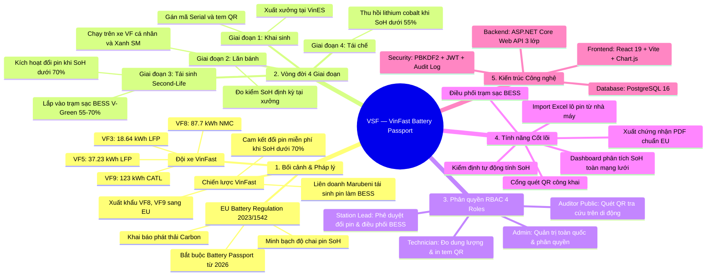

# Phân Tích Đề Bài Top-Down (Research) & Phạm Vi Dự Án — VSF

> **Dự án:** VSF — VinFast Battery Passport & Second-Life Platform  
> **Trạng thái:** TARGET V1  
> **Đối tượng áp dụng:** Hệ sinh thái xe điện VinFast (VF 3, VF 5, VF 6, VF 7, VF 8, VF 9 & Xe máy điện)

---

## 1. Phân Tích Tầng 1: Bối Cảnh Vĩ Mô & Pháp Lý Quốc Tế (Macro Level)

### 1.1. Đạo luật Pin Liên minh Châu Âu (EU Battery Regulation 2023/1542)
Từ năm 2026, Liên minh Châu Âu (EU) áp dụng quy định bắt buộc đối với toàn bộ xe điện (EV) và pin công nghiệp lưu hành tại thị trường Châu Âu:
1. **Bắt buộc có Hộ chiếu Pin Số (Digital Battery Passport):** Mỗi pack pin phải có một mã định danh duy nhất (UUID/QR Code) liên kết đến cơ sở dữ liệu số hóa có thể truy cập công khai.
2. **Khai báo Dấu chân Carbon (Carbon Footprint Declaration):** Bắt buộc công bố tổng lượng CO2 phát thải trong toàn bộ chuỗi cung ứng: từ khai thác khoáng sản (Cobalt, Lithium, Nickel), khâu gia công cell tại nhà máy, đến khâu lắp ráp pack pin.
3. **Chỉ số Sức khỏe Pin (State of Health - SoH):** Phải lưu giữ lịch sử kiểm định SoH, dung lượng khả dụng còn lại, số chu kỳ sạc/xả để chống gian lận thương mại khi mua bán xe cũ.
4. **Trách nhiệm Thu hồi & Tái chế (EPR):** Hãng xe phải chịu trách nhiệm thu hồi 100% pin thải bỏ, đạt tỷ lệ tái chế tối thiểu 70% trọng lượng vào năm 2031.

### 1.2. Thách thức sống còn đối với VinFast toàn cầu
* VinFast đang mở rộng thị trường xuất khẩu dòng xe **VF 8, VF 9 sang Đức, Pháp, Hà Lan** $\to$ **Nếu không có hệ thống Battery Passport chuẩn hóa, xe VinFast sẽ bị hải quan EU từ chối thông quan hoặc bị áp thuế phát thải carbon phạt kịch khung**.

---

## 2. Phân Tích Tầng 2: Bối Cảnh Doanh Nghiệp VinFast (Enterprise Level)

VinFast sở hữu một hệ sinh thái xe điện khép kín độc nhất vô nhị trên thế giới, kéo theo những bài toán quản trị đặc thù:

```text
[Nhà Máy VinES Hải Phòng]
       │
       ▼ (Lắp ráp & Cấp Serial Pin)
[Đội Xe Lăn Bánh: VF 3, VF 5, VF 6, VF 7, VF 8, VF 9 & Taxi Xanh SM]
       │
       ▼ (Đo kiểm định kỳ tại Xưởng VinFast Service)
┌──────────────────────────────────────┐
│  Kiểm tra SoH (Dung lượng pin)       │
└──────────────────┬───────────────────┘
                   │
         ┌─────────┴─────────┐
         ▼                   ▼
    SoH >= 70%           SoH < 70%
 (Tiếp tục chạy xe)   (KÍCH HOẠT ĐỔI PIN MIỄN PHÍ)
                             │
                             ▼
              [ĐÁNH GIÁ TÁI SINH SECOND-LIFE]
              ├── 55% <= SoH < 70%: Tái sinh làm Trạm tích điện BESS V-Green
              └── SoH < 55% hoặc Lỗi cell: Tái chế kim loại hiếm tại VinES
```

### 2.1. Chính sách Thuê Pin & Cam kết "Đổi pin miễn phí khi SoH < 70%"
* Trong hợp đồng thuê pin ký với khách hàng cá nhân và hàng chục nghìn tài xế **GSM (Xanh SM)**, VinFast cam kết: **Khi pin bị chai dung lượng thực tế xuống dưới 70%, VinFast chịu toàn bộ chi phí thu hồi và thay pack pin mới cho khách hàng**.
* **Nỗi đau (Painpoint):** Cần một hệ thống đo đạc đồng bộ, tự động hóa việc tính toán dung lượng khả dụng để tránh tranh chấp quyền lợi bảo hành hoặc kỹ thuật viên khai khống số liệu.

### 2.2. Bài toán Tái sinh Năng lượng (Second-life BESS cho Trạm sạc V-Green)
* Một quả pin xe điện khi chai xuống $68%$ không còn phù hợp để chạy xe, nhưng **vẫn còn hơn 50 kWh điện lưu trữ** (bằng lượng điện sinh hoạt cả tuần của một hộ gia đình).
* Tháng 12/2023, **VinFast đã ký kết thỏa thuận hợp tác với Tập đoàn Marubeni (Nhật Bản)** để tái sử dụng pin cũ làm **Trạm pin lưu trữ năng lượng (BESS)**. Các pack pin này được lắp vào các tủ rack container đặt cạnh các trụ sạc nhanh V-Green trên cao tốc để sạc đệm vào ban đêm và xả ra giờ cao điểm, giảm tải lưới điện quốc gia.

---

## 3. Phân Tích Tầng 3: Bối Cảnh Vận Hành Tại Xưởng Dịch Vụ (Operational Level)

| Nhóm Đối Tượng | Công Việc Hàng Ngày | Nỗi Đau Lớn Nhất (Painpoint) |
|---|---|---|
| **Kỹ thuật viên xưởng (Technician)** | Cắm thiết bị chẩn đoán đo dung lượng, chu kỳ sạc, nội trở khi xe vào bảo dưỡng. | Phải ghi chép số liệu thủ công ra phiếu, tính nhẩm độ chai pin bằng tay, dễ nhầm lẫn giữa các dòng xe (VF 3 dung lượng khác VF 8). |
| **Trưởng xưởng dịch vụ (Station Lead)** | Ký duyệt biên bản đổi pin mới cho khách hàng; quản lý kho pin thu hồi. | Thiếu căn cứ kiểm toán minh bạch; áp lực tồn kho pin cũ dễ gây nguy cơ cháy nổ nếu không phân loại đúng tình trạng cell pin. |
| **Quản trị viên VinFast (Admin)** | Theo dõi toàn bộ tỷ lệ chai pin của các dòng xe trên toàn quốc; lập kế hoạch sản xuất bù đắp. | "Mù số liệu" tổng quan theo thời gian thực; không nắm được lô pin sản xuất đợt nào có tỷ lệ lỗi tế bào cao để thu hồi sớm. |
| **Khách hàng / Kiểm toán viên EU** | Quét mã tra cứu thông số khi mua xe cũ hoặc kiểm tra xuất xứ tại cảng. | Hoàn toàn không có cổng tra cứu độc lập; phải phụ thuộc vào lời nói của thợ sửa xe. |

---

## 4. Phân Tích Tầng 4: Bốn Giai Đoạn Vòng Đời Pin VinFast (4 Lifecycle Stages)

1. **Giai đoạn 1: Khai sinh (Manufacturing & Registration):**
   * Nhà máy VinES Hải Phòng / Gotion / CATL lắp ráp cell thành pack $\to$ Đăng ký mã định danh duy nhất (Serial/QR), lưu thông số gốc (kWh thiết kế, loại cell LFP/NMC, mức phát thải carbon ban đầu).
2. **Giai đoạn 2: Vận hành trên xe (Active On-Road):**
   * Lắp lên xe (VF 3 $\to$ VF 9) $\to$ Theo dõi số chu kỳ sạc, quãng đường km lăn bánh $\to$ Ghi nhận lịch sử kiểm định SoH sau mỗi $20.000\text{ km}$ hoặc 12 tháng.
3. **Giai đoạn 3: Thu hồi & Tái sinh (Recall & Second-Life Deployment):**
   * Khi $\text{SoH} < 70\%$ $\to$ Tự động chuyển trạng thái `RECALL_PENDING` $\to$ Đổi pin mới $\to$ Pack pin cũ được kiểm tra nội trở: Nếu đạt chuẩn an toàn ($55\% \le \text{SoH} < 70\%$), chuyển sang gắn vào trạm tích điện `SECOND_LIFE_BESS` V-Green.
4. **Giai đoạn 4: Tái chế khép kín (Decommission & Material Recycling):**
   * Khi pin chai dưới $55\%$ hoặc hỏng cell vật lý $\to$ Chuyển về nhà máy thủy luyện để bóc tách kim loại quý Lithium, Cobalt, Nickel tái chế phục vụ mẻ sản xuất mới.

---

## 5. Phân Tích Tầng 5: Phạm Vi Hệ Thống (System Boundary)

* **IN-SCOPE (Phải làm trong V1):**
  * Module Xác thực & Phân quyền 4 Roles (Admin, Station Lead, Technician, Auditor).
  * Dashboard trung tâm: Thống kê số lượng pin toàn quốc, biểu đồ phân bố SoH, cảnh báo pin chạm ngưỡng 70%.
  * Quản lý danh mục Model xe VinFast (VF3: 18.64 kWh LFP, VF5: 37.23 kWh LFP, VF6: 59.6 kWh, VF7: 75.3 kWh, VF8: 87.7 kWh NMC, VF9: 123 kWh NMC).
  * Sổ quản lý Pack Pin & Kiểm định: Nhập dung lượng thực đo $\to$ Tự động tính SoH và phân luồng trạng thái.
  * Phân bổ cụm pin cũ vào Trạm sạc V-Green BESS.
  * Import file Excel lô pin mới từ nhà máy VinES (có preview và báo lỗi từng dòng).
  * Cổng Hộ chiếu Pin QR công khai (Mobile-friendly, không cần đăng nhập).
  * Xuất chứng nhận Battery Health Certificate dạng PDF đạt chuẩn EU.
  * Nhật ký kiểm toán (Audit Trail) ghi vết mọi thay đổi dữ liệu.
* **OUT-OF-SCOPE (Không làm trong V1):**
  * Không truyền nhận dữ liệu IoT telematics qua sóng 4G gắn trên xe theo thời gian thực (dữ liệu cập nhật qua các lần kiểm định tại xưởng).
  * Không tích hợp thanh toán cước thuê pin hàng tháng.

---

## 6. Bản Đồ Tư Duy (Mindmap XMind Structure)

### 6.1. Cấu trúc Cây Nhánh để vẽ trên XMind

```text
VSF — VINFAST BATTERY PASSPORT & SECOND-LIFE PLATFORM
│
├── 1. BỐI CẢNH & PHÁP LÝ (RESEARCH CONTEXT)
│   ├── Đạo luật Pin EU 2023/1542
│   │   ├── Bắt buộc Digital Battery Passport từ 2026
│   │   ├── Khai báo phát thải Carbon chuỗi cung ứng
│   │   └── Minh bạch chỉ số chai pin SoH
│   ├── Bài toán VinFast Toàn Cầu
│   │   ├── Xuất khẩu VF 8, VF 9 sang thị trường Châu Âu
│   │   ├── Hợp đồng thuê pin: Đổi pin miễn phí khi SoH < 70%
│   │   └── Hợp tác Marubeni: Tái sinh pin cũ làm trạm BESS V-Green
│   └── Đối tượng & Đội xe VinFast
│       ├── VF 3: 18.64 kWh (LFP - Gotion)
│       ├── VF 5: 37.23 kWh (LFP - VinES)
│       ├── VF 6 / VF 7: 59.6 - 75.3 kWh
│       └── VF 8 / VF 9: 87.7 - 123.0 kWh (NMC - CATL)
│
├── 2. BỐN GIAI ĐOẠN VÒNG ĐỜI (LIFECYCLE STAGES)
│   ├── Giai đoạn 1: Khai sinh (Manufacturing)
│   │   ├── Định danh Serial / In tem QR Hộ chiếu số
│   │   └── Nhập lô từ nhà máy VinES qua file Excel
│   ├── Giai đoạn 2: Lăn bánh (Active On-Road)
│   │   ├── Xe lăn bánh (Khách cá nhân & Taxi Xanh SM)
│   │   └── Kiểm định định kỳ SoH tại xưởng dịch vụ
│   ├── Giai đoạn 3: Tái sinh (Second-Life BESS)
│   │   ├── Kích hoạt thu hồi & đổi pin mới khi SoH < 70%
│   │   └── Lắp vào cụm tích điện đệm trạm sạc V-Green (55% <= SoH < 70%)
│   └── Giai đoạn 4: Tái chế (Recycling)
│       └── Thu hồi kim loại hiếm Lithium/Cobalt (SoH < 55%)
│
├── 3. TÁC NHÂN & PHÂN QUYỀN (ACTORS & RBAC)
│   ├── Administrator (VinFast HQ)
│   │   ├── Giám sát Dashboard toàn quốc
│   │   └── Quản lý tài khoản & Cấu hình ngưỡng bảo hành
│   ├── Station Lead (Trưởng Xưởng / Trạm Sạc)
│   │   ├── Phê duyệt lệnh đổi pin mới
│   │   └── Phân bổ pin vào tủ rack BESS V-Green
│   ├── Technician (Kỹ Thuật Viên Xưởng)
│   │   ├── Nhập số liệu đo kiểm dung lượng & nội trở
│   │   └── In tem mã QR dán lên vỏ pin
│   └── Auditor & Public (Thanh Tra EU & Người Dùng)
│       ├── Quét mã QR tra cứu hộ chiếu pin trên điện thoại
│       └── Tải Giấy chứng nhận kiểm định PDF
│
├── 4. TÍNH NĂNG CỐT LÕI (CORE FEATURES)
│   ├── F01: Xác thực JWT & Phân quyền 4 vai trò
│   ├── F02: Dashboard thống kê vòng đời & phân bố SoH
│   ├── F03: Sổ quản lý Pack Pin VinFast & In tem QR
│   ├── F04: Kiểm định đo đạc & Thuật toán tính SoH tự động
│   ├── F05: Quy trình kích hoạt thu hồi đổi pin (< 70%)
│   ├── F06: Điều phối tái sinh cụm trạm sạc BESS
│   ├── F07: Nhập dữ liệu lô pin Excel (VinES Import)
│   ├── F08: Cổng Hộ chiếu Pin QR công khai (Mobile Web)
│   └── F09: Xuất Giấy chứng nhận kiểm định PDF chuẩn EU
│
└── 5. KIẾN TRÚC KỸ THUẬT (TECH STACK)
    ├── Frontend: React 19 + Vite + Chart.js + QR Engine
    ├── Backend: ASP.NET Core (.NET 9) Web API 3 lớp
    ├── Database: PostgreSQL 16 (Schema vsf_battery)
    └── Security: PBKDF2 Password Hashing + JWT Bearer + Audit Trail
```

### 6.2. Sơ Đồ Mindmap Trực Quan (Mermaid Mindmap)


