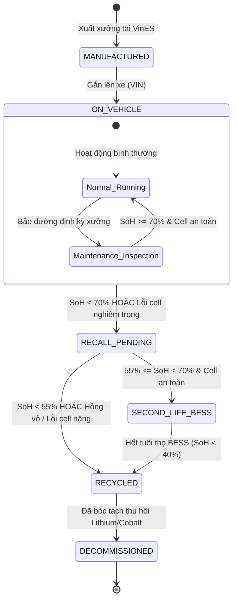
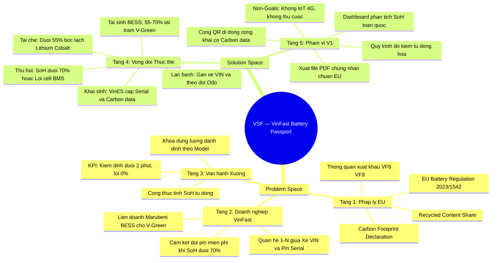

# Phân Tích Đề Bài Top-Down (Research) & Đặc Tả Phạm Vi — VSF

> **Dự án:** VSF — VinFast Battery Passport & Second-Life Platform  
> **Trạng thái:** TARGET V1 (Design & Architecture)  
> **Phương pháp tiếp cận:** Phân tích Top-Down (Từ Problem Space vĩ mô đến Solution Space kỹ thuật)

---

# PHẦN I: MIỀN BỐI CẢNH BÀI TOÁN (PROBLEM SPACE)

---

## 1. Tầng 1: Khung Bối Cảnh Vĩ Mô & Pháp Lý Quốc Tế (Macro Level)

### 1.1. Đạo luật Pin Liên minh Châu Âu (EU Battery Regulation 2023/1542)
Từ năm 2026, Liên minh Châu Âu (EU) áp dụng quy định bắt buộc đối với toàn bộ xe điện (EV) và pin công nghiệp lưu hành tại thị trường Châu Âu:
1. **Digital Battery Passport (Hộ chiếu Pin Số):** Mỗi pack pin bắt buộc phải có mã định danh duy nhất (UUID/QR Code) liên kết đến cơ sở dữ liệu mở.
2. **Khai báo Dấu chân Carbon (Carbon Footprint Declaration):** Bắt buộc công bố tổng lượng phát thải $CO_2$ tích lũy trong toàn bộ chuỗi cung ứng ($gCO_2eq/kWh$): từ mỏ khai thác khoáng sản (Cobalt, Lithium, Nickel), khâu gia công cell tại nhà máy, đến khâu đóng pack.
3. **Tỷ lệ Vật liệu Tái chế (Recycled Content Share):** Bắt buộc chứng minh tỷ lệ % kim loại tái chế được tái sử dụng trong quả pin.
4. **Chỉ số Sức khỏe Pin (State of Health - SoH):** Lưu giữ lịch sử kiểm định SoH, dung lượng khả dụng thực tế, số chu kỳ sạc/xả nhằm bảo vệ quyền lợi người tiêu dùng và chống gian lận thương mại khi mua bán xe cũ.
5. **Trách nhiệm Thu hồi & Tái chế (EPR):** Hãng xe phải thu hồi 100% pin hết hạn sử dụng, đạt tỷ lệ tái chế kim loại tối thiểu 70% vào năm 2031.

### 1.2. Thách thức sống còn đối với VinFast toàn cầu
* VinFast đang mở rộng xuất khẩu và bàn giao xe điện **VF 8, VF 9 tại Đức, Pháp, Hà Lan**.
* **Nguy cơ hiện hữu:** Nếu thiếu một nền tảng Hộ chiếu Pin số hóa minh bạch, các lô xe xuất khẩu của VinFast sẽ đối mặt với nguy cơ **bị hải quan EU từ chối thông quan, phạt thuế carbon kịch khung, hoặc đình chỉ quyền kinh doanh tại thị trường Châu Âu**.

---

## 2. Tầng 2: Bối Cảnh Chiến Lược Doanh Nghiệp VinFast (Enterprise Level)

Hệ sinh thái VinFast vận hành theo mô hình chuỗi cung ứng và dịch vụ khép kín độc nhất:

```text
[Nhà Máy VinES Hải Phòng]
       │
       ▼ (Cung cấp pack pin mới kèm mã QR)
[Đội Xe Lăn Bánh: VF 3, VF 5, VF 6, VF 7, VF 8, VF 9 & Taxi Xanh SM]
       │
       ▼ (Đo kiểm định kỳ tại Xưởng Dịch Vụ VinFast Service)
┌────────────────────────────────────────────────────────┐
│  Kiểm định Dung Lượng (SoH) & Độ Lệch Cell (Delta V)   │
└──────────────────────────┬─────────────────────────────┘
                           │
         ┌─────────────────┴─────────────────┐
         ▼                                   ▼
    ĐIỀU KIỆN ĐẠT                       KÍCH HOẠT ĐỔI PIN MIỄN PHÍ
   SoH >= 70% VÀ                       SoH < 70% HOẶC
  Không lỗi cell                     Lỗi cell / Nguy cơ cháy nổ
 (Tiếp tục lăn bánh)                         │
                                             ▼
                              [ĐÁNH GIÁ TÁI SINH SECOND-LIFE]
                              ├── 55% <= SoH < 70%: Lắp vào Trạm sạc BESS V-Green
                              └── SoH < 55% hoặc Hỏng vỏ: Tái chế kim loại tại VinES
```

### 2.1. Chính sách Thuê Pin & Cam kết "Đổi pin miễn phí khi SoH < 70%"
* Trong hợp đồng thuê pin ký với khách hàng cá nhân và hàng chục nghìn tài xế **GSM (Xanh SM)**, VinFast cam kết: **Khi dung lượng thực tế giảm xuống dưới 70%, VinFast chịu toàn bộ chi phí thu hồi và thay thế pack pin mới**.
* **Đặc thù Nghiệp vụ "Xe đổi pin" (Quan hệ 1 - N giữa Xe và Pin):**
  * Xe điện VinFast (định danh bằng số khung VIN) và Quả pin (định danh bằng Serial Number / UUID) là **hai thực thể độc lập có quan hệ 1 - N theo dòng thời gian**.
  * Trong suốt vòng đời 15 năm của một chiếc xe, xe có thể được thay thế 2 đến 3 pack pin khác nhau.
  * Ngược lại, một quả pin sau khi rời khỏi chiếc xe ban đầu có thể được đưa sang trạm sạc BESS hoặc tái chế, hoàn toàn tách rời khỏi chiếc xe gốc.

### 2.2. Bài toán Tái sinh Năng lượng (Liên doanh VinFast - Marubeni BESS)
* Pin xe điện khi chai xuống $68%$ không còn đủ khả năng phóng dòng cao để tăng tốc trên cao tốc, nhưng **vẫn còn khả năng lưu trữ trên 50 kWh điện** (bằng lượng điện sinh hoạt cả tuần của một hộ gia đình).
* Tháng 12/2023, **VinFast và Tập đoàn Marubeni (Nhật Bản)** đã chính thức ký kết thỏa thuận hợp tác tái sử dụng pin xe điện đã qua sử dụng làm **Trạm pin lưu trữ năng lượng (BESS - Battery Energy Storage System)**. Các pack pin này được gom thành các tủ rack container đặt tại các trạm sạc nhanh V-Green trên các tuyến cao tốc để sạc đệm ban đêm và xả điện hỗ trợ trụ sạc giờ cao điểm.

---

## 3. Tầng 3: Bối Cảnh Vận Hành Xưởng & Chân Dung Tác Nhân (Operational & Personas)

### 3.1. Bảng phân tích Chân dung Tác nhân & Nỗi đau nghiệp vụ

| Nhóm Tác Nhân | Công Việc Thực Tế Tại Xưởng | Nỗi Đau Lớn Nhất (Painpoint) |
|---|---|---|
| **Kỹ thuật viên xưởng (Technician)** | Cắm thiết bị chẩn đoán chuyên dụng đọc dung lượng, chu kỳ sạc, nội trở khi xe vào bảo dưỡng. | Phải ghi chép số liệu thủ công ra phiếu giấy, tính nhẩm độ chai pin bằng tay, dễ nhầm lẫn dung lượng gốc giữa các dòng xe (VF 3 khác VF 8). |
| **Trưởng xưởng dịch vụ (Station Lead)** | Ký duyệt biên bản đổi pin mới cho khách hàng; quản lý kho pin thu hồi chờ xử lý. | Thiếu căn cứ số liệu minh bạch; áp lực tồn kho pin cũ dễ gây nguy cơ cháy nổ nếu không phân loại đúng tình trạng cell pin. |
| **Quản trị viên VinFast (Admin)** | Theo dõi toàn bộ tỷ lệ chai pin của các dòng xe trên toàn quốc; lập kế hoạch sản xuất bù đắp. | "Mù số liệu" tổng quan theo thời gian thực; không nắm được lô pin sản xuất đợt nào có tỷ lệ lỗi tế bào cao để thu hồi sớm. |
| **Khách hàng / Kiểm toán viên EU** | Quét mã tra cứu thông số khi mua xe cũ hoặc kiểm tra xuất xứ tại cảng nhập khẩu. | Hoàn toàn không có cổng tra cứu độc lập; phải phụ thuộc vào lời nói của thợ sửa xe. |

### 3.2. Chuẩn hóa Công thức Đo đạc Tự Động (Loại bỏ tính nhẩm thủ công)
Hệ thống VSF khóa cứng dung lượng danh định gốc ($C_{\text{nominal}}$) theo từng Model xe. Kỹ thuật viên chỉ cần nhập giá trị dung lượng đo thực tế ($C_{\text{measured}}$) từ máy chẩn đoán:

$$\text{SoH (\%)} = \left( \frac{C_{\text{measured}}}{C_{\text{nominal}}} \right) \times 100\%$$

*Bảng tra cứu dung lượng danh định được hệ thống tự động áp dụng:*
* **VinFast VF 3:** $C_{\text{nominal}} = 18.64\text{ kWh}$ (LFP)
* **VinFast VF 5 Plus:** $C_{\text{nominal}} = 37.23\text{ kWh}$ (LFP)
* **VinFast VF 6:** $C_{\text{nominal}} = 59.60\text{ kWh}$ (LFP)
* **VinFast VF 7 Plus:** $C_{\text{nominal}} = 75.30\text{ kWh}$ (NMC)
* **VinFast VF 8 Eco/Plus:** $C_{\text{nominal}} = 87.70\text{ kWh}$ (NMC)
* **VinFast VF 9 Plus:** $C_{\text{nominal}} = 123.00\text{ kWh}$ (NMC)

---

# PHẦN II: MIỀN GIẢI PHÁP KỸ THUẬT (SOLUTION SPACE)

---

## 4. Tầng 4: Miền Dữ Liệu & Vòng Đời Thực Thể (Entity Lifecycle Model)

Hệ thống quản lý quả pin qua **4 trạng thái tiến hóa khép kín** (Cradle-to-Cradle):



### Chi tiết các giai đoạn vòng đời:
1. **Giai đoạn 1: Khai sinh (Manufacturing & Registration):**
   * Đăng ký Serial/UUID, liên kết Model xe, lưu trữ thông số tĩnh từ nhà máy: Dấu chân Carbon ban đầu ($gCO_2eq/kWh$), Tỷ lệ vật liệu tái chế (Recycled Content %).
2. **Giai đoạn 2: Lăn bánh (Active On-Road):**
   * Gắn với xe qua mã VIN (Quan hệ 1-N). Cập nhật số chu kỳ sạc, Odometer (km), và lịch sử các lần kiểm định tại xưởng.
3. **Giai đoạn 3: Thu hồi & Tái sinh (Recall & Second-Life Deployment):**
   * Kích hoạt đổi pin khi: **$\text{SoH} < 70.00\%$ HOẶC $\text{has\_critical\_cell\_fault} = \text{true}$** (Độ lệch điện áp cell quá lớn $\Delta V > 100mV$, nguy cơ thoát nhiệt).
   * Phân luồng: Nếu đạt điều kiện an toàn, pack pin được giải phóng khỏi xe và gắn vào cụm trạm sạc `SECOND_LIFE_BESS` V-Green.
4. **Giai đoạn 4: Tái chế nguyên liệu (Material Recycling):**
   * Pin chai dưới $55\%$ hoặc hư hỏng vật lý được chuyển sang nhà máy thủy luyện để thu hồi khoáng sản.

---

## 5. Tầng 5: Đặc Tả Phạm Vi Phần Mềm V1 (System Functional Scope)

### 5.1. Khung Đo Lường Thành Công Dự Án (Success Metrics / KPIs)

| Chỉ số Hiệu quả (KPI) | Hiện trạng Thủ công (Baseline) | Mục tiêu VSF V1 |
|---|---|---|
| **Thời gian tạo biên bản & phân luồng đổi pin** | 15 – 30 phút / xe (ghi giấy, tính nhẩm) | **< 2 phút** (tính toán & phân luồng tự động) |
| **Tỷ lệ sai sót dung lượng gốc giữa các dòng xe** | ~5% (nhầm lẫn giữa VF 3, VF 5, VF 8) | **0%** (khóa cứng tự động theo Model ID) |
| **Thời gian xuất trình Hộ chiếu Pin khi kiểm tra EU** | 3 – 5 ngày (lục tìm hồ sơ nhà máy) | **< 5 giây** (quét mã QR mở ngay Hộ chiếu) |
| **Tính minh bạch chỉ số Carbon Footprint** | Không theo dõi được theo từng pack | **100% pack pin** có trường Carbon rõ ràng |
| **Tỷ lệ kiểm soát vòng đời pin Second-Life** | Thất thoát, tự phát không theo dõi | **Theo dõi chính xác 100%** vị trí trạm BESS |

### 5.2. Phạm vi Chức năng V1 (In-Scope V1 Goals)
* **Xác thực & RBAC 4 Roles:** Đăng nhập JWT Bearer (Admin, Station Lead, Technician, Auditor).
* **Dashboard Phân tích Sức khỏe Pin:** Biểu đồ phân bố SoH toàn quốc, cảnh báo thu hồi pin $<70\%$.
* **Sổ Quản lý Pack Pin (Battery Registry):** Quản lý định danh Serial/UUID, lịch sử gắn xe VIN, in tem nhãn QR.
* **Quy trình Đo kiểm & Tự động Tính SoH:** Khóa cứng dung lượng chuẩn theo Model, nhập dung lượng thực đo $\to$ tự động cập nhật trạng thái và ghi Audit log.
* **Xử lý Ngoại lệ (Lỗi Cell Vật Lý):** Bổ sung cờ cảnh báo lỗi cell/nguy cơ thoát nhiệt để kích hoạt thu hồi khẩn cấp dù SoH còn trên $70\%$.
* **Điều phối Trạm sạc V-Green BESS:** Quản lý danh mục trạm sạc, phân bổ pin $55-70\%$ vào tủ rack trạm sạc.
* **Import Lô Pin từ Excel:** Nhập file danh sách pin mới từ VinES, bao gồm cả trường thông số Carbon Footprint ($gCO_2eq/kWh$) và Tỷ lệ vật liệu tái chế (%).
* **Cổng Quét QR Công Khai (Mobile Public Passport):** Cho phép bất kỳ ai quét mã QR xem thông số kỹ thuật, SoH, và chỉ số Carbon Footprint mà không cần đăng nhập.
* **Xuất Giấy Chứng Nhận PDF:** Tạo file Battery Health Certificate có mã QR xác thực chuẩn Châu Âu.

### 5.3. Giới hạn Ngoài Phạm Vi (Non-Goals V1)
* Không tích hợp telemetry sóng di động truyền dữ liệu cell pin theo thời gian thực (real-time CAN bus streaming).
* Không quản lý bảo hiểm xe, sửa chữa thân vỏ hoặc bán linh kiện phụ tùng.
* Không tích hợp cổng thanh toán trực tuyến cước thuê pin hàng tháng.

---

## 6. Bản Đồ Tư Duy (Mindmap XMind Structure)

### 6.1. Cây thư mục để vẽ trên phần mềm XMind

```text
VSF — VINFAST BATTERY PASSPORT & SECOND-LIFE PLATFORM
│
├── 1. MIỀN BỐI CẢNH (PROBLEM SPACE)
│   ├── Tầng 1: Vĩ mô & Pháp lý Quốc tế
│   │   ├── Đạo luật Pin EU 2023/1542 (Bắt buộc Passport từ 2026)
│   │   ├── Khai báo Dấu chân Carbon (gCO2eq/kWh) & Tỷ lệ Tái chế (%)
│   │   └── Thách thức xuất khẩu VF 8, VF 9 sang Châu Âu
│   ├── Tầng 2: Doanh Nghiệp VinFast
│   │   ├── Hợp đồng thuê pin: Đổi pin miễn phí khi SoH < 70%
│   │   ├── Bản chất nghiệp vụ: Quan hệ 1-N giữa Xe (VIN) và Pin (Serial)
│   │   └── Liên doanh Marubeni: Tái sinh pin cũ làm BESS trạm sạc V-Green
│   └── Tầng 3: Vận Hành Xưởng & Tác Nhân
│       ├── Kỹ thuật viên: Cần công thức SoH tự động (khóa dung lượng gốc)
│       ├── Trưởng xưởng: Quản lý kho pin thu hồi & an toàn cháy nổ
│       └── Bảng đo lường thành công (KPIs): Giảm thời gian kiểm định < 2 phút
│
├── 2. MIỀN GIẢI PHÁP (SOLUTION SPACE)
│   ├── Tầng 4: Vòng Đời Thực Thể (Lifecycle Model)
│   │   ├── Giai đoạn 1: Khai sinh (Manufacturing & Carbon data)
│   │   ├── Giai đoạn 2: Lăn bánh (Active on Vehicle VIN)
│   │   ├── Giai đoạn 3: Thu hồi (SoH < 70% HOẶC Lỗi cell/nguy cơ thoát nhiệt)
│   │   ├── Giai đoạn 4: Tái sinh BESS (55% <= SoH < 70% tại trạm V-Green)
│   │   └── Giai đoạn 5: Tái chế kim loại (SoH < 55% hoặc hỏng vỏ)
│   └── Tầng 5: Đặc Tả Phạm Vi Phần Mềm V1
│       ├── In-Scope: Dashboard SoH, Kiểm định tự động, Điều phối BESS
│       ├── In-Scope: Import Excel lô pin, Xuất PDF chứng nhận EU
│       ├── In-Scope: Cổng tra cứu QR di động hiển thị Carbon Footprint
│       └── Non-Goals: Không IoT thời gian thực, không thanh toán cước
│
└── 3. NỀN TẢNG CÔNG NGHỆ (TECH STACK)
    ├── Frontend: React 19 + Vite + Chart.js + QR Code Generator
    ├── Backend: ASP.NET Core (.NET 9) Web API 3 lớp
    ├── Database: PostgreSQL 16 (Schema vsf_battery)
    └── Security: PBKDF2 Hashing + JWT Bearer + Audit Trail
```

### 6.2. Sơ đồ Mindmap Xem Trực Tiếp Trên Markdown (Mermaid)


