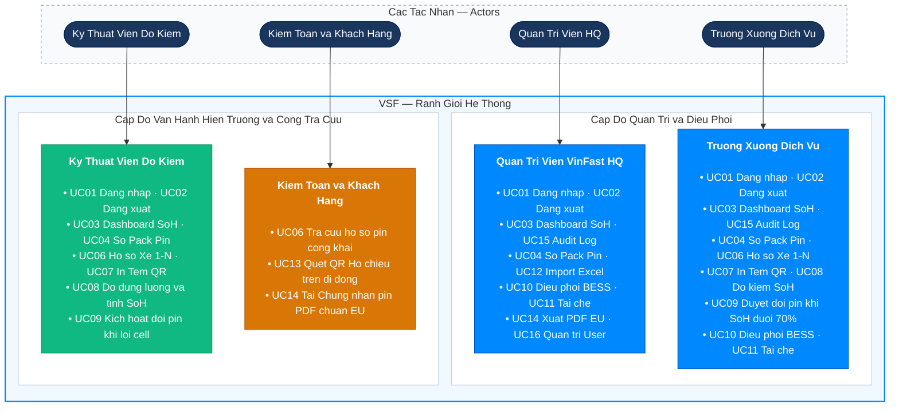

# Đặc Tả Ca Sử Dụng & Ma Trận Phân Quyền (Use Cases & RBAC) — VSF

> **Dự án:** VSF — VinFast Battery Passport & Second-Life Platform  
> **Trạng thái:** TARGET V1  
> **Tuân thủ:** Phân rã 16 Use Cases (UC01 – UC16) bao phủ trọn vẹn 6 phân hệ sản phẩm.

---

## 1. Các Tác Nhân Hệ Thống (Actors & Personas)

1. **Administrator (Ban Quản Trị VinFast HQ):**  
   Chịu trách nhiệm quản lý toàn diện nền tảng trên quy mô toàn quốc; cấu hình ngưỡng bảo hành đổi pin (mặc định $70\%$); quản trị danh mục tài khoản nhân sự và phân bổ xưởng dịch vụ.
2. **Station Lead (Trưởng Xưởng Dịch Vụ / Trưởng Trạm V-Green):**  
   Chịu trách nhiệm phê duyệt các lệnh đổi pin mới cho khách hàng; quản lý kho pin thu hồi; điều phối phân bổ các pack pin $55-70\%$ vào trạm tích điện đệm BESS; phê duyệt lệnh thanh lý tái chế.
3. **Technician (Kỹ Thuật Viên Xưởng Dịch Vụ):**  
   Thao tác trực tiếp tại cầu nâng bảo dưỡng: cắm máy chẩn đoán, nhập thông số đo dung lượng ($C_{\text{measured}}$), nội trở, độ lệch điện áp cell; in tem nhãn QR dán lên vỏ pack pin.
4. **Auditor / Public User (Kiểm Toán Viên EU / Khách Hàng / Tài Xế):**  
   Người dùng đại chúng hoặc thanh tra hải quan: sử dụng camera điện thoại quét mã QR trên vỏ quả pin để tra cứu Hộ chiếu Pin số hóa công khai; tải Giấy chứng nhận kiểm định PDF mà không cần tài khoản đăng nhập.

---

## 2. Sơ Đồ Ca Sử Dụng Toàn Hệ Thống (System Use Case Diagram)

## 3. Ma Trận Phân Quyền Chi Tiết (RBAC Matrix)

| Quyền Hạn / Tính Năng (Capabilities) | Admin | Station Lead | Technician | Auditor / Public | Ghi Chú Thực Thi Nghiệp Vụ |
|---|:---:|:---:|:---:|:---:|---|
| **Xem Dashboard KPI & Biểu đồ SoH** | Có | Có | Có | Không | Phân tích toàn quốc vs xưởng |
| **Tra cứu Sổ Pack Pin (Battery Registry)** | Có | Có | Có | Không | Có bộ lọc đa chiều |
| **Đăng ký Pack Pin mới xuất xưởng** | Có | Có | Không | Không | Tạo lẻ từng quả pin |
| **In Tem Nhãn Mã QR kích thước chuẩn** | Có | Có | Có | Không | Xuất file in nhiệt 50x30mm |
| **Nhập thông số đo kiểm dung lượng** | Có | Có | Có | Không | Khóa cứng Model, tính SoH |
| **Phê duyệt lệnh đổi pin mới (<70%)** | Có | Có | Không | Không | Thẩm quyền duyệt xuất kho |
| **Điều phối Pin vào Trạm sạc BESS** | Có | Có | Không | Không | Phân bổ vào cụm V-Green |
| **Lập lệnh chuyển giao tái chế (<55%)** | Có | Có | Không | Không | Chuyển nhà máy thủy luyện |
| **Batch Import file Excel từ VinES** | Có | Có | Không | Không | Giới hạn 10 MB, 5.000 dòng |
| **Quét mã QR tra cứu Hộ chiếu Công khai** | Có | Có | Có | **Có** | Endpoint mở không cần token |
| **Xuất Giấy Chứng Nhận PDF chuẩn EU** | Có | Có | Có | Có | File PDF có QR và mã băm |
| **Xem Nhật ký Kiểm toán (Audit Trail)** | Có | Có | Không | Không | Quyền tra cứu bất biến |
| **Quản trị người dùng & Xưởng dịch vụ** | **Có** | Không | Không | Không | Chỉ duy nhất Admin HQ |
| **Đổi mật khẩu cá nhân** | Có | Có | Có | Không | Xác thực mật khẩu cũ |

---

## 4. Đặc Tả Chi Tiết 16 Use Cases Cốt Lõi

### UC01: Đăng Nhập Hệ Thống (Login)
* **Tác nhân chính:** Toàn bộ người dùng nội bộ (Admin, Station Lead, Technician, Auditor).
* **Tiền điều kiện:** Tài khoản đã được cấp và đang ở trạng thái `is_active = true`.
* **Luồng chính (Main Flow):**
  1. Người dùng truy cập `/login`, nhập Email và Mật khẩu.
  2. Frontend gửi request `POST /api/v1/auth/login`.
  3. Backend kiểm tra tài khoản, xác thực mật khẩu qua PBKDF2 hash.
  4. Backend sinh Access Token JWT (chứa Claim: UserId, Role, StationName) thời hạn 60 phút.
  5. Frontend lưu token, giải mã role và chuyển hướng người dùng vào trang `/dashboard`.
* **Luồng rẽ nhánh (Alternative/Error):**
  * 3a. Email hoặc mật khẩu sai $\to$ Trả về mã HTTP 401 với thông điệp: *"Email hoặc mật khẩu không chính xác"*.
  * 3b. Tài khoản bị vô hiệu hóa (`is_active = false`) $\to$ Trả về mã HTTP 403: *"Tài khoản đã bị khóa bởi Quản trị viên"*.

### UC02: Đăng Xuất (Logout)
* **Tác nhân:** Người dùng đang đăng nhập.
* **Luồng chính:** Người dùng bấm "Đăng xuất" $	o$ Frontend xóa Access Token khỏi bộ nhớ (client-side token discard), gửi sự kiện ghi log `LOGOUT` về máy chủ và chuyển hướng về màn hình `/login`.

### UC03: Xem Dashboard Vòng Đời & Phân Bố SoH
* **Tác nhân:** Admin, Station Lead, Technician.
* **Luồng chính:** Hệ thống tải dữ liệu tổng quan: tổng số pin toàn mạng lưới, phân bố tỷ lệ SoH theo 3 dải màu (Xanh $\ge 85\%$, Vàng $70-85\%$, Đỏ $< 70\%$), danh sách các pack pin cảnh báo chai nhanh. Trưởng xưởng chỉ xem phạm vi xưởng mình; Admin xem toàn quốc.

### UC04: Tra Cứu & Quản Lý Sổ Pack Pin (Battery Registry)
* **Tác nhân:** Admin, Station Lead, Technician.
* **Luồng chính:** Người dùng xem bảng danh sách pack pin có phân trang. Áp dụng bộ lọc linh hoạt: Dòng xe (VF 3, VF 5, VF 8, VF 9), khoảng SoH, trạng thái (`ON_VEHICLE`, `RECALL_PENDING`, `SECOND_LIFE_BESS`, `RECYCLED`).

### UC05: Đăng Ký Pack Pin Mới Xuất Xưởng
* **Tác nhân:** Admin, Station Lead.
* **Luồng chính:** Người dùng mở Modal "Thêm pin mới", chọn Model xe (VF 3, VF 5, VF 8...), nhập số Serial, ngày sản xuất, chỉ số Carbon Footprint ban đầu ($gCO_2eq/kWh$). Hệ thống kiểm tra tính duy nhất của Serial và lưu vào DB ở trạng thái `MANUFACTURED`.

### UC06: Xem Chi Tiết Hồ Sơ Pin & Lịch Sử Xe (1-N Mapping)
* **Tác nhân:** Toàn bộ tác nhân.
* **Luồng chính:** Mở trang chi tiết một quả pin: hiển thị thông số khai sinh, dung lượng hiện tại, số chu kỳ sạc, bảng lịch sử các xe (VIN) từng gắn quả pin này qua các thời kỳ, và bảng lịch sử các lần đo kiểm bảo dưỡng.

### UC07: In Tem Nhãn Mã QR Kích Thước Chuẩn
* **Tác nhân:** Station Lead, Technician.
* **Luồng chính:** Chọn một pack pin $\to$ Bấm "In Tem QR". Hệ thống sinh mã QR chứa URL tra cứu `https://vsf.vinfast.vn/passport/{serial}`, hiển thị bản xem trước tem nhãn chuẩn công nghiệp 50x30mm kèm thông số Model, Serial và gửi lệnh tới máy in nhiệt tại xưởng.

### UC08: Đo Kiểm Dung Lượng & Tính SoH Tự Động
* **Tác nhân:** Technician, Station Lead.
* **Tiền điều kiện:** Xe hoặc pack pin đang ở xưởng dịch vụ.
* **Luồng chính:**
  1. Kỹ thuật viên quét mã QR hoặc nhập Serial của pin.
  2. Hệ thống tự động điền thông số Model và khóa cứng dung lượng gốc $C_{\text{nominal}}$ (ví dụ VF 8 là $87.7\text{ kWh}$).
  3. Kỹ thuật viên nhập: Dung lượng thực tế $C_{\text{measured}}$ (từ máy chẩn đoán), Nội trở ($m\Omega$), Độ lệch điện áp cell ($\Delta V$), Nhiệt độ đỉnh.
  4. Hệ thống tự động tính $\text{SoH} = (C_{\text{measured}} / C_{\text{nominal}}) \times 100\%$.
  5. Cập nhật SoH mới vào hồ sơ pack pin, lưu 1 bản ghi vào bảng `battery_inspections` và ghi Audit log.
* **Luồng rẽ nhánh (Lỗi an toàn):**
  * Nếu $\Delta V > 100\text{mV}$ hoặc phát hiện nguy cơ thoát nhiệt $\to$ Hệ thống bật cờ đỏ cảnh báo nguy hiểm, kích hoạt chuyển sang UC09.

### UC09: Kích Hoạt Bảo Hành Đổi Pin Miễn Phí (< 70% hoặc Lỗi Cell)
* **Tác nhân:** Technician (kích hoạt), Station Lead (phê duyệt).
* **Tiền điều kiện:** Kết quả kiểm định có $\text{SoH} < 70.00\%$ HOẶC có lỗi cell vật lý nghiêm trọng.
* **Luồng chính:**
  1. Hệ thống tự động chuyển trạng thái pack pin thành `RECALL_PENDING`.
  2. Bật cờ thông báo: *"Đủ điều kiện kích hoạt bảo hành đổi pin miễn phí theo hợp đồng thuê pin VinFast"*.
  3. Trưởng xưởng phê duyệt biên bản thu hồi, gán mã pack pin mới xuất kho để lắp lên xe cho khách hàng.
  4. Pack pin cũ được thu hồi về khu vực chờ tái sinh BESS.

### UC10: Điều Phối Pin Tái Sinh Vào Trạm Sạc V-Green BESS
* **Tác nhân:** Station Lead, Admin.
* **Tiền điều kiện:** Pack pin đã thu hồi có $55.00\% \le \text{SoH} < 70.00\%$ và vượt qua kiểm tra an toàn cell.
* **Luồng chính:** Trưởng xưởng mở danh sách pin Second-Life, chọn các pack pin đủ chuẩn $\to$ Gán vào mã Trạm sạc cao tốc V-Green (ví dụ: `VGREEN-BESS-PV-01`) và vị trí tủ rack $\to$ Trạng thái pin chuyển thành `SECOND_LIFE_BESS`.

### UC11: Thanh Lý Chuyển Giao Tái Chế Phế Liệu (< 55%)
* **Tác nhân:** Station Lead, Admin.
* **Tiền điều kiện:** Pack pin có $\text{SoH} < 55.00\%$ hoặc bị biến dạng vỏ/cháy hỏng.
* **Luồng chính:** Trưởng xưởng lập lệnh thanh lý, trạng thái pin chuyển sang `RECYCLED` $\to$ Đóng gói chuyển về nhà máy thủy luyện VinES Hải Phòng để bóc tách kim loại quý.

### UC12: Nhập Lô Pin Xuất Xưởng Từ File Excel (VinES Batch Import)
* **Tác nhân:** Admin, Station Lead.
* **Luồng chính:** Người dùng tải file mẫu `.xlsx`, điền thông số lô pin (Serial, Model, Ngày SX, Carbon footprint, Tỷ lệ tái chế) $\to$ Kéo thả file lên web $\to$ Hệ thống parse dữ liệu, hiển thị bảng xem trước (Preview) $\to$ Người dùng xác nhận $\to$ Hệ thống lưu hàng loạt 500-1.000 bản ghi theo cơ chế Atomic Transaction.
* **Luồng rẽ nhánh (Lỗi dữ liệu):** Nếu phát hiện trùng Serial hoặc sai Model $\to$ Báo đỏ chi tiết số dòng và lý do lỗi, từ chối ghi vào DB cho đến khi sửa xong.

### UC13: Tra Cứu Hộ Chiếu QR Công Khai (Mobile Public Passport)
* **Tác nhân:** Khách hàng, Tài xế, Thanh tra EU (Auditor).
* **Tiền điều kiện:** Không cần đăng nhập, thiết bị có camera quét QR hoặc truy cập URL `/passport/{serial}`.
* **Luồng chính:** Trình duyệt di động mở trang Hộ chiếu Pin số: hiển thị huy hiệu chứng nhận VinFast, thông số Model xe, dung lượng gốc, điểm SoH hiện tại, số chu kỳ sạc, Dấu chân Carbon ($gCO_2eq/kWh$), Tỷ lệ vật liệu tái chế (%) và nút bấm tải Giấy chứng nhận PDF.

### UC14: Xuất Giấy Chứng Nhận Sức Khỏe Pin PDF Chuẩn EU
* **Tác nhân:** Toàn bộ tác nhân.
* **Luồng chính:** Người dùng bấm "Tải Chứng Nhận PDF" $	o$ Backend sử dụng QuestPDF sinh tài liệu *EU Battery Health Certificate* khổ A4 có mã QR xác thực điện tử, bảng thông số kiểm định và mã băm chữ ký số bảo mật.

### UC15: Xem Nhật Ký Kiểm Toán (Audit Trail)
* **Tác nhân:** Admin, Station Lead.
* **Luồng chính:** Truy cập trang `/audit` để kiểm tra lịch sử mọi thao tác: thời gian, người thực hiện, hành động (`INSPECT`, `STATUS_CHANGE`, `RECALL`, `DEPLOY`), dữ liệu trước và sau khi thay đổi. Hệ thống chỉ cho phép đọc, không ai có quyền sửa hay xóa log kiểm toán.

### UC16: Quản Trị Người Dùng & Phân Xưởng Dịch Vụ
* **Tác nhân:** Administrator (VinFast HQ).
* **Luồng chính:** Quản trị viên xem danh sách nhân sự toàn quốc, tạo mới tài khoản kỹ thuật viên, phân bổ xưởng làm việc (`station_name`), phân vai trò (`role`), hoặc kích hoạt/khóa tài khoản nhân viên khi nghỉ việc.
