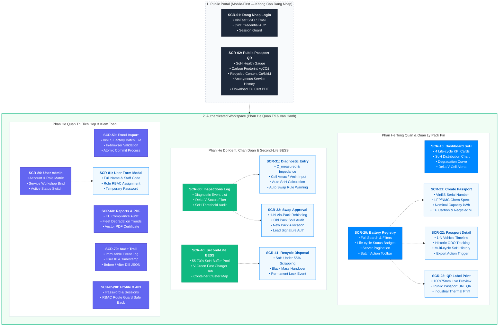

# Kiến Trúc Thông Tin & Phân Cấp Giao Diện (Information Architecture) — VSF

> **Dự án:** VSF — VinFast Battery Passport & Second-Life Platform  
> **Trạng thái:** TARGET V1  
> **Tiêu chuẩn:** Đáp ứng đầy đủ quy định Hộ chiếu Pin EU Battery Regulation (EU 2023/1542), quy trình vận hành xưởng VinFast & trạm tích điện đệm V-Green BESS.

---

## 1. Sơ Đồ Kiến Trúc Thông Tin & Thành Phần Màn Hình (Information Architecture Diagram)

Sơ đồ Mermaid thể hiện toàn diện 19 màn hình/modal của hệ thống, bao gồm cấu trúc phân hệ, các khối thông tin hiển thị bên trong và từng chức năng nghiệp vụ trọng tâm:



---

## 2. Sơ Đồ Cây Phân Cấp Màn Hình Dạng Text (Sitemap Tree)

Hệ thống được phân rã thành 2 phân vùng kiến trúc độc lập: **Public Portal** (Cổng tra cứu công khai không cần đăng nhập dành cho kiểm toán EU, khách hàng, tài xế) và **Authenticated Workspace** (Không gian làm việc bảo mật dành cho Quản trị viên VinFast HQ, Trưởng xưởng dịch vụ và Kỹ thuật viên).

```text
VSF — VinFast Battery Passport & Second-Life Platform
│
├── Public Portal (Không cần đăng nhập, thiết kế Mobile-First)
│   ├── /login                                    [SCR-01: Màn hình Đăng nhập 2 cột phong cách VinFast Electric]
│   └── /passport/:serialNumber                   [SCR-02: Cổng Tra Cứu Hộ Chiếu Pin Công Khai (Mobile QR)]
│       └── Action: Tải Giấy Chứng Nhận Pin PDF Chuẩn EU (EU Battery Passport Certificate)
│
└── Authenticated Workspace (Bảo mật JWT/RBAC, Sidebar + Topbar)
    ├── /dashboard                                [SCR-10: Dashboard Tổng Quan Giám Sát SoH & Cảnh Báo Pin]
    │   ├── KPI Cards (Tổng Pack, First-Life, Second-Life BESS, Cần Thay Thế)
    │   ├── Biểu đồ Phân Bố SoH & Suy Hao Chu Kỳ (Degradation Curve)
    │   └── Bảng Cảnh Báo Lỗi Cell Khẩn Cấp (Voltage Delta > 0.05V)
    │
    ├── /batteries                                [SCR-20: Sổ Quản Lý Pack Pin Toàn Hệ Thống (Battery Registry)]
    │   ├── Modal: Thêm Mới Pack Pin & Khởi Tạo Hộ Chiếu     [SCR-21]
    │   ├── Modal / Drawer: Chi Tiết Hộ Chiếu & Lịch Sử Xe 1-N [SCR-22]
    │   └── Modal: Cấu Hình & In Tem Nhãn Mã QR Pack Pin     [SCR-23]
    │
    ├── /inspections                              [SCR-30: Danh Mục Nhật Ký Đo Kiểm Dung Lượng & Sức Khỏe Cell]
    │   ├── Modal: Nhập Liệu Đo Kiểm & Tính Toán SoH Tự Động   [SCR-31]
    │   └── Modal: Phê Duyệt Lệnh Đổi Pin Mới (SoH < 70% / Cell Fault) [SCR-32]
    │
    ├── /second-life                              [SCR-40: Phân Hệ Điều Phối Pin Tái Sinh Trạm Sạc V-Green BESS]
    │   ├── Danh sách Pin Đạt Chuẩn Tái Sinh (55% <= SoH < 70%)
    │   ├── Bảng Điều Phối Cụm Container BESS Trạm Sạc
    │   └── Modal: Phê Duyệt Lệnh Thanh Lý & Tái Chế Đen (Black Mass) [SCR-41]
    │
    ├── /import                                   [SCR-50: Nhập Dữ Liệu Lô Pin Xuất Xưởng Từ Excel (VinES)]
    │   ├── Khu vực Kéo Thả File & Xem Trước Dữ Liệu (Preview Table)
    │   └── Tiến Trình Kiểm Tra & Thực Thi Nhập Liệu Nguyên Tử (Atomic Import)
    │
    ├── /reports                                  [SCR-60: Trung Tâm Báo Cáo & Xuất Chứng Nhận EU Battery Passport]
    │   ├── Bộ Lọc Báo Cáo Phân Tích Đa Chiều (Model xe, Thời gian, Xưởng)
    │   └── Trình Xem Trước & Xuất File PDF Đạt Tiêu Chuẩn In Ấn
    │
    ├── /audit                                    [SCR-70: Nhật Ký Kiểm Toán Toàn Hệ Thống (Audit Trail)]
    │   └── Bảng Lịch Sử Bất Biến (Truy vết Actor, Thời điểm, Thao tác, Dữ liệu Before/After)
    │
    ├── /users                                    [SCR-80: Quản Trị Tài Khoản Nhân Sự & Phân Xưởng Dịch Vụ]
    │   └── Modal: Thêm Mới / Cập Nhật Người Dùng & Phân Bổ Xưởng Công Tác [SCR-81]
    │
    ├── /profile                                  [SCR-85: Hồ Sơ Cá Nhân & Thiết Lập Bảo Mật]
    │   ├── Tab: Thông Tin Nhân Viên & Quyền Hạn
    │   └── Tab: Đổi Mật Khẩu & Phiên Đăng Nhập
    │
    └── /403                                      [SCR-90: Màn Hình Từ Chối Quyền Truy Cập (Forbidden)]
```

---

## 3. Sơ Đồ Điều Hướng Màn Hình (Screen Hierarchy Flow)

```mermaid
flowchart TB
    Login["SCR-01 Login (Public)"]
    PublicQR["SCR-02 Tra Cứu QR Mobile (Public)"]
    Shell["Authenticated Workspace Shell"]
    
    Login -->|Đăng nhập thành công| Shell
    PublicQR -->|Tải PDF| PDFExport["Xuất PDF Chứng Nhận EU"]
    
    Shell --> Dashboard["SCR-10 Dashboard SoH"]
    
    Shell --> Batteries["SCR-20 Sổ Pack Pin"]
    Batteries --> BattCreate["SCR-21 Tạo Hộ Chiếu Modal"]
    Batteries --> BattDetail["SCR-22 Chi Tiết Hộ Chiếu & Xe 1-N"]
    Batteries --> BattQR["SCR-23 In Tem QR Modal"]
    
    Shell --> Inspections["SCR-30 Đo Kiểm Dung Lượng"]
    Inspections --> InspCreate["SCR-31 Đo Kiểm SoH Modal"]
    Inspections --> SwapApprove["SCR-32 Duyệt Đổi Pin Modal"]
    
    Shell --> SecondLife["SCR-40 Điều Phối BESS"]
    SecondLife --> RecycleModal["SCR-41 Thanh Lý Tái Chế Modal"]
    
    Shell --> Import["SCR-50 Nhập Excel VinES"]
    Shell --> Reports["SCR-60 Báo Cáo & PDF EU"]
    Shell --> Audit["SCR-70 Nhật Ký Audit Log"]
    
    Shell --> Users["SCR-80 Quản Trị Nhân Sự"]
    Users --> UserModal["SCR-81 Tạo/Sửa User Modal"]
    
    Shell --> Profile["SCR-85 Hồ Sơ Cá Nhân"]
    Shell --> Forbidden["SCR-90 403 Forbidden"]

    classDef pub fill:#f8fafc,stroke:#94a3b8,color:#1e293b
    classDef authen fill:#0088ff,stroke:#0055b3,color:#fff
    classDef sub fill:#f0f9ff,stroke:#0088ff,color:#0055b3
    class Login,PublicQR pub
    class Shell,Dashboard,Batteries,Inspections,SecondLife,Import,Reports,Audit,Users,Profile,Forbidden authen
    class BattCreate,BattDetail,BattQR,InspCreate,SwapApprove,RecycleModal,UserModal,PDFExport sub
```



---

## 4. Danh Mục Màn Hình Toàn Hệ Thống (Screen Inventory)

| Mã Màn Hình | Tên Màn Hình | Dạng Trình Bày | URL Route | Tác Nhân Truy Cập (RBAC) | Ca Sử Dụng Liên Quan |
| :--- | :--- | :--- | :--- | :--- | :--- |
| **SCR-01** | Đăng Nhập Hệ Thống | Trang đơn (Public) | `#/login` | Tất cả | UC01, UC02 |
| **SCR-02** | Cổng Tra Cứu Hộ Chiếu Pin QR | Trang Mobile-First (Public) | `#/passport/:serialNumber` | Kiểm toán EU, Khách hàng, Public | UC06, UC13, UC14 |
| **SCR-10** | Dashboard Giám Sát SoH & Cảnh Báo | Trang chính Workspace | `#/dashboard` | Admin HQ, Station Lead, Kỹ thuật viên | UC03 |
| **SCR-20** | Sổ Quản Lý Pack Pin Hệ Thống | Trang dạng bảng dữ liệu | `#/batteries` | Admin HQ, Station Lead, Kỹ thuật viên | UC04 |
| **SCR-21** | Đăng Ký Pin & Khởi Tạo Hộ Chiếu | Hộp thoại Modal | `#/batteries/new` | Admin HQ | UC05 |
| **SCR-22** | Chi Tiết Hộ Chiếu & Lịch Sử Xe 1-N | Hộp thoại Drawer / Modal | `#/batteries/:id` | Admin HQ, Station Lead, Kỹ thuật viên | UC04, UC06 |
| **SCR-23** | Cấu Hình & In Tem Nhãn Mã QR | Hộp thoại Modal | `#/batteries/:id/qr` | Station Lead, Kỹ thuật viên | UC07 |
| **SCR-30** | Danh Mục Nhật Ký Đo Kiểm SoH | Trang dạng bảng dữ liệu | `#/inspections` | Admin HQ, Station Lead, Kỹ thuật viên | UC08 |
| **SCR-31** | Nhập Liệu Đo Dung Lượng & Lỗi Cell | Hộp thoại Modal | `#/inspections/new` | Station Lead, Kỹ thuật viên | UC08, UC09 |
| **SCR-32** | Phê Duyệt Lệnh Đổi Pin Mới Cho Xe | Hộp thoại Modal | `#/inspections/:id/swap` | Station Lead | UC09 |
| **SCR-40** | Điều Phối Tái Sinh Trạm Sạc BESS | Trang dạng thẻ trạm & bảng | `#/second-life` | Admin HQ, Station Lead | UC10 |
| **SCR-41** | Phê Duyệt Lệnh Thanh Lý & Tái Chế | Hộp thoại Modal | `#/second-life/recycle` | Admin HQ, Station Lead | UC11 |
| **SCR-50** | Nhập Lô Dữ Liệu Pin Từ Excel | Trang thao tác tải tệp | `#/import` | Admin HQ | UC12 |
| **SCR-60** | Trung Tâm Báo Cáo & Xuất PDF EU | Trang tương tác lọc & xem | `#/reports` | Admin HQ, Station Lead | UC14 |
| **SCR-70** | Nhật Ký Kiểm Toán (Audit Trail) | Trang dạng bảng bất biến | `#/audit` | Admin HQ, Station Lead | UC15 |
| **SCR-80** | Quản Trị Tài Khoản & Phân Xưởng | Trang dạng bảng dữ liệu | `#/users` | Admin HQ | UC16 |
| **SCR-81** | Tạo Mới / Sửa Người Dùng | Hộp thoại Modal | `#/users/form` | Admin HQ | UC16 |
| **SCR-85** | Hồ Sơ Cá Nhân & Bảo Mật | Trang dạng Tabs | `#/profile` | Tất cả người dùng nội bộ | UC01, UC16 |
| **SCR-90** | Từ Chối Truy Cập (403 Forbidden) | Trang thông báo lỗi | `#/403` | Tất cả | Cross-cutting RBAC |

---

## 5. Đặc Tả Chi Tiết Từng Màn Hình (Screen Components & Functions)

### 4.1 SCR-01: Màn Hình Đăng Nhập (Login)
- **Mục đích:** Xác thực danh tính người dùng nội bộ của VinFast (Kỹ thuật viên, Trưởng xưởng, Quản trị viên).
- **Thành phần hiển thị trên giao diện:**
  - Bố cục 2 cột (Split-screen) hiện đại: Cột trái hiển thị hình ảnh thương hiệu VinFast Electric Pack & khẩu hiệu bền vững; cột phải là Form đăng nhập tối giản.
  - Ô nhập: Tên đăng nhập / Email công vụ (`@vinfast.vn`), Mật khẩu (có nút ẩn/hiện mật khẩu).
  - Checkbox: "Ghi nhớ đăng nhập trên thiết bị này" (Remember session).
  - Nút bấm: "Đăng Nhập" (Primary Action) và nút chuyển chế độ SSO VinFast ID.
  - Vùng thông báo lỗi: Hiển thị lỗi tài khoản bị khóa, sai mật khẩu kèm mã lỗi.
- **Chức năng nghiệp vụ:**
  - Kiểm tra tính hợp lệ client (định dạng email, mật khẩu không được để trống).
  - Gửi yêu cầu xác thực tới API `/api/auth/login`.
  - Lưu trữ an toàn Bearer Access Token và Refresh Token, điều hướng người dùng trực tiếp vào `SCR-10 Dashboard`.

---

### 4.2 SCR-02: Cổng Tra Cứu Hộ Chiếu Pin Công Khai Trên Di Động (Mobile QR Passport Portal)
- **Mục đích:** Cung cấp thông tin minh bạch về hộ chiếu số quả pin cho tài xế, người mua xe cũ và thanh tra hải quan EU khi quét mã QR dán trên thân vỏ pack pin.
- **Thành phần hiển thị trên giao diện:**
  - Thiết kế Mobile-First tối ưu hiển thị trên trình duyệt điện thoại (iOS/Android).
  - **Header Chứng Nhận:** Logo VinFast, Huy hiệu xác thực "EU Battery Regulation Compliant", Mã Serial Number định danh dạng Barcode/QR.
  - **Thẻ Chỉ Số Sức Khỏe Pin:**
    - Dung lượng khả dụng đo kiểm gần nhất (kWh / Ah).
    - Tỷ lệ Sức Khỏe Pin SoH (Hiển thị thanh Gauge tròn trực quan: Xanh lá >80%, Vàng 70-80%, Cam 55-70%, Đỏ <55%).
    - Số chu kỳ nạp/xả tích lũy (Total Cycle Count).
  - **Thẻ Dấu Chân Carbon & Tuân Thủ Môi Trường:**
    - Tổng lượng phát thải vòng đời: `kg CO2 eq/kWh`.
    - Tỷ lệ vật liệu tái chế thu hồi: Tỷ lệ Niken (%), Coban (%), Liti (%) đạt ngưỡng luật định Châu Âu.
  - **Thẻ Thông Số Kỹ Thuật Gốc:**
    - Loại cell (LFP / NMC), Điện áp danh định (V), Khối lượng tịnh (kg), Nhà máy sản xuất (VinES Hải Phòng / Hà Tĩnh).
  - **Lịch Sử Đổi Pin & Bảo Dưỡng Công Khai:**
    - Danh sách các mốc thời gian kiểm định và thay thế (Toàn bộ thông tin cá nhân của chủ xe và số VIN được ẩn danh hóa theo tiêu chuẩn bảo mật dữ liệu GDPR).
  - **Nút Hành Động:** "Tải Chứng Nhận Kiểm Định PDF Đạt Chuẩn EU" (Nút cố định ở chân màn hình - Sticky Footer).
- **Chức năng nghiệp vụ:**
  - Truy vấn dữ liệu công khai theo Serial Number qua API không cần Token: `GET /api/public/passport/:serialNumber`.
  - Tải file PDF chính thức có chữ ký số và tem chứng thực số.

---

### 4.3 SCR-10: Dashboard Tổng Quan Giám Sát Sức Khỏe Pin (Overview Dashboard)
- **Mục đích:** Giúp Ban Quản trị HQ và Trưởng xưởng nắm bắt ngay lập tức tình trạng toàn bộ tài sản pin trên toàn mạng lưới.
- **Thành phần hiển thị trên giao diện:**
  - **Thanh Công Cụ Trên Cùng:** Bộ lọc chọn Xưởng dịch vụ (hoặc Toàn quốc), Khoảng thời gian (Hôm nay, 7 ngày, 30 ngày, Quý này), Nút làm mới dữ liệu tức thì.
  - **4 Khối Thẻ Thống Kê Chính (KPI Metric Cards):**
    1. *Tổng Pack Pin Đang Quản Lý:* Tổng số lượng, tăng giảm so với tháng trước.
    2. *Pack Pin Đạt Chuẩn First-Life (SoH >= 70%):* Tỷ lệ % và số lượng đang gắn trên xe thương mại.
    3. *Pack Pin Tái Sinh Second-Life BESS (55% <= SoH < 70%):* Số lượng đang phục vụ trạm sạc V-Green.
    4. *Pack Pin Cần Thu Hồi / Lỗi Khẩn Cấp:* Số lượng pack pin SoH < 70% hoặc có tế bào cell bị lệch áp cần triệu hồi đổi mới.
  - **Khung Biểu Đồ Trực Quan (Interactive Charts):**
    - *Biểu đồ 1 (Donut Chart):* Phân bổ trạng thái vòng đời (First-Life, Second-Life, Pending Inspection, Recycled).
    - *Biểu đồ 2 (Bar/Line Chart):* Xu hướng suy giảm SoH trung bình theo số km lăn bánh của từng dòng xe (VF e34, VF 8, VF 9).
  - **Bảng Cảnh Báo Sức Khỏe Cell Khẩn Cấp (Critical Battery Alerts Table):**
    - Liệt kê Top 10 Pack pin có độ lệch điện áp cell $Delta V > 0.05V$ hoặc nhiệt độ bất thường.
    - Cột dữ liệu: Serial Number, Xe đang gắn, Độ lệch cell áp, SoH, Xưởng phụ trách, Nút hành động nhanh ("Tạo Lệnh Kiểm Tra").
- **Chức năng nghiệp vụ:**
  - Gọi API thống kê tổng hợp: `GET /api/dashboard/metrics`.
  - Hỗ trợ xem chi tiết bằng cách click trực tiếp vào từng thành phần biểu đồ để chuyển sang danh sách đã lọc tương ứng.

---

### 4.4 SCR-20: Sổ Quản Lý Pack Pin Toàn Hệ Thống (Battery Registry)
- **Mục đích:** Danh mục quản trị cốt lõi theo dõi chi tiết từng quả pin từ khi xuất xưởng VinES cho tới khi tiêu hủy tái chế.
- **Thành phần hiển thị trên giao diện:**
  - **Thanh Điều Khiển & Bộ Lọc Nhanh:**
    - Ô tìm kiếm toàn văn: Tìm nhanh theo Serial Number, Hộ chiếu ID, hoặc Biển số xe / VIN đang gắn.
    - Bộ lọc Select: Trạng thái vòng đời (Mới sản xuất, Đang trên xe, Thu hồi kho, Đang ở trạm BESS, Đã thanh lý).
    - Bộ lọc Dải SoH: Khỏe mạnh (>=80%), Cần theo dõi (70-80%), Đủ điều kiện tái sinh (55-70%), Dưới chuẩn (<55%).
    - Bộ lọc Dòng xe tương thích: VF 5, VF 6, VF 7, VF 8, VF 9, VF e34.
  - **Bảng Dữ Liệu Trung Tâm (Data Table):**
    - Các cột: Mã Serial, Loại Cell, Dung Lượng Thiết Kế, SoH Hiện Tại, Chu Kỳ Sạc, Xe Đang Gắn (VIN), Xưởng Quản Lý, Ngày Cập Nhật Cuối, Trạng Thái Badge (Màu chuẩn hóa).
    - Cột Thao tác: Xem chi tiết (Eye Icon), In Tem QR (Printer Icon), Lịch sử xe (History Icon).
  - **Thanh Phân Trang & Đếm Bản Ghi:** Lựa chọn 10, 25, 50 bản ghi/trang.
  - **Cụm Nút Tác Vụ Chính (Primary Actions):**
    - Nút "Thêm Mới Pack Pin" (Chỉ Admin HQ thấy).
    - Nút "In Mã QR Hàng Loạt".
    - Nút "Xuất Danh Sách Excel".
- **Chức năng nghiệp vụ:**
  - Phân trang, tìm kiếm, sắp xếp đa cột từ phía máy chủ: `GET /api/batteries`.
  - Mở các modal xử lý tương ứng (`SCR-21`, `SCR-22`, `SCR-23`).

---

### 4.5 SCR-21: Modal Đăng Ký Pin & Khởi Tạo Hộ Chiếu Số (Create Battery Passport)
- **Mục đích:** Nhập thủ công từng pack pin mới xuất xưởng từ VinES vào hệ thống.
- **Thành phần hiển thị trên giao diện:**
  - Tiêu đề modal: "Khởi Tạo Hộ Chiếu Số Cho Pack Pin Mới".
  - **Nhóm Thông Tin Định Danh:**
    - Mã Serial Number (Bắt buộc, quét barcode hoặc gõ tay, định dạng chuẩn `VF-BAT-XXXXXXXX`).
    - Nhà máy chế tạo (Dropdown: VinES Hải Phòng, VinES Hà Tĩnh).
    - Ngày sản xuất xuất xưởng (Datepicker).
  - **Nhóm Thông Số Kỹ Thuật Điện Hóa:**
    - Dòng xe tương thích (VF 8 / VF 9 / VF e34,...).
    - Loại hóa học cell (Dropdown: LFP - Lithium Iron Phosphate, NMC - Nickel Manganese Cobalt).
    - Dung lượng danh định ($C_{	ext{nominal}}$ tính bằng kWh).
    - Điện áp định danh (V), Khối lượng pack (kg).
  - **Nhóm Chỉ Số Môi Trường EU Regulation:**
    - Dấu chân Carbon (`kg CO2 eq/kWh`).
    - Tỷ lệ vật liệu tái chế: % Coban, % Liti, % Niken tái chế.
  - Nút bấm: "Hủy bỏ" và "Xác Nhận Khởi Tạo Hộ Chiếu" (Có spinner khi đang lưu).
- **Chức năng nghiệp vụ:**
  - Client Validation: Kiểm tra trùng Serial, kiểm tra các giá trị kỹ thuật không âm.
  - Gọi API tạo mới: `POST /api/batteries`, tự động sinh mã Hộ chiếu số và mã hash bất biến.

---

### 4.6 SCR-22: Modal / Drawer Chi Tiết Hộ Chiếu & Lịch Sử Xe 1-N (Battery Detail & History)
- **Mục đích:** Cung cấp góc nhìn 360 độ về toàn bộ lịch sử sử dụng, hoán đổi xe và sức khỏe của 1 quả pin cụ thể.
- **Thành phần hiển thị trên giao diện:**
  - Hiển thị dạng Drawer trượt từ cạnh phải hoặc Modal toàn màn hình.
  - **Thẻ Tóm Tắt Đầu Trang:** Serial Number lớn, Trạng thái Badge, SoH hiện tại, Nút in nhanh tem QR, Nút xuất PDF.
  - **3 Tab Nội Dung Chi Tiết:**
    1. *Tab 1: Thông Số Hộ Chiếu & Thuộc Tính Kỹ Thuật:* Hiển thị toàn bộ thông số xuất xưởng, thành phần nguyên liệu, tiêu chuẩn an toàn UN 38.3.
    2. *Tab 2: Lịch Sử Gắn Xe 1-N (Vehicle Binding Timeline):*
       - Hiển thị dạng Timeline trực quan ghi nhận tất cả các xe từng sử dụng pack pin này.
       - Mỗi mốc gồm: Số VIN, Biển số xe, Ngày lắp vào, Ngày tháo ra, ODO xe tại thời điểm tháo, Lý do hoán đổi, Kỹ thuật viên thực hiện.
       - Đánh dấu rõ ràng chiếc xe hiện tại đang sở hữu quả pin.
    3. *Tab 3: Lịch Sử Đo Kiểm Định Kỳ:*
       - Biểu đồ đường biến thiên dung lượng thực đo qua các mốc thời gian.
       - Bảng danh sách các đợt kiểm định: Ngày đo, Người đo, Dung lượng thực, SoH, Độ lệch cell áp.
- **Chức năng nghiệp vụ:**
  - Gọi API chi tiết: `GET /api/batteries/:id` và `GET /api/batteries/:id/vehicle-history`.

---

### 4.7 SCR-23: Modal Cấu Hình & In Tem Nhãn Mã QR (QR Label Generator)
- **Mục đích:** Tạo và xuất tem nhãn mã QR vật lý dán lên vỏ quả pin tại xưởng dịch vụ hoặc nhà máy.
- **Thành phần hiển thị trên giao diện:**
  - Khung xem trước trực tiếp (Live Label Preview) tỷ lệ thực:
    - Logo VinFast chính hãng.
    - Tiêu đề: "VINFAST OFFICIAL BATTERY PASSPORT".
    - Mã QR chuẩn xác trỏ đến URL công khai `https://passport.vinfast.vn/passport/:serialNumber`.
    - Thông tin in trên tem: Serial Number, Loại Cell, Dung lượng định danh, Ngày kích hoạt.
  - Cấu hình khổ in: Chọn khổ tem nhiệt (Khổ chuẩn công nghiệp: 100mm x 75mm, hoặc 80mm x 50mm).
  - Tùy chọn máy in: Máy in mã vạch chuyên dụng tại xưởng hoặc xuất file PDF/SVG vector.
  - Nút bấm: "Gửi Lệnh In Trực Tiếp" và "Tải File Tem In".
- **Chức năng nghiệp vụ:**
  - Sinh mã QR vector SVG độ phân giải cao; kích hoạt cửa sổ in native của trình duyệt hoặc gửi lệnh tới máy in tem nhiệt ESC/POS.

---

### 4.8 SCR-30: Danh Mục Nhật Ký Đo Kiểm Dung Lượng & Sức Khỏe Cell (Inspections List)
- **Mục đích:** Quản lý toàn bộ hồ sơ đo đạc kỹ thuật tại các xưởng bảo dưỡng định kỳ trên toàn quốc.
- **Thành phần hiển thị trên giao diện:**
  - Bộ lọc: Lọc theo khoảng ngày kiểm định, theo Xưởng dịch vụ, theo Kỹ thuật viên phụ trách, và theo Kết luận kiểm định (Đạt chuẩn / Lỗi Cell / Cần đổi pin).
  - Bảng danh sách kết quả đo đạc:
    - Mã kiểm định, Mã Serial Pin, Xe kiểm tra (VIN), Ngày đo, Dung lượng đo ($C_{	ext{measured}}$), SoH tính toán (%), Độ lệch áp cell max ($Delta V$), Trạng thái cell (Bình thường / Báo động), Kỹ thuật viên.
    - Cột kết luận: Badge xanh "Đủ điều kiện First-Life", Badge cam "Cần điều phối BESS", Badge đỏ "Lỗi Cell khẩn cấp".
  - Nút tác vụ chính: "Tạo Đợt Đo Kiểm Mới" (Mở modal `SCR-31`).
- **Chức năng nghiệp vụ:**
  - Truy vấn danh sách nhật ký đo kiểm phân trang: `GET /api/inspections`.

---

### 4.9 SCR-31: Modal Thực Hiện Đo Kiểm & Đánh Giá SoH (Diagnostic Entry Modal)
- **Mục đích:** Kỹ thuật viên nhập các thông số vật lý thực tế sau khi cắm máy chẩn đoán vào pack pin.
- **Thành phần hiển thị trên giao diện:**
  - Chọn Pack Pin cần kiểm tra (Dropdown tìm kiếm theo Serial hoặc quét mã QR từ máy quét).
  - Tự động hiển thị Dung lượng danh định gốc ($C_{	ext{nominal}}$) để đối chiếu.
  - **Form Nhập Liệu Đo Đạc Thực Tế:**
    - Dung lượng đo thực tế ($C_{	ext{measured}}$ - đơn vị $Ah$ hoặc $kWh$).
    - Nội trở tổng thể pack pin ($mOmega$).
    - Điện áp cell cao nhất ($V_{	ext{max}}$) và thấp nhất ($V_{	ext{min}}$).
    - Số chu kỳ sạc đo được từ BMS (Cycle count).
    - Nhiệt độ pack pin tại thời điểm đo ($^circ C$).
  - **Hộp Tính Toán & Đánh Giá Tự Động (Real-time Evaluation Card):**
    - Tự động hiển thị ngay lập tức: $	ext{SoH} = (C_{	ext{measured}} / C_{	ext{nominal}}) 	imes 100%$.
    - Tự động tính độ lệch áp: $Delta V = V_{	ext{max}} - V_{	ext{min}}$.
    - **Hệ Thống Cảnh Báo Quy Tắc Nghiệp Vụ:**
      - *Nếu SoH >= 70% và $Delta V le 0.05V$:* Thông báo xanh "Pin đạt chuẩn tiếp tục sử dụng trên xe".
      - *Nếu SoH < 70% HOẶC $Delta V > 0.05V$:* Hiển thị cảnh báo đỏ nổi bật "Pin không đạt chuẩn First-Life! Cần kích hoạt quy trình đổi pin mới cho khách hàng".
  - Nút bấm: "Lưu Kết Quả Kiểm Định" và nút "Lưu & Mở Lệnh Đổi Pin Ngay".
- **Chức năng nghiệp vụ:**
  - Kiểm tra điều kiện đầu vào, gửi dữ liệu đo kiểm qua API: `POST /api/inspections`.
  - Tự động chuyển trạng thái pack pin sang `UNDER_INSPECTION` hoặc `DEGRADED`.

---

### 4.10 SCR-32: Modal Phê Duyệt Lệnh Đổi Pin Mới (Battery Swap Approval)
- **Mục đích:** Trưởng xưởng dịch vụ phê duyệt thay thế pack pin mới cho khách hàng khi pin cũ bị chai dưới 70% hoặc có lỗi cell nghiêm trọng.
- **Thành phần hiển thị trên giao diện:**
  - **Thông Tin Xe Được Đổi Pin:** Biển số, Số VIN, ODO hiện tại, Tên khách hàng.
  - **Thông Tin Pack Pin Cũ Bị Tháo:**
    - Mã Serial, SoH đo được, Lý do thu hồi (Chai dung lượng / Lỗi lệch áp cell nguy hiểm).
  - **Lựa Chọn Pack Pin Mới Thay Thế:**
    - Dropdown danh sách các pack pin mới 100% (SoH = 100%) hoặc pin chuẩn dự phòng đang có sẵn trong kho của xưởng.
  - **Xác Nhận Điều Phối Pin Cũ:**
    - Lựa chọn hướng xử lý pin cũ: Đưa vào kho Second-Life trạm sạc BESS (nếu $55% le 	ext{SoH} < 70%$) hoặc chuyển bãi chờ thanh lý tái chế (nếu $	ext{SoH} < 55%$).
  - Chữ ký số / Mã PIN xác thực của Trưởng Xưởng Dịch Vụ.
  - Nút bấm: "Từ Chối Yêu Cầu" và "Phê Duyệt Đổi Pin & Cập Nhật Hồ Sơ Xe".
- **Chức năng nghiệp vụ:**
  - Thực thi giao dịch nguyên tử hoán đổi quan hệ 1-N: Gỡ Pack pin cũ khỏi VIN xe, cập nhật trạng thái pin cũ sang `RETIRED_FROM_VEHICLE` hoặc `SECOND_LIFE_BESS`, gán Pack pin mới vào VIN xe, ghi nhận lịch sử vào Timeline.
  - Gọi API: `POST /api/inspections/:id/approve-swap`.

---

### 4.11 SCR-40: Phân Hệ Điều Phối Pin Tái Sinh Trạm Sạc V-Green BESS (Second-Life BESS)
- **Mục đích:** Tối ưu hóa giá trị tài nguyên, điều phối các pack pin còn 55-70% dung lượng vào làm nguồn lưu trữ điện đệm tại các trạm sạc siêu nhanh của V-Green.
- **Thành phần hiển thị trên giao diện:**
  - **Tab 1: Kho Pin Chờ Tái Sinh (Available BESS Pool):**
    - Danh sách các pack pin đã thu hồi từ xe điện có $55% le 	ext{SoH} < 70%$ và tế bào cell lành lặn.
    - Nút thao tác: "Gán Vào Trạm BESS".
  - **Tab 2: Bản Đồ & Danh Sách Cụm Trạm Sạc V-Green (BESS Station Clusters):**
    - Danh sách các trạm sạc: Tên trạm (Trạm Sạc Cao Tốc Pháp Vân, Trạm Sạc Vincom Mega Mall,...), Dung lượng lưu trữ đệm hiện tại (kWh), Số lượng pack pin đang ghép nối trong cụm container BESS.
    - Nút thao tác: "Xem Cấu Trúc Cụm Pin", "Rút Pin Hết Tuổi Thọ Để Tái Chế".
- **Chức năng nghiệp vụ:**
  - Gọi API điều phối: `POST /api/second-life/allocate` để liên kết Pack Serial vào Module BESS ID.

---

### 4.12 SCR-41: Modal Phê Duyệt Lệnh Thanh Lý & Tái Chế Đen (Recycling & Disposal)
- **Mục đích:** Xử lý cuối vòng đời đối với các pack pin có SoH < 55% hoặc hư hỏng cơ học không thể tái sử dụng, chuyển giao đối tác thu hồi Black Mass.
- **Thành phần hiển thị trên giao diện:**
  - Danh sách các pack pin được chọn để thanh lý.
  - Chọn Đơn vị đối tác tái chế được cấp phép (Đối tác luyện kim tái chế pin chuẩn Châu Âu / Việt Nam).
  - Nhập Mã biên bản bàn giao & Ngày chuyển giao.
  - Upload tệp Giấy chứng nhận tiếp nhận xử lý an toàn môi trường.
  - Nút bấm: "Xác Nhận Thanh Lý & Đóng Hộ Chiếu Vĩnh Viễn".
- **Chức năng nghiệp vụ:**
  - Cập nhật trạng thái vòng đời sang `RECYCLED`. Khóa vĩnh viễn không cho phép gắn lại vào xe hay trạm sạc.
  - Ghi nhận tỷ lệ thu hồi kim loại quý (Co, Ni, Li) vào báo cáo ESG.

---

### 4.13 SCR-50: Nhập Lô Dữ Liệu Pin Xuất Xưởng Từ Excel (Batch Excel Import)
- **Mục đích:** Cho phép Quản trị viên nhập danh sách hàng trăm pack pin mới xuất xưởng từ VinES cùng lúc.
- **Thành phần hiển thị trên giao diện:**
  - Khu vực kéo thả tệp hỗ trợ định dạng `.xlsx`, `.xls` (kèm link tải tệp mẫu chuẩn `VinFast_Battery_Import_Template.xlsx`).
  - **Bảng Xem Trước Dữ Liệu (Preview Table):**
    - Hiển thị danh sách các dòng dữ liệu đọc được từ file.
    - Cột trạng thái kiểm tra (Validation): Icon xanh (Hợp lệ), Icon đỏ (Lỗi định dạng, trùng Serial, thiếu thông số).
    - Thông báo tổng quan: "Tìm thấy 150 dòng: 148 hợp lệ, 2 dòng bị lỗi".
  - Nút bấm: "Hủy bỏ" và "Tiến Hành Nhập 148 Bản Ghi Hợp Lệ".
  - Thanh tiến trình thực thi (Progress Bar) hiển thị tỷ lệ % nhập liệu.
- **Chức năng nghiệp vụ:**
  - Phân tích file tại client, gửi dữ liệu lên endpoint kiểm tra: `POST /api/batteries/import/preview`.
  - Thực thi nhập giao dịch nguyên tử: `POST /api/batteries/import/commit`.

---

### 4.14 SCR-60: Trung Tâm Báo Cáo & Xuất Chứng Nhận EU Battery Passport (Reports & Export)
- **Mục đích:** Cung cấp công cụ phân tích và xuất hồ sơ báo cáo phục vụ kiểm toán độc lập và cơ quan quản lý năng lượng EU.
- **Thành phần hiển thị trên giao diện:**
  - Bộ lọc báo cáo: Khoảng thời gian, Xưởng dịch vụ, Loại pin, Dòng xe, Trạng thái sức khỏe SoH.
  - **Các Mẫu Báo Cáo Có Sẵn:**
    1. *Báo cáo Đánh giá Tuân thủ Quy định Pin EU (EU Compliance Report).*
    2. *Báo cáo Thống kê Tỷ lệ Đổi Pin Mới & Nguyên Nhân Hỏng Cell.*
    3. *Báo cáo Hiệu quả Thu hồi Kim loại Quý & Tái sinh Second-Life BESS.*
  - Khung xem trước báo cáo thời gian thực.
  - Nút hành động: "Tải Bản Excel Tổng Hợp" và "Xuất Giấy Chứng Nhận PDF Chuẩn EU".
- **Chức năng nghiệp vụ:**
  - Tổng hợp dữ liệu động từ API: `GET /api/reports/analytics`.
  - Xuất báo cáo định dạng PDF/Excel vector chất lượng cao.

---

### 4.15 SCR-70: Nhật Ký Kiểm Toán Toàn Hệ Thống (Audit Trail)
- **Mục đích:** Lưu trữ dấu vết bảo mật bất biến theo yêu cầu của Luật Dữ Liệu & Quy chế Kiểm toán EU.
- **Thành phần hiển thị trên giao diện:**
  - Bộ lọc tìm kiếm theo: Tác nhân (Tên/Email User), Loại hành động (Đăng nhập, Tạo hộ chiếu, Cập nhật SoH, Đổi pin, Điều phối BESS, Xóa), Thời gian, và Serial/VIN liên quan.
  - Bảng danh sách Audit Log (Chỉ đọc, không cho phép sửa/xóa):
    - Thời điểm (Timestamp chuẩn ISO 8601), Tác nhân, Vai trò, Địa chỉ IP, Hành động thực hiện, Mã thực thể bị ảnh hưởng.
    - Nút "Xem Chi Tiết": Mở modal hiển thị dạng Diff JSON (Dữ liệu cũ trước khi đổi vs Dữ liệu mới sau khi đổi).
- **Chức năng nghiệp vụ:**
  - Truy vấn dữ liệu audit bất biến phân trang: `GET /api/audit-logs`.

---

### 4.16 SCR-80: Quản Trị Tài Khoản Nhân Sự & Phân Xưởng Dịch Vụ (User Management)
- **Mục đích:** Quản lý tài khoản cán bộ nhân viên VinFast trên toàn cầu và phân bổ xưởng dịch vụ trực thuộc.
- **Thành phần hiển thị trên giao diện:**
  - Bộ lọc tìm kiếm theo Tên, Email, Vai trò (Admin, Trưởng xưởng, KTV), và Xưởng dịch vụ trực thuộc.
  - Bảng danh sách người dùng:
    - Họ và tên, Email công vụ, Vai trò, Xưởng dịch vụ công tác, Trạng thái (Đang hoạt động / Đang khóa), Lần đăng nhập cuối.
    - Cột thao tác: Chỉnh sửa thông tin, Đổi mật khẩu khẩn cấp, Khóa/Mở khóa tài khoản.
  - Nút bấm: "Thêm Mới Người Dùng" (Mở modal `SCR-81`).
- **Chức năng nghiệp vụ:**
  - Gọi API quản lý user: `GET /api/users`, `POST /api/users`, `PUT /api/users/:id/status`.

---

### 4.17 SCR-81: Modal Thêm Mới / Cập Nhật Người Dùng (User Form Modal)
- **Mục đích:** Tạo mới hoặc cập nhật thông tin và quyền hạn của một nhân sự trong hệ thống.
- **Thành phần hiển thị trên giao diện:**
  - Ô nhập: Họ tên, Email `@vinfast.vn`, Số điện thoại, Mã nhân viên VinFast.
  - Dropdown phân quyền: Quản trị viên VinFast HQ, Trưởng xưởng dịch vụ, Kỹ thuật viên đo kiểm.
  - Dropdown gán Xưởng dịch vụ phụ trách (Ví dụ: VinFast Center Landmark 81, VinFast Long Biên,...).
  - Mật khẩu khởi tạo tạm thời.
  - Nút bấm: "Hủy bỏ" và "Lưu Thông Tin Tài Khoản".
- **Chức năng nghiệp vụ:**
  - Xác thực định dạng email công vụ, gửi yêu cầu tạo/sửa tới `POST /api/users` hoặc `PUT /api/users/:id`.

---

### 4.18 SCR-85: Hồ Sơ Cá Nhân & Thiết Lập Bảo Mật (Personal Profile)
- **Mục đích:** Cung cấp không gian cho từng nhân sự quản lý thông tin tài khoản cá nhân của chính mình.
- **Thành phần hiển thị trên giao diện:**
  - **Tab 1: Thông Tin Tài Khoản:** Hiển thị Tên, Email, Vai trò, Tên xưởng dịch vụ công tác (Chỉ đọc các trường do Admin quản lý).
  - **Tab 2: Bảo Mật & Mật Khẩu:**
    - Form đổi mật khẩu: Nhập mật khẩu hiện tại, Mật khẩu mới, Xác nhận mật khẩu mới.
    - Danh sách các thiết bị / phiên làm việc đang đăng nhập (Active Sessions) kèm nút "Đăng xuất khỏi tất cả thiết bị khác".
- **Chức năng nghiệp vụ:**
  - Gọi API: `GET /api/profile`, `PUT /api/profile/password`.

---

### 4.19 SCR-90: Màn Hình Từ Chối Quyền Truy Cập (403 Forbidden)
- **Mục đích:** Xử lý an toàn khi người dùng cố tình truy cập các đường dẫn vượt thẩm quyền phân quyền RBAC.
- **Thành phần hiển thị trên giao diện:**
  - Minh họa đồ họa cảnh báo bảo mật.
  - Thông báo: "403 — Bạn không có quyền truy cập khu vực này!".
  - Giải thích rõ ràng vai trò hiện tại của người dùng và quyền hạn cần có.
  - Nút bấm hành động: "Quay Về Trang Dashboard An Toàn".
- **Chức năng nghiệp vụ:**
  - Chặn đứng mọi tương tác nguy hiểm tại router guard, không để lộ thông tin bảo mật của xưởng hoặc hệ thống.

---

## 6. Hợp Đồng Trạng Thái Giao Diện Chuẩn Hóa (UI/UX State Contract)

Mọi màn hình và thành phần giao diện trong hệ thống VSF đều bắt buộc phải tuân thủ nghiêm ngặt 8 trạng thái chuẩn hóa sau:

| Trạng Thái (State) | Yêu Cầu Hành Vi Giao Diện & Trải Nghiệm Người Dùng (UX Contract) |
| :--- | :--- |
| **1. Initial Loading** | Giữ nguyên khung sườn trang (Shell); hiển thị hiệu ứng Skeleton Loader mượt mà cho bảng dữ liệu hoặc thẻ thống kê; tuyệt đối không để màn hình trắng hoặc giật layout. |
| **2. Empty State** | Hiển thị hình ảnh minh họa tối giản kèm thông điệp rõ ràng giải thích chưa có dữ liệu; phân biệt rõ giữa trường hợp "Dữ liệu trống hoàn toàn" và "Không tìm thấy kết quả phù hợp với bộ lọc"; luôn hiển thị nút gợi ý hành động chính (ví dụ: "Thêm Mới Pack Pin"). |
| **3. Validation Error** | Giữ nguyên toàn bộ dữ liệu người dùng đã gõ; bôi viền đỏ ô nhập liệu; hiển thị thông báo lỗi cụ thể bên dưới trường vi phạm; tự động cuộn và focus con trỏ vào trường lỗi đầu tiên. |
| **4. API Error** | Hiển thị Banner cảnh báo màu đỏ hoặc Toast Notification chứa thông điệp lỗi nghiệp vụ thân thiện; kèm theo mã tham chiếu `traceId` (theo chuẩn RFC 7807 Problem Details); tuyệt đối không để lộ mã nguồn hay lỗi máy chủ thô ra giao diện. |
| **5. Unauthorized (401)** | Hủy bỏ Token không hợp lệ trong bộ nhớ; lưu vết URL hiện tại để chuyển hướng lại sau khi đăng nhập; đưa người dùng về màn hình `SCR-01 Login`. |
| **6. Forbidden (403)** | Giữ nguyên phiên đăng nhập; điều hướng người dùng tới màn hình `SCR-90 Forbidden` kèm nút điều hướng quay về Dashboard an toàn. |
| **7. Saving / Processing** | Vô hiệu hóa nút bấm chính để ngăn chặn click đúp (Duplicate Submission); hiển thị biểu tượng quay vòng (Spinner) và nhãn đang xử lý ("Đang lưu...", "Đang khởi tạo hộ chiếu..."). Không khóa màn hình nếu không có nguy cơ mất dữ liệu. |
| **8. Success Feedback** | Hiển thị Toast thông báo màu xanh thành công tự động ẩn sau 3 giây; tự động đóng modal khi thao tác hoàn tất; kích hoạt nạp lại dữ liệu (Re-fetch Query) của bảng danh sách liên quan. |

---

## 7. Sơ Đồ Luồng Thao Tác Điển Hình (Primary Task Flows)

```mermaid
flowchart LR
    Start["Truy Cập Danh Sách"] --> Filter["Lọc / Tìm Kiếm Dữ Liệu"]
    Filter --> Detail["Mở Drawer Chi Tiết"]
    
    Start --> Action["Mở Modal Thêm / Đo Kiểm / Đổi Pin"]
    Action --> ClientVal["Kiểm Tra Hợp Lệ Client"]
    ClientVal -->|Hợp lệ| APIVal["Gửi Request Tới API Backend"]
    ClientVal -->|Sai sót| Action
    
    APIVal -->|Thành công (200/201)| Success["Hiển Thị Toast Thành Công & Làm Mới Bảng"]
    APIVal -->|Lỗi nghiệp vụ (400/422)| Action
    APIVal -->|Hết phiên (401)| Login["Chuyển Hướng Về SCR-01 Login"]
    APIVal -->|Không đủ quyền (403)| Forbidden["Chuyển Hướng Về SCR-90 Forbidden"]
```
