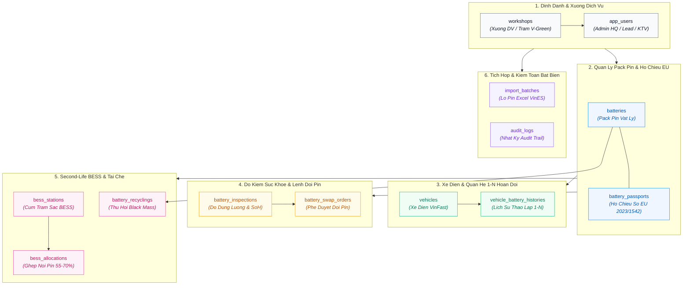
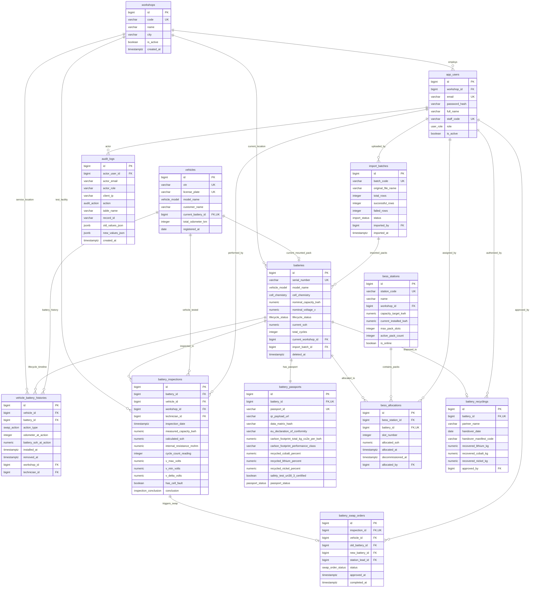
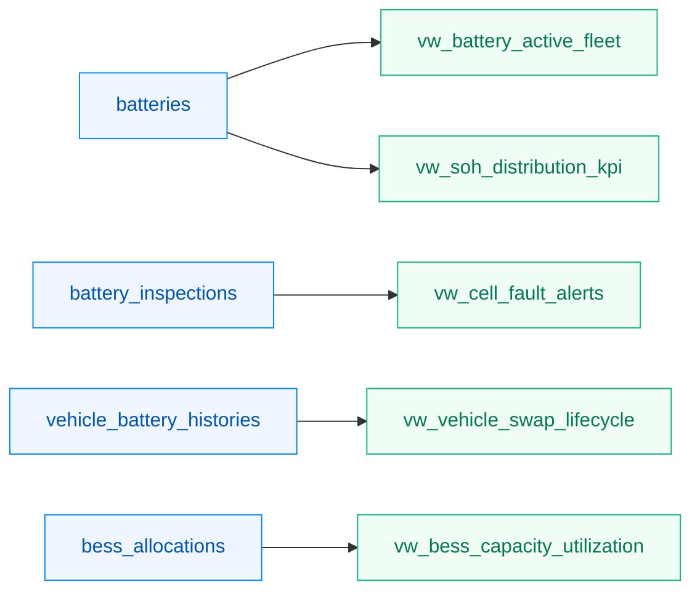

# Sơ Đồ Cơ Sở Dữ Liệu & Thực Thể Liên Kết (Data Diagram & ERD) — VSF

> **Dự án:** VSF — VinFast Battery Passport & Second-Life Platform  
> **Hệ quản trị CSDL:** PostgreSQL 16 (Schema: `vsf_core`)  
> **Trạng thái:** TARGET V1  
> **Mã nguồn thiết kế:** [schema.dbml](../src/database/schema.dbml) · [05-data-model.md](05-data-model.md)

---

## 1. Sơ Đồ Phân Nhóm Thực Thể (High-Level Entity Groups)

Sơ đồ phân rã 13 bảng thực thể thành 6 phân hệ cốt lõi: Phân hệ Định danh & Xưởng, Phân hệ Pack Pin & Hộ Chiếu EU, Phân hệ Xe Điện & Lịch sử 1-N, Phân hệ Đo Kiểm & Đổi Pin, Phân hệ Tái Sinh BESS & Tái Chế, và Phân hệ Quản Trị & Kiểm Toán.



---

## 2. Sơ Đồ Thực Thể Liên Kết Chi Tiết (Detailed ER Diagram)



---

## 3. Danh Mục Các Kiểu Liệt Kê (Enums Dictionary)

| Tên Enum | Giá Trị Hợp Lệ | Mô Tả & Vị Trí Sử Dụng Trong Nghiệp Vụ |
| :--- | :--- | :--- |
| `user_role` | `ADMIN_HQ`, `STATION_LEAD`, `TECHNICIAN`, `AUDITOR_PUBLIC` | Phân quyền RBAC nội bộ VinFast và kiểm toán độc lập |
| `vehicle_model` | `VF3`, `VF5`, `VF6`, `VF7`, `VF8`, `VF9`, `VFe34` | Dòng xe điện VinFast thương mại tương thích |
| `cell_chemistry` | `LFP`, `NMC` | Hóa học tế bào pin (Lithium Iron Phosphate / Nickel Manganese Cobalt) |
| `lifecycle_status`| `NEW_MANUFACTURED`, `FIRST_LIFE_VEHICLE`, `RECALL_PENDING`, `RETIRED_FROM_VEHICLE`, `SECOND_LIFE_BESS`, `RECYCLED` | 6 nấc trạng thái vòng đời quả pin |
| `passport_status` | `ACTIVE`, `SUSPENDED`, `EXPIRED_RECYCLED` | Trạng thái chứng nhận Hộ chiếu pin EU 2023/1542 |
| `swap_action` | `INITIAL_INSTALL`, `MAINTENANCE_SWAP`, `WARRANTY_REPLACEMENT`, `RETIRE_TO_BESS` | Hành động ghi nhận lịch sử tháo/lắp quan hệ 1-N |
| `inspection_conclusion` | `PASS_FIRST_LIFE`, `FAIL_DEGRADED_SOH`, `FAIL_CELL_VOLTAGE_FAULT`, `SCHEDULE_SWAP` | Kết luận tự động từ thuật toán đo kiểm SoH và $\Delta V$ |
| `swap_order_status` | `PENDING_LEAD_APPROVAL`, `APPROVED`, `REJECTED`, `COMPLETED` | Luồng phê duyệt lệnh đổi pin mới của Trưởng Xưởng |
| `import_status` | `PENDING`, `VALIDATING`, `COMPLETED`, `FAILED` | Trạng thái tiến trình import Excel lô pin từ VinES |
| `audit_action` | `CREATE`, `UPDATE`, `SOFT_DELETE`, `SWAP_BATTERY`, `ALLOCATE_BESS`, `RECYCLE_DISPOSAL`, `EXPORT_PDF`, `IMPORT_EXCEL`, `LOGIN` | Danh mục hành động ghi vết kiểm toán bất biến |

---

## 4. Báo Cáo Phân Tích Thông Qua SQL Views

Hệ thống không lưu trữ các bảng thống kê cứng mà tính toán động thông qua các PostgreSQL Materialized Views / Standard Views để đảm bảo tính thời gian thực:



1. `vw_battery_active_fleet`: Danh sách pack pin đang hoạt động thực tế trên xe điện thương mại.
2. `vw_soh_distribution_kpi`: Tỷ lệ % phân bổ sức khỏe pin theo 4 dải ($ge 80%$, $70-80%$, $55-70%$, $<55%$).
3. `vw_cell_fault_alerts`: Danh sách khẩn cấp các pack pin có độ lệch điện áp cell $\Delta V > 0.05V$.
4. `vw_vehicle_swap_lifecycle`: Tổng hợp vòng đời xe điện và số lần thay đổi pack pin theo km lăn bánh.
5. `vw_bess_capacity_utilization`: Thống kê tổng công suất đệm tích điện đang lưu trữ tại các trạm sạc V-Green BESS.

---

## 5. Chiến Lược Đánh Chỉ Mục & Tối Ưu Hóa Truy Vấn (Indexing Strategy)

Để đảm bảo hiệu năng quét mã QR trên di động và tìm kiếm tại xưởng dịch vụ đạt chuẩn **dưới 50ms**:

```sql
-- 1. Index tra cứu nhanh Hộ chiếu công khai qua mã Serial Number (< 50ms)
CREATE UNIQUE INDEX idx_batteries_serial_number ON batteries (serial_number) WHERE deleted_at IS NULL;
CREATE UNIQUE INDEX idx_battery_passports_passport_id ON battery_passports (passport_id);
CREATE UNIQUE INDEX idx_battery_passports_battery_id ON battery_passports (battery_id);

-- 2. Index quản lý xe và số VIN 17 ký tự
CREATE UNIQUE INDEX idx_vehicles_vin ON vehicles (vin);
CREATE UNIQUE INDEX idx_vehicles_current_battery ON vehicles (current_battery_id) WHERE current_battery_id IS NOT NULL;

-- 3. Composite Index truy vấn lịch sử 1-N xe & pin theo thời gian
CREATE INDEX idx_vbh_vehicle_installed ON vehicle_battery_histories (vehicle_id, installed_at DESC);
CREATE INDEX idx_vbh_battery_installed ON vehicle_battery_histories (battery_id, installed_at DESC);

-- 4. Index phát hiện nhanh cảnh báo lệch áp cell khẩn cấp và SoH dưới ngưỡng
CREATE INDEX idx_inspections_cell_fault ON battery_inspections (has_cell_fault, inspection_date DESC) WHERE has_cell_fault = true;
CREATE INDEX idx_batteries_soh_status ON batteries (lifecycle_status, current_soh);

-- 5. Index tìm kiếm Audit Trail theo Actor và thời gian
CREATE INDEX idx_audit_logs_actor_time ON audit_logs (actor_user_id, created_at DESC);
CREATE INDEX idx_audit_logs_table_record ON audit_logs (table_name, record_id, created_at DESC);
```
