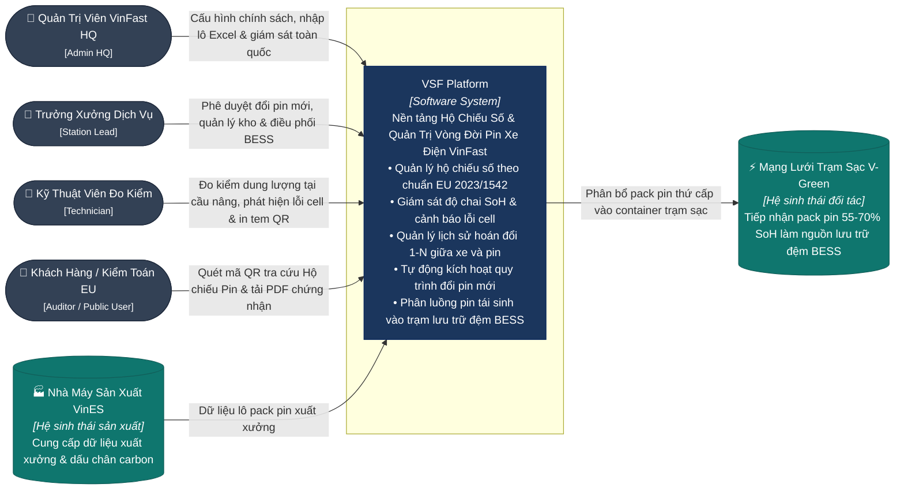

# C1 — System Context (Ngữ Cảnh Hệ Thống) — VSF

> **Mục đích:** Thể hiện rõ ràng những ai sử dụng hệ thống VSF, hệ thống chịu trách nhiệm cho các năng lực gì và tương tác với các hệ sinh thái bên ngoài nào mà không đi sâu vào chi tiết công nghệ.

---

## 1. Sơ Đồ Ngữ Cảnh C1 (System Context Diagram)

---

## 2. Ranh Giới Trách Nhiệm Của Hệ Thống (System Boundary)

VSF chịu trách nhiệm:
1. **Khởi tạo & Duy trì Hộ chiếu Pin Số (EU 2023/1542):** Quản lý định danh duy nhất cho từng quả pin, tính toán lượng phát thải Carbon vòng đời (`kg CO2 eq/kWh`), tỷ lệ vật liệu tái chế thu hồi (Coban, Liti, Niken), và sinh mã QR tra cứu.
2. **Quản trị Mối quan hệ Hoán đổi 1-N (Xe & Pin):** Ghi nhận chính xác chiếc xe VinFast nào đang gắn quả pin nào, lưu trữ toàn bộ lịch sử tháo/lắp, số km ODO qua từng đời pin.
3. **Đo kiểm Chẩn đoán Sức khỏe Cell:** Ghi nhận dung lượng thực tế ($C_{\text{measured}}$), tự động tính độ chai $\text{SoH}$, phát hiện độ lệch điện áp cell $\Delta V > 0.05\text{V}$.
4. **Quy trình Đổi pin Mới Tự động:** Kích hoạt cảnh báo và phê duyệt thay thế pin khi $\text{SoH} < 70\%$ hoặc có lỗi cell nguy hiểm theo chính sách bảo hành/thuê pin của VinFast.
5. **Điều phối Tái sinh Second-Life BESS:** Quản lý kho pin $55-70\%$ và ghép nối vào các tủ rack container trạm sạc siêu nhanh của V-Green.
6. **Bàn giao Tái chế Tiêu hủy:** Chốt trạng thái cuối vòng đời cho các pack pin $< 55\%$, bàn giao đối tác thu hồi Black Mass.

---

## 3. Các Tác Nhân & Thẩm Quyền Truy Cập (Personas & Responsibilities)

| Tác Nhân | Trách Nhiệm Vận Hành Chính | Phạm Vi Thẩm Quyền RBAC |
| :--- | :--- | :--- |
| **Quản Trị Viên VinFast HQ** | Ban hành chính sách bảo hành, nhập dữ liệu xuất xưởng hàng loạt từ VinES qua Excel, giám sát KPIs toàn cầu, quản trị nhân sự. | `ADMIN_HQ` (Toàn quyền hệ thống) |
| **Trưởng Xưởng Dịch Vụ / Trạm V-Green** | Phê duyệt lệnh thay pin mới cho khách hàng, quản lý kho pin xưởng, phê duyệt ghép nối pin vào trạm BESS, ký biên bản tái chế. | `STATION_LEAD` (Phê duyệt xưởng) |
| **Kỹ Thuật Viên Xưởng** | Cắm máy chẩn đoán đo dung lượng tại cầu nâng, ghi nhận thông số cell, tạo yêu cầu đổi pin, in tem nhãn mã QR dán lên vỏ quả pin. | `TECHNICIAN` (Thao tác hiện trường) |
| **Khách Hàng / Kiểm Toán Viên EU** | Quét mã QR trên thân pin bằng camera điện thoại, tra cứu thông số sức khỏe, dấu chân carbon và tải Giấy chứng nhận PDF đạt chuẩn Châu Âu. | `AUDITOR_PUBLIC` (Tra cứu công khai không cần login) |

---

**Chuyển tiếp:** Zoom vào các khối container runtime $\rightarrow$ [C2 — Container](02-container.md).
