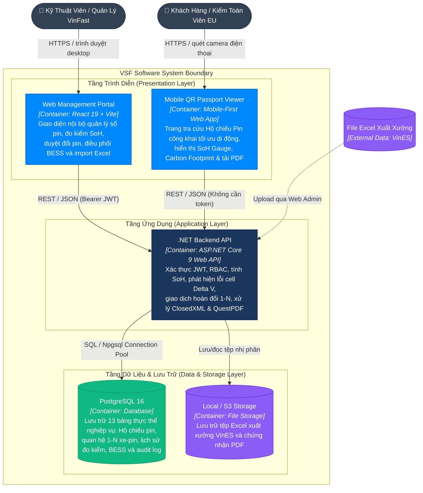

# C2 — Container Diagram (Các Khối Runtime & Lưu Trữ) — VSF

> **Mục đích:** Zoom vào phần mềm VSF để mô tả các khối thực thi runtime, công nghệ sử dụng, giao thức giao tiếp và các kho lưu trữ dữ liệu bền vững.

---

## 1. Sơ Đồ Khối Container C2

---

## 2. Bảng Trách Nhiệm Các Khối Container

| Khối Container | Công Nghệ Sử Dụng | Trách Nhiệm Kỹ Thuật Cốt Lõi |
| :--- | :--- | :--- |
| **Web Management Portal** | React 19, Vite, TailwindCSS / CSS | Giao diện làm việc cho nhân viên nội bộ: Router Guard phân quyền, Data Tables tìm kiếm, Form đo kiểm, Drawer lịch sử xe 1-N, Live Preview tem QR in nhiệt. |
| **Mobile QR Passport Viewer** | HTML5 / React Mobile-First | Giao diện tải cực nhanh (< 1 giây) khi quét mã QR trên đường: Hiển thị thanh Gauge SoH, Dấu chân carbon, tỷ lệ tái chế và nút tải PDF Giấy chứng nhận EU. |
| **.NET Backend API** | C#, ASP.NET Core 9 Web API | Ranh giới tin cậy (Trust Boundary): Xác thực JWT, thực thi RBAC, thuật toán tính SoH & lỗi cell $\Delta V > 0.05\text{V}$, quản lý Database Transactions hoán đổi 1-N nguyên tử. |
| **PostgreSQL Database** | PostgreSQL 16 (Schema `vsf_core`) | Lưu trữ bền vững dữ liệu quan hệ, thực thi ràng buộc khóa ngoại, partial unique indexes cho mã QR, và ghi nhật ký kiểm toán bất biến. |
| **File Storage** | Local Disk / S3 Object Storage | Lưu trữ tệp Excel lô pin phục vụ kiểm toán đối soát và các tệp Giấy chứng nhận PDF có chữ ký số. |

---

## 3. Các Nguyên Tắc Kiến Trúc Bắt Buộc (Architecture Rules)

1. **Trình duyệt không bao giờ kết nối trực tiếp vào PostgreSQL:** Toàn bộ truy vấn dữ liệu bắt buộc phải đi qua các Controller của .NET Backend API.
2. **Ẩn nút bấm trên UI chỉ phục vụ trải nghiệm người dùng (UX):** Tầng Backend là ranh giới bảo mật tối cao và bắt buộc phải kiểm tra thẩm quyền RBAC trên từng Request HTTP (`x-roles`).
3. **Hiệu năng quét mã QR di động dưới 50ms:** Endpoint `/public/passport/{serialNumber}` sử dụng chỉ mục `idx_batteries_serial_number` và không yêu cầu xác thực JWT để đảm bảo tài xế và thanh tra EU có thể tra cứu tức thì ngay cả khi mạng 4G/5G yếu.
4. **Cam kết tính nguyên tử (Atomicity):** Quy trình đổi pin mới cho xe bắt buộc phải gỡ pin cũ, gắn pin mới và cập nhật lịch sử 1-N trong cùng **1 Database Transaction duy nhất**.
5. **Tiêu chuẩn bảo mật SEC-AUDIT-001:** Tuyệt đối không lưu mật khẩu, chuỗi băm (hash) hoặc token trong nhật ký kiểm toán `audit_logs`.

---

**Chuyển tiếp:** Zoom vào tầng máy chủ .NET Backend API $\rightarrow$ [C3 — Component](03-component.md).
