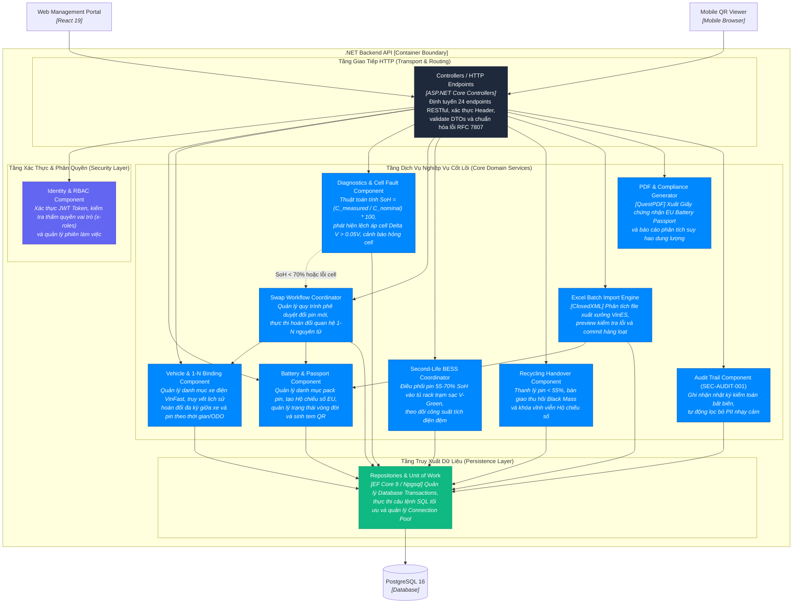

# C3 — Component Diagram (Cấu Trúc Tầng .NET Backend API) — VSF

> **Mục đích:** Zoom vào khối Container **.NET Backend API** để phân rã cấu trúc module, luồng điều hướng nghiệp vụ và sự cộng tác giữa các thành phần dịch vụ nội bộ.

---

## 1. Sơ Đồ Cấu Trúc Thành Phần C3

---

## 2. Bảng Danh Mục & Trách Nhiệm Các Component

| Tên Component | Trách Nhiệm Sở Hữu (Owns) | Điều Không Thuộc Trách Nhiệm (Does Not Own) |
| :--- | :--- | :--- |
| **Controllers / HTTP API** | Tiếp nhận HTTP Request, xác thực DTOs, chuyển giao cho Service, chuẩn hóa Response và lỗi RFC 7807. | Không chứa logic tính toán nghiệp vụ hay câu lệnh SQL trực tiếp. |
| **Identity & RBAC** | Giải mã JWT token, kiểm tra vai trò (`x-roles`), mã hóa mật khẩu người dùng. | Không hiển thị giao diện hay lưu vết tài chính/pin. |
| **Battery & Passport Component** | Quản lý vòng đời pin, khởi tạo Hộ chiếu số EU, cập nhật SoH hiện tại, sinh mã QR in tem nhiệt. | Không trực tiếp can thiệp vào quy trình thanh lý hay điều phối trạm BESS. |
| **Vehicle & 1-N Binding Component** | Quản lý số VIN xe, kiểm soát quan hệ ràng buộc 1 quả pin trên 1 xe tại một thời điểm, lưu timeline lịch sử hoán đổi. | Không trực tiếp thực hiện đo đạc vật lý ở xưởng. |
| **Diagnostics & Cell Fault** | Thuật toán đánh giá độ chai SoH, phát hiện độ lệch áp cell $\Delta V > 0.05\text{V}$, gán nhãn kết luận kiểm định. | Không trực tiếp phê duyệt thay pin mới (thuộc thẩm quyền Trưởng xưởng). |
| **Swap Workflow Coordinator** | Quản lý luồng phê duyệt lệnh đổi pin mới, điều phối việc tháo pin cũ và lắp pin mới trong 1 transaction nguyên tử. | Không đo đạc kỹ thuật trực tiếp tại cầu nâng. |
| **Second-Life BESS Coordinator** | Phân bổ các pack pin $55-70\%$ vào trạm sạc lưu trữ đệm V-Green, quản lý dung lượng rack container. | Không xử lý pin mới $100\%$ xuất xưởng. |
| **Recycling Handover Component** | Quản lý quy trình bàn giao tiêu hủy pin $< 55\%$, ghi nhận biên bản giao nhận Black Mass và khóa hộ chiếu. | Không tái sử dụng pin đã thanh lý. |
| **Excel Batch Import Engine** | Đọc file Excel xuất xưởng từ VinES (ClosedXML), kiểm tra hợp lệ từng dòng trong bộ nhớ và lưu hàng loạt. | Không bypass qua domain logic khi tạo pack pin. |
| **PDF & Compliance Generator** | Tạo Giấy Chứng Nhận Kiểm Định Pin Đạt Chuẩn EU (QuestPDF) dạng vector có chữ ký số. | Không thay đổi dữ liệu gốc trong cơ sở dữ liệu. |
| **Audit Trail (SEC-AUDIT-001)** | Ghi nhận lịch sử kiểm toán bất biến, tự động che giấu mật khẩu, token và thông tin định danh cá nhân. | Không lưu dữ liệu vận hành chính. |
| **Persistence Layer** | EF Core DbContext, Repositories, Quản lý giao dịch nguyên tử (`IUnitOfWork`), ánh xạ dữ liệu PostgreSQL. | Không chứa logic phân quyền HTTP hay logic giao diện. |

---

**Chuyển tiếp:** Zoom vào chi tiết mã nguồn C# $\rightarrow$ [C4 — Code](04-code.md).
