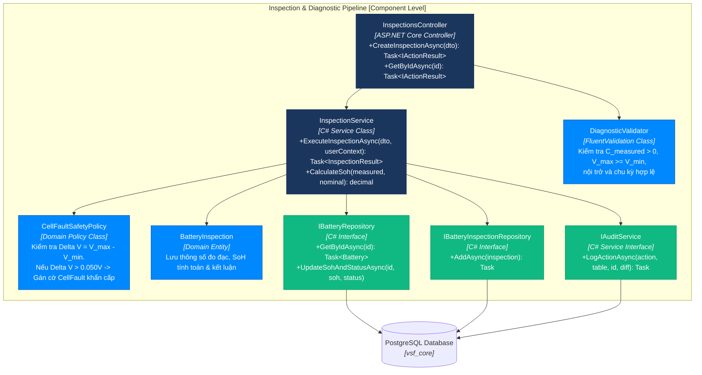
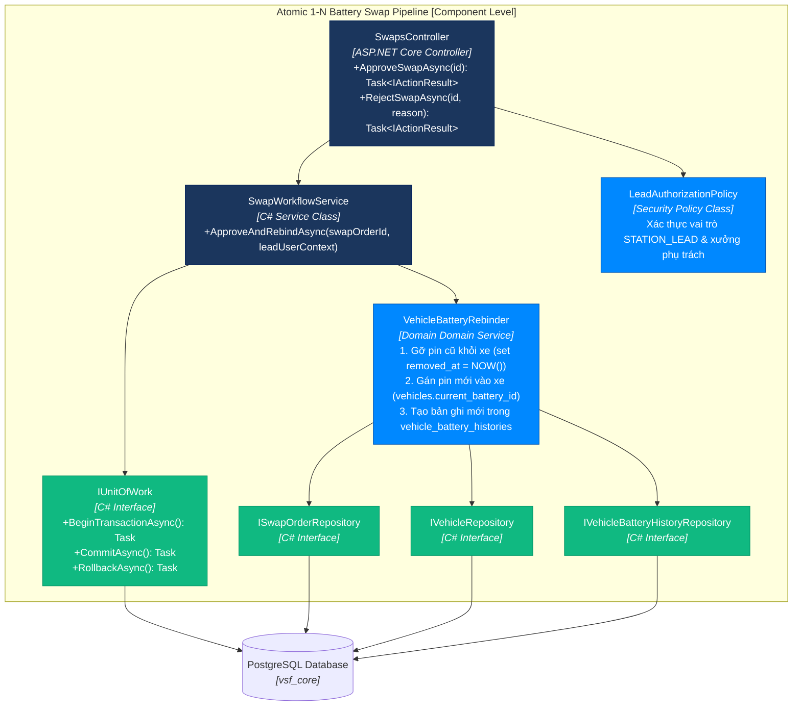

# C4 Level 4 — Code (Thiết Kế Cộng Tác Mã Nguồn C#) — VSF

> **Mục đích:** Zoom vào cấu trúc mã nguồn C# nội bộ bên trong 2 phân hệ nghiệp vụ cốt lõi nhất của hệ thống: **Đo kiểm Chẩn đoán Sức khỏe Cell** và **Quy trình Phê duyệt Đổi Pin Mới 1-N Nguyên Tử**.

---

## L4.1 Luồng Đo Kiểm Chẩn Đoán & Phát Hiện Lỗi Cell (Inspection & Diagnostic Pipeline)

---

## L4.2 Luồng Phê Duyệt Đổi Pin Mới 1-N Nguyên Tử (Atomic 1-N Battery Swap Pipeline)

