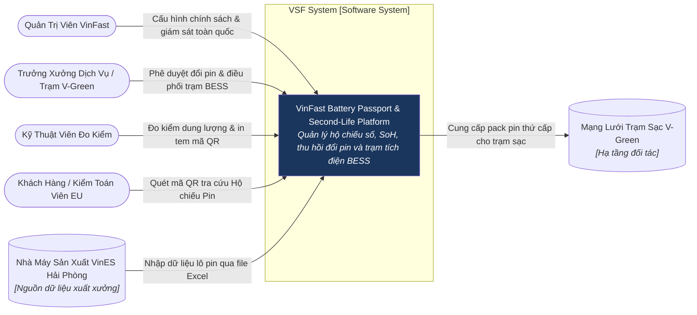
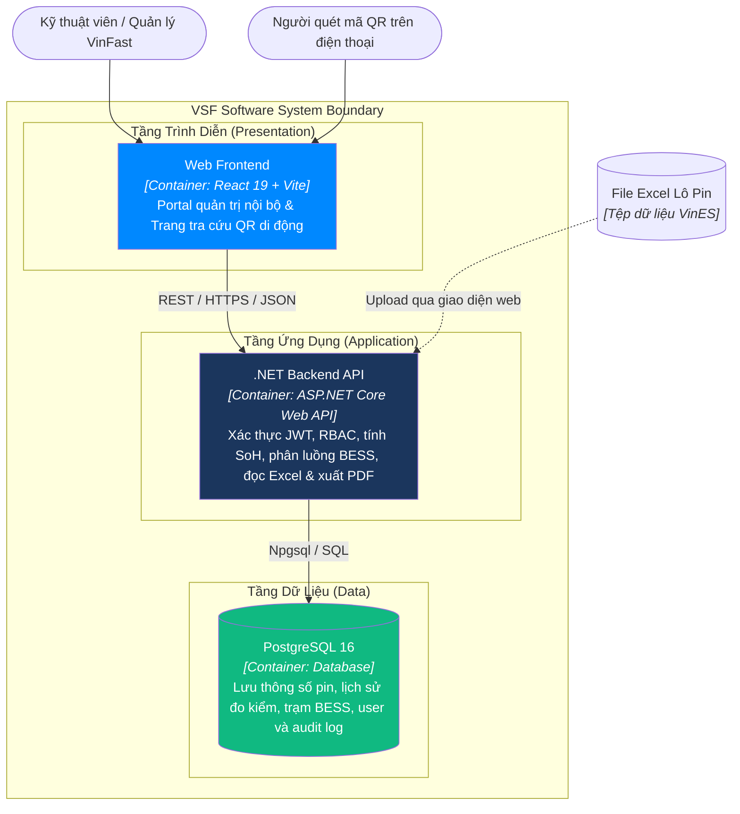
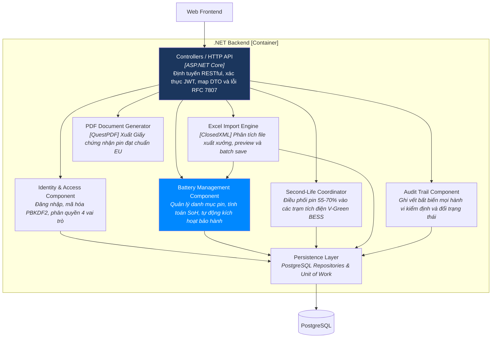

# Kiến Trúc C4 — VSF (VinFast Battery Passport)

Tài liệu này đặc tả kiến trúc hệ thống VSF theo mô hình C4 (C1 System Context, C2 Container, C3 Component, C4 Code).

## C1 — System Context (Ngữ cảnh Hệ thống)

## C2 — Container Diagram (Các Khối Thành Phần)

## C3 — Component Diagram (Cấu Trúc Tầng Backend API)

