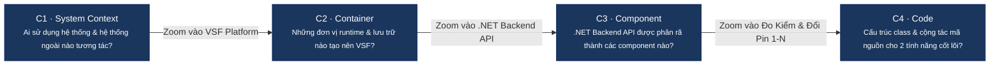

# Mô Hình Kiến Trúc C4 (C4 Architecture Model) — VSF

> **Dự án:** VSF — VinFast Battery Passport & Second-Life Platform  
> **Trạng thái:** TARGET V1 Architecture Baseline  
> **Đối tượng:** Kỹ sư phần mềm, Kiến trúc sư giải pháp và Chuyên viên kiểm toán kỹ thuật

Mô hình C4 (Context, Containers, Components, Code) phân rã hệ thống VSF theo 4 cấp độ trực quan từ tổng quan đến chi tiết, cung cấp góc nhìn toàn diện về ranh giới hệ thống, các khối runtime, thành phần nghiệp vụ và cấu trúc mã nguồn.

---

## 1. Mục Lục Các Cấp Độ C4

| Cấp Độ | Tài Liệu Kỹ Thuật | Phạm Vi Mô Tả |
| :---: | :--- | :--- |
| **C1** | [01-system-context.md](01-system-context.md) | Ngữ cảnh toàn cầu: 4 nhóm tác nhân, ranh giới phần mềm VSF và 2 đối tác tích hợp ngoại vi (VinES & V-Green BESS). |
| **C2** | [02-container.md](02-container.md) | Các khối Container runtime: React 19 Web, Mobile QR Browser, ASP.NET Core API, PostgreSQL 16 và File Storage. |
| **C3** | [03-component.md](03-component.md) | Phân rã 12 thành phần nghiệp vụ bên trong tầng máy chủ .NET Backend. |
| **C4** | [04-code.md](04-code.md) | Thiết kế cộng tác mã nguồn C# (Class, Interface, Service, Repository, Validator, Policy) cho 2 nghiệp vụ quan trọng nhất. |

---

## 2. Trạng Thái Hiện Thực Kỹ Thuật

| Thành Phần Runtime | Công Nghệ Mục Tiêu | Trạng Thái Hiện Tại |
| :--- | :--- | :--- |
| **Web Frontend** | React 19, Vite, TailwindCSS / Vanilla CSS | Đã thiết kế sitemap 19 màn hình, luồng điều hướng và hợp đồng UI |
| **Mobile QR Portal** | Responsive Web App (Mobile-First) | Đã đặc tả màn hình tra cứu công khai không cần login và tải PDF |
| **.NET Backend API** | C#, ASP.NET Core 9 Web API, RESTful | Đã hoàn thiện hợp đồng OpenAPI 3.0.4 đầy đủ 24 endpoints |
| **Cơ Sở Dữ Liệu** | PostgreSQL 16 (Schema `vsf_core`) | Đã thiết kế 13 bảng thực thể quan hệ, DBML 2.0 và chiến lược Indexing < 50ms |
| **Lưu Trữ Tệp Tin** | File Storage (Local Disk / S3 Object Storage) | Xử lý tệp Excel lô pin VinES (ClosedXML) và Giấy chứng nhận PDF (QuestPDF) |

---

## 3. Quy Ước Màu Sắc Trong Sơ Đồ C4

- **Xanh dương đậm (`#1b365d`):** Đơn vị trọng tâm chính của cấp độ đang zoom.
- **Xanh dương sáng (`#0088ff`):** Thành phần lân cận nằm cùng trong ranh giới hệ thống VSF.
- **Xám đậm (`#475569`):** Tác nhân người dùng hoặc hệ thống ngoại vi bên ngoài ranh giới VSF.
- **Xanh ngọc (`#10b981`):** Cơ sở dữ liệu và kho lưu trữ bền bỉ.
- **Viền nét đứt (Dashed lines):** Ranh giới phân định Software System, Container hoặc Component.
