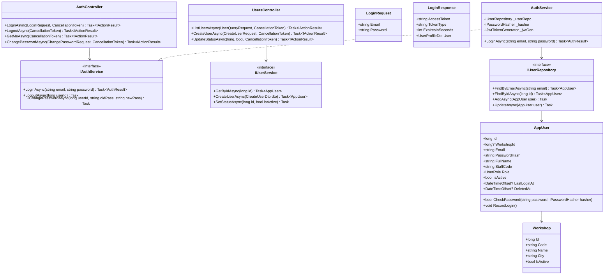
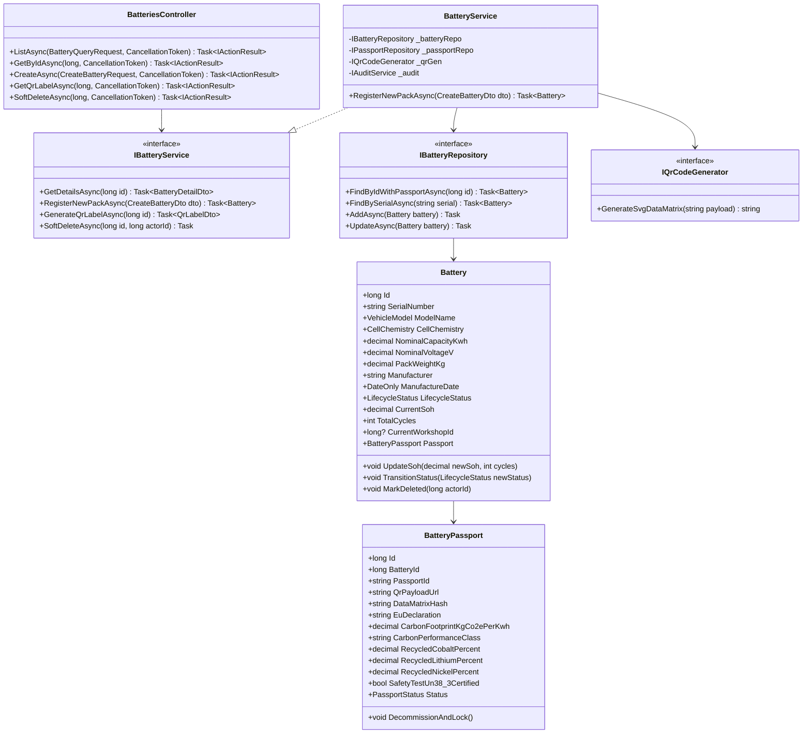
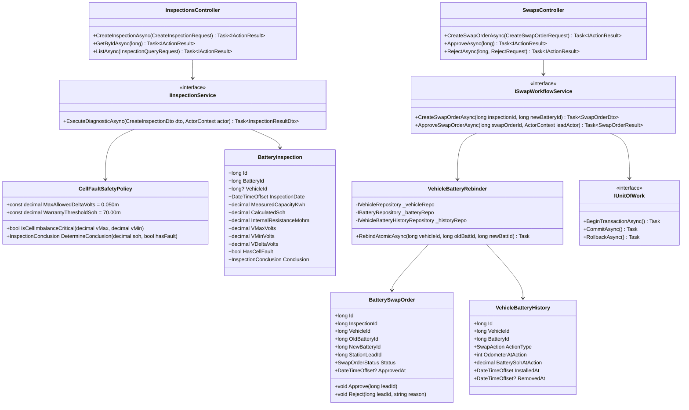

# Sơ Đồ Lớp Cốt Lõi (Core Class Diagrams) — VSF

> **Dự án:** VSF — VinFast Battery Passport & Second-Life Platform  
> **Trạng thái:** TARGET V1 Clean Architecture Baseline  
> **Kiến trúc:** 3 tầng phân rã chuẩn hóa (Presentation API $\rightarrow$ Application Domain $\rightarrow$ Infrastructure Persistence)

Các sơ đồ lớp sử dụng quy ước bố cục từ trên xuống (`direction TB`) để tối ưu độ rộng hiển thị. Mỗi khối lớp định nghĩa rõ ràng kiểu dữ liệu C#, tính đóng gói (`+` public, `-` private), các interface (`<<interface>>`) và quan hệ thực thi (`..|>`).

---

## 1. Phân Hệ Xác Thực & Quản Trị Nhân Sự (Authentication & User Administration)

Quản lý đăng nhập JWT, kiểm tra quyền hạn RBAC và gán nhân sự trực thuộc xưởng dịch vụ:

---

## 2. Phân Hệ Pack Pin & Hộ Chiếu Số EU (Battery Registry & Digital Passport)

Quản lý thuộc tính điện hóa, tích hợp quy định EU Battery Regulation (EU 2023/1542), tính toán dấu chân carbon và xuất tem nhãn QR in nhiệt 100x75mm:

---

## 3. Phân Hệ Đo Kiểm Sức Khỏe & Hoán Đổi Xe 1-N Nguyên Tử (Diagnostics & 1-N Swap)

Thuật toán tính toán SoH, phát hiện độ lệch điện áp cell $\Delta V = V_{\text{max}} - V_{\text{min}}$, tự động kích hoạt bảo hành khi $\text{SoH} < 70\%$ hoặc $\Delta V > 0.050\text{V}$ và phê duyệt hoán đổi 1-N:

