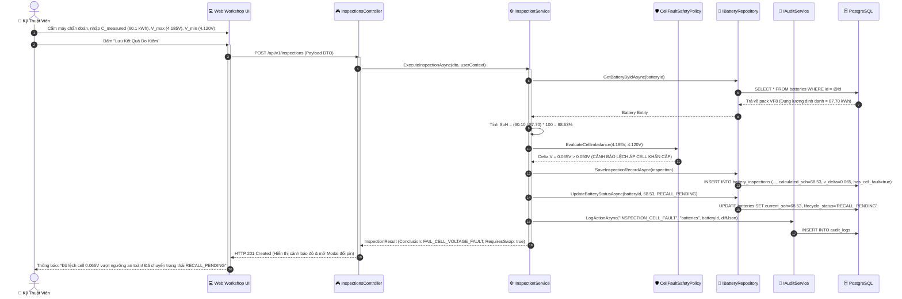
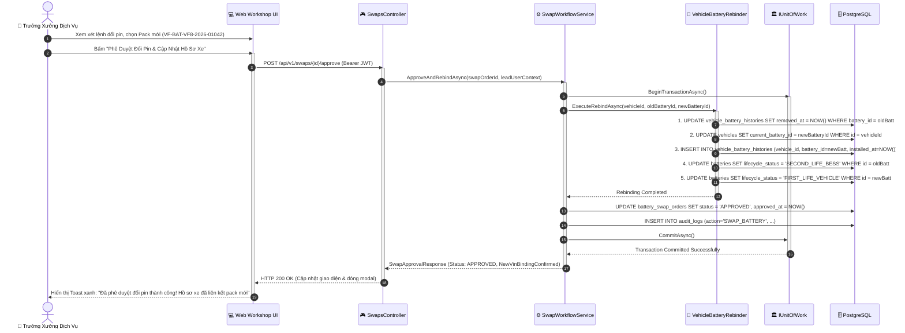
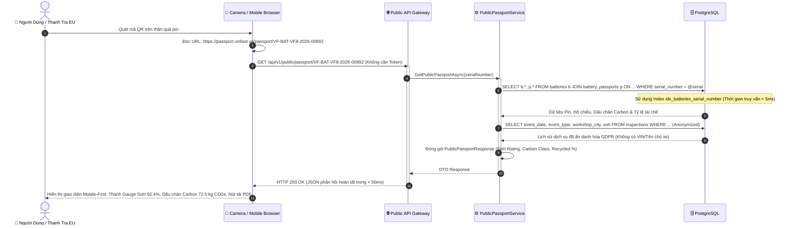
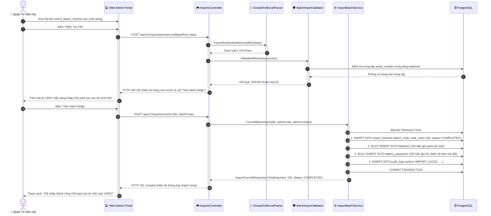

# Sơ Đồ Tuần Tự Cốt Lõi (Core Sequence Diagrams) — VSF

> **Dự án:** VSF — VinFast Battery Passport & Second-Life Platform  
> **Trạng thái:** TARGET V1  
> **Mục đích:** Đặc tả chi tiết trình tự tương tác giữa Tác nhân, Giao diện Web/Mobile, Tầng điều hướng Controllers, Dịch vụ nghiệp vụ Domain Services và Tầng lưu trữ PostgreSQL cho 4 kịch bản vận hành trọng yếu.

---

## 1. Luồng 1: Đo Kiểm Chẩn Đoán Dung Lượng, Phát Hiện Lệch Áp Cell & Tạo Lệnh Đổi Pin

Kỹ thuật viên cắm máy chẩn đoán vào pack pin tại cầu nâng xưởng. Hệ thống tự động tính SoH và kiểm tra độ lệch điện áp cell $\Delta V = V_{\text{max}} - V_{\text{min}}$. Nếu $\text{SoH} < 70\%$ hoặc $\Delta V > 0.050\text{V}$, hệ thống lập tức gắn cờ cảnh báo nguy hiểm và tạo Lệnh đổi pin mới chờ Trưởng xưởng duyệt.

---

## 2. Luồng 2: Trưởng Xưởng Phê Duyệt Đổi Pin Mới & Hoán Đổi Quan Hệ 1-N Nguyên Tử

Trưởng Xưởng Dịch Vụ kiểm tra thông số pack pin cũ bị lỗi cell/chai dung lượng, lựa chọn pack pin mới từ kho xưởng và thực thi giao dịch hoán đổi quan hệ 1-N nguyên tử (Atomic Database Transaction).

---

## 3. Luồng 3: Quét Mã QR Tra Cứu Hộ Chiếu Pin Công Khai Trên Di Động (< 50ms)

Khách hàng hoặc kiểm toán viên EU dùng camera quét tem mã QR dán trên vỏ quả pin. Yêu cầu gửi tới cổng Public Gateway không cần Token, truy vấn qua Partial Unique Index và trả về đầy đủ hồ sơ Hộ chiếu số bảo mật GDPR trong vòng dưới **50ms**.

---

## 4. Luồng 4: Nhập Lô Dữ Liệu Pin Xuất Xưởng Từ File Excel Nhà Máy VinES

Quản trị viên HQ tải lên tệp Excel danh sách pack pin mới xuất xưởng từ VinES. Hệ thống kiểm tra hợp lệ toàn bộ file trong bộ nhớ (ClosedXML), nếu có lỗi sẽ báo chi tiết từng dòng; nếu hợp lệ sẽ thực thi giao dịch nguyên tử lưu hàng loạt tối đa 5,000 pack pin.

