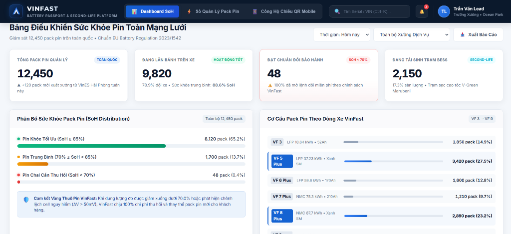
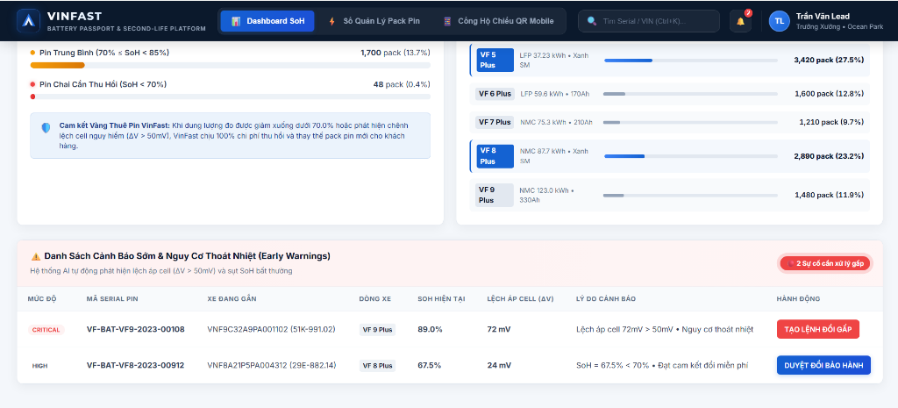

# Bản Vẽ Giao Diện (Wireframe): Dashboard Sức Khỏe Pin & Giám Sát Mạng Lưới (SCR-10)

> **Mã màn hình:** `SCR-10`  
> **Người dùng chính:** Quản trị viên VinFast (Admin), Trưởng Xưởng Dịch Vụ (Station Lead)  
> **Mục tiêu:** Cung cấp cái nhìn toàn cảnh tức thời về toàn bộ mạng lưới 12.450 pack pin VinFast toàn quốc, tỷ lệ chai pin và kích hoạt cảnh báo sớm.

---

## 1. Hình Ảnh Giao Diện Thực Tế (Live Screenshot)





## 2. Bản Vẽ Bố Cục Chi Tiết (ASCII Wireframe Layout)

```text
┌────────────────────────────────────────────────────────────────────────────────────────────────────────────────────────┐
│ [V] VINFAST  |  BATTERY PASSPORT & SECOND-LIFE PLATFORM             [Q Tìm Serial/VIN...]  [🔔 Cảnh báo (2)]  [👤 Tran Van Lead]│
├────────────────────────────────────────────────────────────────────────────────────────────────────────────────────────┤
│ BẢNG ĐIỀU KHIỂN SỨC KHỎE PIN TOÀN MẠNG LƯỚI                                     [Thời gian: Hôm nay ▼] [Xưởng: Tất cả ▼]│
│                                                                                                                        │
│ ┌──────────────────────┐ ┌──────────────────────┐ ┌──────────────────────┐ ┌──────────────────────┐                   │
│ │ TỔNG PACK PIN QUẢN LÝ│ │ ĐANG LĂN BÁNH TRÊN XE│ │ ĐẠT CHUẨN ĐỔI BẢO HÀNH│ │ ĐANG TÁI SINH BESS   │                   │
│ │ 12,450 pack          │ │ 9,820 xe (78.9%)     │ │ 48 pack (0.4%)       │ │ 2,150 pack (17.3%)   │                   │
│ │ ▲ +120 pack tuần này │ │ Sức khỏe TB: 88.6%   │ │ [!] Cần đổi pin gấp  │ │ Trạm sạc V-Green     │                   │
│ └──────────────────────┘ └──────────────────────┘ └──────────────────────┘ └──────────────────────┘                   │
│                                                                                                                        │
│ ┌───────────────────────────────────────────────────────────────┐ ┌──────────────────────────────────────────────────┐ │
│ │ PHÂN BỐ SỨC KHỎE PIN (SoH DISTRIBUTION)                       │ │ CƠ CẤU PACK PIN THEO DÒNG XE                     │ │
│ │                                                               │ │                                                  │ │
│ │ [Xanh] Pin Khỏe (SoH >= 85%)     : 8,120 pack [============== │ │ • VinFast VF 3 :  1,850 pack (14.9%)             │ │
│ │ [Vàng] Trung Bình (70% - 85%)    : 1,700 pack [===            │ │ • VinFast VF 5 :  3,420 pack (27.5%) [GSM Taxi]  │ │
│ │ [Đỏ]   Chai Cần Đổi (SoH < 70%)  :    48 pack [!              │ │ • VinFast VF 6 :  1,600 pack (12.8%)             │ │
│ │                                                               │ │ • VinFast VF 7 :  1,210 pack  (9.7%)             │ │
│ │ Ngưỡng cam kết VinFast: Khi SoH < 70.0% => Đổi miễn phí       │ │ • VinFast VF 8 :  2,890 pack (23.2%) [GSM Taxi]  │ │
│ │ Tỷ lệ tuân thủ cam kết: 100% (48/48 xe đã mở lệnh đổi)        │ │ • VinFast VF 9 :  1,480 pack (11.9%)             │ │
│ └───────────────────────────────────────────────────────────────┘ └──────────────────────────────────────────────────┘ │
│                                                                                                                        │
│ ┌────────────────────────────────────────────────────────────────────────────────────────────────────────────────────┐ │
│ │ ⚠️ DANH SÁCH CẢNH BÁO SỚM & NGUY CƠ THOÁT NHIỆT (EARLY WARNINGS)                      [Xuất báo cáo PDF] [Xem tất cả]│ │
│ ├──────────────────────┬───────────────────┬────────┬───────┬─────────┬─────────────────────────┬────────────────────┤ │
│ │ MÃ SERIAL PIN        │ XE GẮN (VIN/BIỂN) │ DÒNG XE│ SOH   │ DELTA V │ LÝ DO CẢNH BÁO          │ HÀNH ĐỘNG XỬ LÝ    │ │
│ ├──────────────────────┼───────────────────┼────────┼───────┼─────────┼─────────────────────────┼────────────────────┤ │
│ │ VF-BAT-VF9-2023-00108│ VNF9C32A9PA001102 │ VF 9   │ 89.0% │ 0.072V  │ [CRITICAL] Lệch áp cell │ [TẠO LỆNH ĐỔI GẤP] │ │
│ │                      │ (51K-991.02)      │ Plus   │       │ (72mV)  │ Nguy cơ thoát nhiệt     │                    │ │
│ ├──────────────────────┼───────────────────┼────────┼───────┼─────────┼─────────────────────────┼────────────────────┤ │
│ │ VF-BAT-VF8-2023-00912│ VNF8A21P5PA004312 │ VF 8   │ 67.5% │ 0.024V  │ [HIGH] SoH < 70%        │ [DUYỆT ĐỔI BẢO HÀNH]│ │
│ │                      │ (29E-882.14) Xanh │ Plus   │       │ (24mV)  │ Đạt cam kết đổi miễn phí│                    │ │
│ └──────────────────────┴───────────────────┴────────┴───────┴─────────┴─────────────────────────┴────────────────────┘ │
└────────────────────────────────────────────────────────────────────────────────────────────────────────────────────────┘
```

---

## 3. Bảng Mô Tả Mock Data Thực Tế

### 2.1 Các Thẻ Số Liệu KPI Đầu Trang
* **Tổng số pack pin:** `12,450` pack trên toàn quốc (Tăng 120 pack mới xuất xưởng từ VinES Hải Phòng trong tuần).
* **Đang gắn trên xe lăn bánh:** `9,820` xe (Chiếm 78.9% tổng lượng pin, trong đó 65% thuộc đội xe Taxi Xanh SM).
* **Pin đạt chuẩn đổi mới:** `48` pack (Chiếm 0.4%, toàn bộ đều được hệ thống phát hiện tự động và gửi thông báo mời tài xế vào xưởng).
* **Pin đang tái sinh làm trạm sạc BESS:** `2,150` pack (Chiếm 17.3%, đang lưu trữ điện năng tại mạng lưới 85 trạm sạc cao tốc V-Green).

### 2.2 Danh Sách Cảnh Báo Sớm
1. **Trường hợp 1 - Lỗi lệch áp cell khẩn cấp (Mã pin: `VF-BAT-VF9-2023-00108`):**
   * Xe: VinFast VF 9 Plus, biển số `51K-991.02`.
   * SoH tổng thể: **89.0%** (Dung lượng vẫn còn rất tốt).
   * Độ lệch điện áp giữa các cell: $\Delta V = 0.072\text{V} \ (72\text{mV} > 50\text{mV})$.
   * **Phản ứng UI:** Thẻ màu đỏ nhấp nháy, hiện cờ `CRITICAL_FAULT`, nút bấm màu đỏ đậm: **"TẠO LỆNH ĐỔI GẤP"**.
2. **Trường hợp 2 - Pin chai dưới 70% cam kết (Mã pin: `VF-BAT-VF8-2023-00912`):**
   * Xe: VinFast VF 8 Plus của Xanh SM, biển số `29E-882.14`.
   * SoH: **67.5%** ($< 70.00\%$).
   * Độ lệch cell: $\Delta V = 0.024\text{V}$ (Các cell vẫn đều và an toàn).
   * **Phản ứng UI:** Badge màu cam nổi bật `WARRANTY_ELIGIBLE`, nút bấm xanh VinFast: **"DUYỆT ĐỔI BẢO HÀNH & CHUYỂN BESS"**.
