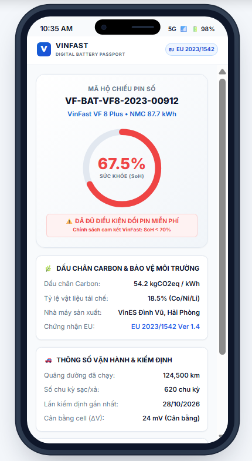

# Bản Vẽ Giao Diện: Cổng Hộ Chiếu Pin QR Di Động Chuẩn EU 2023/1542 (SCR-02)

> **Mã màn hình:** `SCR-02`  
> **Người dùng chính:** Chủ xe VinFast, Bác tài Xanh SM, Khách mua xe cũ, Cơ quan Hải quan EU  
> **Thiết bị hiển thị:** Màn hình điện thoại di động thông minh (Mobile-First — Khung 390 x 844 px)  
> **Đặc điểm nổi bật:** Truy cập trực tiếp qua camera quét mã QR, không cần tài khoản đăng nhập, phản hồi dưới 50ms, tự động ẩn danh thông tin cá nhân (PII Redacted).

---

## 1. Hình Ảnh Giao Diện Thực Tế (Live Screenshot)

<div align="center">
  
</div>

## 2. Bản Vẽ Bố Cục Mobile-First (ASCII Wireframe Layout)

```text
┌─────────────────────────────────────────┐
│  09:41                             5G 🔋 │
├─────────────────────────────────────────┤
│ [V] VINFAST  |  DIGITAL BATTERY PASSPORT│
│ 🇪🇺 Official EU Battery Regulation 2023  │
├─────────────────────────────────────────┤
│                                         │
│    PACK PIN: VF-BAT-VF8-2023-00912      │
│    VinFast VF 8 Plus • Cell NMC 87.7kWh │
│                                         │
│             ╭──────────────╮            │
│          ╭──╯   ĐỘ KHỎE    ╰──╮         │
│          │       67.5%        │         │
│          ╰──╮   [CAM ĐỎ]   ╭──╯         │
│             ╰──────────────╯            │
│      ⚠️ ĐÃ ĐẠT ĐIỀU KIỆN ĐỔI MỚI        │
│      Chính sách bảo hành: SoH < 70%     │
│                                         │
│ ┌─────────────────────────────────────┐ │
│ │ 🌿 THÔNG SỐ BẢO VỆ MÔI TRƯỜNG & KHÍ │ │
│ ├─────────────────────────────────────┤ │
│ │ • Dấu chân Carbon : 54.2 kgCO2eq/kWh│ │
│ │ • Tỷ lệ Tái chế   : 18.5% (Co/Ni/Li)│ │
│ │ • Đơn vị sản xuất : VinES Hải Phòng │ │
│ │ • Năm xuất xưởng  : 2023            │ │
│ └─────────────────────────────────────┘ │
│                                         │
│ ┌─────────────────────────────────────┐ │
│ │ 🚗 DỮ LIỆU VẬN HÀNH & KIỂM ĐỊNH     │ │
│ ├─────────────────────────────────────┤ │
│ │ • Quãng đường xe : 124,500 km       │ │
│ │ • Số chu kỳ sạc  : 620 chu kỳ       │ │
│ │ • Lần đo gần nhất: 28/10/2026       │ │
│ │ • Xưởng dịch vụ  : VinFast Ocean Pk │ │
│ │ • Cân bằng cell  : TỐT (Delta 24mV) │ │
│ └─────────────────────────────────────┘ │
│                                         │
│ ┌─────────────────────────────────────┐ │
│ │ 🔒 BẢO MẬT & MINH BẠCH (NGHỊ ĐỊNH 13)│ │
│ ├─────────────────────────────────────┤ │
│ │ Thông tin chủ xe đã được mã hóa ẩn  │ │
│ │ danh: Khách hàng GSM (Xanh SM)      │ │
│ └─────────────────────────────────────┘ │
│                                         │
│  [📥 TẢI CHỨNG NHẬN HỘ CHIẾU PIN PDF]   │
│  (Văn bản có mộc số xác thực chuẩn EU) │
│                                         │
│   VinFast Auto Ltd. • All Rights Reserved│
└─────────────────────────────────────────┘
```

---

## 3. Chi Tiết Các Khối Nội Dung & Mock Data

### 2.1 Khối Định Danh & Chứng Nhận Quốc Tế (Header)
* **Logo VinFast chữ V mạ chrome:** Đặt góc trên cùng kèm dòng chữ xanh tinh tế: `DIGITAL BATTERY PASSPORT`.
* **Huy hiệu EU Flag:** `🇪🇺 Official EU Battery Regulation 2023/1542 Compliant`. Khẳng định quả pin đủ điều kiện pháp lý lăn bánh tại các thị trường Đức, Pháp, Hà Lan...

### 2.2 Vòng Tròn Sức Khỏe Pin Tương Tác (Interactive SoH Gauge)
* Hiển thị con số lớn: **67.5%**.
* Vòng cung màu cam đỏ thể hiện mức chai pin.
* Thông báo thân thiện cho khách hàng: *"Pack pin đã đủ điều kiện đổi pin mới hoàn toàn miễn phí theo chính sách thuê pin của VinFast"*.

### 2.3 Khối Dấu Chân Carbon & Kinh Tế Tuần Hoàn
* **Dấu chân Carbon (Carbon Footprint):** `54.2 kgCO2eq / kWh` (Đạt chuẩn xanh hơn mức trung bình 65 kgCO2eq/kWh của các hãng pin khác trên thế giới).
* **Tỷ lệ vật liệu tái chế (Recycled Content):** `18.5%` (Gồm Cobalt, Niken, Lithium được thu hồi từ các trạm tái chế của VinFast).
* **Nhà máy sản xuất:** Tổ hợp nhà máy giải pháp năng lượng VinES, Khu kinh tế Đình Vũ, Cát Hải, Hải Phòng.

### 2.4 Khối Lịch Sử Vận Hành (Đã Ẩn Danh)
* Tuân thủ Nghị định 13/2023/NĐ-CP về bảo vệ dữ liệu cá nhân: Tuyệt đối không hiện tên, số điện thoại hay CCCD của chủ xe.
* Chỉ hiển thị dữ liệu kỹ thuật: Xe đã chạy `124,500 km`, đã qua `620` lần sạc, lần kiểm định gần nhất ngày `28/10/2026` tại `VinFast Service Ocean Park`.

### 2.5 Nút Tải Chứng Nhận PDF Chuẩn EU
* Bấm vào nút màu xanh VinFast lớn ở đáy màn hình, điện thoại tự động tải về file PDF khổ A4 chính thức có mã QR và mã hash SHA-256 để nộp cho cơ quan kiểm toán hoặc người mua xe cũ kiểm tra.
